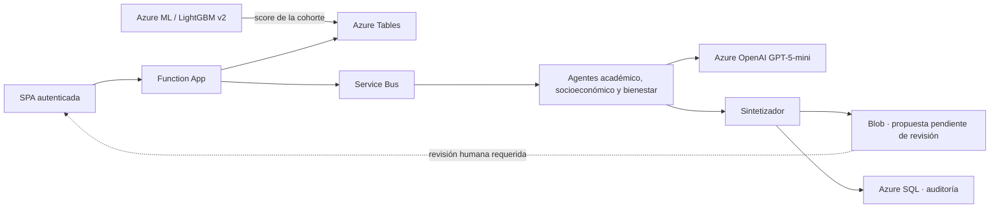

# SAT-FUMC | Plataforma de apoyo a la permanencia estudiantil

Repositorio de investigación y prueba de concepto (POC) para estimar riesgo de deserción y apoyar la revisión profesional. **No es una solución institucional de producción**: la información de demostración es sintética y no hay conectores autorizados a fuentes FUMC.

> **Corte de documentación:** 2026-11-09. El estado de Azure que se indica abajo fue comprobado directamente; no equivale a validar el flujo institucional extremo a extremo.

## 01. Propósito y límites

El proyecto reúne dos líneas técnicas conectadas: (1) un pipeline de aprendizaje automático tabular que entrena LightGBM y lo sirve desde un endpoint Azure ML, que puntúa la cohorte operativa; y (2) una aplicación de agentes con Azure Functions, Service Bus, Semantic Kernel y Azure OpenAI GPT-5-mini, que analiza los casos de mayor riesgo y registra su resultado en Azure SQL. La meta es apoyar a profesionales, no automatizar decisiones académicas, financieras ni de bienestar.

Los datos actuales son sintéticos. No suministres nombres, documentos, correos, datos clínicos ni registros institucionales reales. Ninguna métrica sintética acredita validez para FUMC.

## 02. Estado verificado de la implementación

| Capacidad | Estado al 2026-11-12 | Alcance de la comprobación |
|---|---|---|
| Infraestructura | Function App `FUMCanalyticscore` (`FUMC.CaseReviewer`, Brazil South, Flex Consumption, Python 3.11): `Running` | Storage, Service Bus, Azure OpenAI, Application Insights y Azure SQL en uso |
| Autenticación | Easy Auth/Entra con allowlist de revisores | Sesión interactiva autenticada con respuestas `200` y `POST` operativos |
| Azure SQL | `SATFUMCOperational` en `satfumc-sql-fumc01`, serverless; **conectada a la app** | 10 tablas verificadas; la app escribe predicciones, propuestas, ejecuciones de agente y auditoría con su identidad administrada |
| Modelo predictivo | Endpoint `sat-fumc-endpoint` (`blue`, `SAT_FUMC_LightGBM_Model` v2) | Cohorte de 15.000 estudiantes puntuada por el endpoint; la interfaz no llama al endpoint en tiempo real |
| Agentes | Service Bus + 3 agentes GPT-5-mini + sintetizador | Lote E2E de 20 casos: 20 procesados, 0 fallidos |
| Datos institucionales | No habilitados | Todos los datos son sintéticos; sin conectores SIS/LMS/finanzas/bienestar autorizados |

Evidencia detallada, problemas corregidos y pendientes: [`docs/12_Guia_Operacion.md` §9](docs/12_Guia_Operacion.md#9-validación-e2e-del-2026-11-12).

## 03. Arquitectura implementada



## 04. Modelo y evidencia

**Recall ≥ 0,80** es una meta de aceptación, no un resultado institucional aprobado. Se hicieron evaluaciones ML sintéticas a 6k, 10k, 15k, 30k y 100k; 50k fue generación solamente. El dataset/resultados 10k y dataset/resultados 100k se cargaron como assets al Workspace AML. Los runs 10k/100k alcanzaron Recall de test 0,8453/0,8162, pero alertaron 70,17%/78,68% y ninguno es elegible para promoción. Las versiones/splits difieren; no mezclar métricas. La matriz, hashes, detalle de los assets y métricas está en [`docs/04_Arquitectura_ML.md` §8](docs/04_Arquitectura_ML.md#8-experimentos-de-escala-generador-200-corte-2026-11-10).

**Recalibración integral (2026-11-11).** Se reevaluó el modelo en 5k, 10k, 15k, 25k, 50k, 75k y 100k estudiantes, con las mismas variables del contrato, 10 semillas por tamaño, intervalos bootstrap y un oráculo que reconstruye el riesgo real del generador como techo teórico. Con el generador 2.1.0 corregido, la configuración final (regresión logística con transformaciones determinísticas de las mismas columnas, política de capacidad) obtiene AUC ≈ 0,68 y recall ≈ 0,60 con 40 % de alertas, estable entre tamaños, pero queda a ≤ 0,007 de AUC del oráculo: recall 0,80 exige alertar ≈ 62–65 % de los estudiantes. Ninguna de las 210 corridas finales cumple a la vez recall ≥ 0,75, alertas ≤ 50 % y precisión ≥ 0,30, así que **el modelo sigue sin ser promovible** y el techo es una propiedad de los datos sintéticos, no del ajuste. Detalle, causas raíz, estadística y acciones en [`docs/04_Arquitectura_ML.md` §9](docs/04_Arquitectura_ML.md#9-recalibración-5k100k-corte-2026-11-11).

`src/ml/model_selection.py` selecciona umbral con datos de validación; el holdout no debe usarse para optimización. Los modelos y archivos de `models/`, `data/` y `mlruns/` se conservan como artefactos de investigación, pero sus métricas no deben extrapolarse a estudiantes reales.

## 05. Componentes y responsabilidades

- `src/ml/`: ingeniería de características, evaluación temporal, selección de umbral y feedback del modelo.
- `azure/train_azure.py` y `azure/components/`: entrenamiento/registro de Azure ML.
- `azure/endpoints/`: contrato, configuración y scoring de Azure ML; el endpoint puntuó la cohorte operativa.
- `azure/agent_platform/function_app.py`: API, flujo de agentes por Service Bus, rutas de revisión y SPA.
- `azure/agent_platform/sat_agents/batch_flow.py`: estado de lotes y resultados de agentes en Azure Tables.
- `azure/agent_platform/sat_agents/`: contratos, políticas y agentes especializados/sintetizador.
- `azure/agent_platform/infra/main.bicep`: infraestructura Azure verificada para la POC.
- `azure/agent_platform/infra/sql_schema.sql`: esquema SQL aplicado y usado por la API (`sat_agents/audit_sql.py`).
- `tests/`: pruebas unitarias y de contratos (118 aprobadas el 2026-11-12). La validación E2E en Azure está en `docs/12_Guia_Operacion.md` (§9).

## 06. Índice documental

### 06.01. Paquete documental técnico (vigente)

Punto de entrada: [`docs/00_Resumen_Ejecutivo.md`](docs/00_Resumen_Ejecutivo.md).

| Documento | Contenido |
|---|---|
| [`00_Resumen_Ejecutivo`](docs/00_Resumen_Ejecutivo.md) | Visión, alcance, estado verificado, riesgos y mapa documental |
| [`01_Estructura_Repositorio`](docs/01_Estructura_Repositorio.md) | Árbol del repositorio y ficha de cada carpeta |
| [`02_Arquitectura_General`](docs/02_Arquitectura_General.md) | Capas, flujos, decisiones, arquitectura objetivo y criterios de habilitación |
| [`03_Arquitectura_Datos`](docs/03_Arquitectura_Datos.md) | Digital Twin, modelo de datos, target, calidad y flujo de datos |
| [`04_Arquitectura_ML`](docs/04_Arquitectura_ML.md) | Entrenamiento, inferencia, métricas, experimentos de escala y recalibración |
| [`05_Arquitectura_MultiAgente`](docs/05_Arquitectura_MultiAgente.md) | Agentes, orquestación, vista ejecutiva y decisión humana |
| [`06_Arquitectura_Frontend`](docs/06_Arquitectura_Frontend.md) | SPA, vistas y API consumida |
| [`07_Arquitectura_Backend`](docs/07_Arquitectura_Backend.md) | API, disparadores, módulos y configuración |
| [`08_Arquitectura_BD`](docs/08_Arquitectura_BD.md) | Azure SQL, Table Storage y Blob |
| [`09_Arquitectura_Azure`](docs/09_Arquitectura_Azure.md) | Recursos, identidades, Azure ML y costos |
| [`10_Seguridad_Gobierno`](docs/10_Seguridad_Gobierno.md) | Controles, gobierno de IA y preparación para producción |
| [`11_DevOps_CICD`](docs/11_DevOps_CICD.md) | CI, despliegue manual y reversa |
| [`12_Guia_Operacion`](docs/12_Guia_Operacion.md) | Operación, apagado, escalado, diagnóstico y validación E2E |

Diagramas regenerables en [`docs/diagramas/`](docs/diagramas/) e imágenes en [`docs/imagenes/`](docs/imagenes/). Los documentos anteriores, ya integrados en este paquete, se conservan como histórico en [`docs/archivo/`](docs/archivo/).

### 06.04. Artículo y entregables

- [`entregables/articulo_trabajo_grado.md`](entregables/articulo_trabajo_grado.md) — artículo fuente.
- `entregables/articulo_trabajo_grado.docx` — versión Word generada con [`entregables/generate_docx.py`](entregables/generate_docx.py).

## 07. Desarrollo y validación local

Usa Python 3.11 para coincidir con Functions; el pipeline de pruebas del repositorio también se ha ejecutado con Python 3.13. La ejecución local de Functions requiere Core Tools v4 y configuración local; no crea recursos automáticamente.

```powershell
python -m pip install -r requirements.txt
python -m pytest -q
```

Para agentes, consulta [`azure/agent_platform/README.md`](azure/agent_platform/README.md). No publiques `local.settings.json`, tokens, contraseñas ni secretos.

## 08. Seguridad y autorización institucional

Las recomendaciones generativas son borradores y requieren decisión humana. La POC permanece en `DATA_MODE=synthetic`; el prefijo `syn-` no prueba procedencia. No usar con población real hasta aprobar fuentes, privacidad, seguridad, objetivo, evaluación temporal, capacidad de atención, SQL integrado, pruebas autenticadas, operación y CI/CD. La matriz completa está en [los gates de arquitectura](docs/02_Arquitectura_General.md#8-criterios-de-habilitación-institucional).
