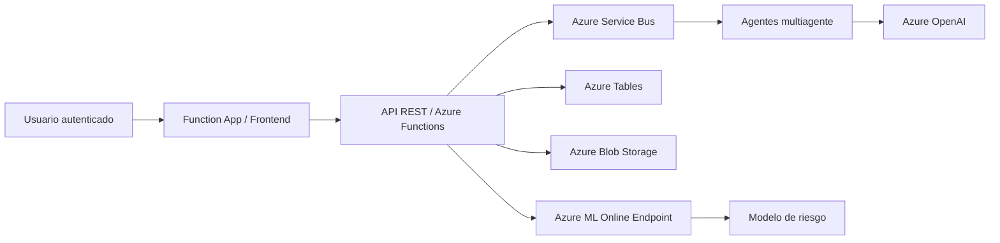

# SAT-FUMC — Plataforma de permanencia estudiantil y riesgo de deserción

Este repositorio concentra la implementación funcional de una solución de permanencia estudiantil basada en aprendizaje automático, agentes de análisis y una interfaz operativa desplegada en Azure. El sistema actual está orientado a la validación de riesgo de deserción en modo sintético, con una arquitectura lista para despliegue repetible en la suscripción `reverse05` y con la Function App y el endpoint Azure ML conectados.

## Estado actual del proyecto

- La solución está desplegada y operando en Azure en la suscripción correcta.
- El frontend web y la API backend están servidos por una Function App.
- El endpoint de inferencia de Azure ML ya está conectado y consumiendo el modelo.
- Los datos son sintéticos y no institucionales, con un modo `DATA_MODE=synthetic`.
- El volumen operativo actual está configurado en 5.000 estudiantes y el conjunto de datos sintético queda listo para validación de carga, análisis y dashboard.
- La arquitectura actual queda documentada en [docs/CloudDeploymentArchitecture.md](./docs/CloudDeploymentArchitecture.md).

## Arquitectura actual



## Componentes clave

- `azure/agent_platform/function_app.py`: backend principal y rutas de negocio.
- `azure/agent_platform/static/`: interfaz web de dashboard y perfiles.
- `azure/endpoints/score.py`: script de inferencia compatible con Azure ML.
- `azure/environments/*.yaml`: entornos de ejecución online.
- `src/ml/train_pipeline.py`: pipeline de entrenamiento y evaluación.
- `src/ml/feature_engineering.py`: ingeniería de variables y transformación sonora del riesgo.
- `outputs/`: reportes, predicciones y artefactos generados.
- `docs/`: arquitectura, visión, modelo predictivo y despliegue.

## Datos y modelo

La solución usa un Digital Twin sintético para modelar:
- estudiantes por programa y sede,
- contexto académico,
- riesgo financiero,
- bienestar y acompañamiento,
- alertas y seguimientos.

La lógica de predicción prioriza Recall porque una mala detección de estudiantes en riesgo tiene mayor costo operacional que una alerta adicional. El modelo se entrenó con partición temporal y la métrica de referencia principal fue Recall, con F1 y AUC-ROC como métrica complementaria.

## Indicadores actuales del modelo

| Indicador | Valor |
|---|---:|
| Recall | 0.7318 |
| Precision | 0.1385 |
| F1-score | 0.2330 |
| AUC-ROC | 0.6507 |
| Brier score | 0.1820 |
| Umbral | 0.35 |
| Registros evaluados | 27.975 |
| Riesgo global observado | 27.61% |

Estos valores representan la configuración operativa actual del modelo en contexto sintético. El ajuste favorece detección temprana de estudiantes con riesgo antes que maximizar exactitud en toda la población.

## Repositorio y limpieza de despliegue

La carpeta del repositorio se mantiene enfocada en los artefactos que realmente forman parte del sistema desplegado:
- código de la Function App,
- archivos Azure ML,
- scripts del pipeline y feature engineering,
- documentación de arquitectura,
- artefactos de salida y reportes,
- dependencias y tests relevantes.

Se eliminaron artefactos obsoletos, temporales y redundantes que no forman parte del flujo de despliegue final, dejando la estructura limpia y repetible para un re-despliegue.

## Documentación relevante

- [docs/CloudDeploymentArchitecture.md](./docs/CloudDeploymentArchitecture.md)
- [docs/AIArchitecture.md](./docs/AIArchitecture.md)
- [docs/DataArchitecture.md](./docs/DataArchitecture.md)
- [docs/UI-Architecture-SAT-DE.md](./docs/UI-Architecture-SAT-DE.md)
- [docs/ProductionReadiness.md](./docs/ProductionReadiness.md)
- [docs/SyntheticDataStrategy.md](./docs/SyntheticDataStrategy.md)
- [articulo_trabajo_grado.md](./articulo_trabajo_grado.md)

## Ejecución local mínima

```powershell
python -m venv .venv
.\.venv\Scripts\Activate.ps1
python -m pip install -r requirements.txt
pytest -q tests\test_distributed_agent_contracts.py
```

## Notas de operación

- Los recursos de Azure deben manejarse en la suscripción de `reverse05`.
- El modo de despliegue actual es demo/sintético.
- No se procesan datos reales de estudiantes ni se toman decisiones institucionales automáticas.
- La recomendación final del LLM es de apoyo a la revisión humana y no reemplaza la gestión institucional.
