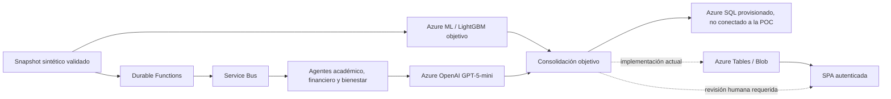

# SAT-FUMC | Plataforma de apoyo a la permanencia estudiantil

Repositorio de investigación y prueba de concepto (POC) para estimar riesgo de deserción y apoyar la revisión profesional. **No es una solución institucional de producción**: la información de demostración es sintética y no hay conectores autorizados a fuentes FUMC.

> **Corte de documentación:** 2026-11-09. El estado de Azure que se indica abajo fue comprobado directamente; no equivale a validar el flujo institucional extremo a extremo.

## 01. Propósito y límites

El proyecto reúne dos líneas técnicas que hoy permanecen separadas: (1) un pipeline de aprendizaje automático tabular que entrena LightGBM y define contratos de inferencia Azure ML; y (2) una aplicación de agentes con Azure Functions/Durable Functions, Service Bus, Semantic Kernel y Azure OpenAI GPT-5-mini. La meta es apoyar a profesionales, no automatizar decisiones académicas, financieras ni de bienestar.

Los datos actuales son sintéticos. No suministres nombres, documentos, correos, datos clínicos ni registros institucionales reales. Ninguna métrica sintética acredita validez para FUMC.

## 02. Estado verificado de la implementación

| Capacidad | Estado al 2026-11-09 | Alcance de la comprobación |
|---|---|---|
| Infraestructura Bicep | Despliegue `satfumc-prod`: `Succeeded` en `rg-sat-fumc-prod`, Brazil South | Function App, plan Flex Consumption, Storage, Key Vault, Service Bus, Azure OpenAI, Application Insights y Azure SQL provisionados |
| Azure Functions | `satfumcfunc0e83b2486979`: `Running`, Linux, Python 3.11; 33 funciones indexadas | Publicación con Core Tools v4 y compilación remota completada |
| Autenticación | Easy Auth/Entra habilitado | Acceso anónimo a `/` y `/api/poc/status`: `401`; `/.auth/login/aad`: redirección `302` a Microsoft. No se comprobó una respuesta `200` de una sesión interactiva autenticada |
| Azure SQL | `SATFUMCOperational`: `Online`, Basic | Se aplicó `azure/agent_platform/infra/sql_schema.sql` y se comprobaron las nueve tablas operacionales |
| Service Bus y modelo generativo | Namespace y despliegue `sat-gpt5-mini`: `Succeeded` | Aprovisionamiento comprobado; no se ejecutó una corrida autenticada de agentes |
| Integración de la aplicación | Parcial | Functions usa Azure Tables/Blob para la POC; no consume el repositorio SQL ni pasa sus casos al endpoint Azure ML |
| Datos institucionales | No habilitados | Sin conectores SIS/LMS/finanzas/bienestar autorizados |

El esquema SQL está desplegado, pero **eso no significa que la aplicación lo use**. Asimismo, la existencia de manifiestos AML no demuestra que haya un endpoint conectado a Functions. La advertencia Bicep `BCP187` sobre `sku` se presentó durante el despliegue, que aun así terminó correctamente; debe mantenerse como observación de esquema, no como fallo operativo.

## 03. Arquitectura objetivo frente a la implementada

El diseño objetivo ejecuta en paralelo, sobre un snapshot temporal común, Azure ML/LightGBM y el análisis de agentes. La aplicación actual todavía no realiza esa unión: el Digital Twin genera el score sintético y la POC de agentes guarda el estado en Tables/Blob.



## 04. Modelo y evidencia

**Recall ≥ 0,80** es una meta de aceptación, no un resultado vigente. Hay corridas sintéticas ML a 6k, 15k y 30k con métricas documentadas; las corridas 50k/100k son de generación solamente, sin entrenamiento/scoring del modelo. Los resultados no son institucionales ni todos comparables entre versiones. La matriz, dataset hashes, Recall, precisión, F1, AUC, Brier y tasas de alertas está en [`docs/ScaleExperiments.md`](docs/ScaleExperiments.md). Ningún run es elegible para promoción.

`src/ml/model_selection.py` selecciona umbral con datos de validación; el holdout no debe usarse para optimización. Los modelos y archivos de `models/`, `data/` y `mlruns/` se conservan como artefactos de investigación, pero sus métricas no deben extrapolarse a estudiantes reales.

## 05. Componentes y responsabilidades

- `src/ml/`: ingeniería de características, evaluación temporal, selección de umbral y feedback del modelo.
- `azure/train_azure.py` y `azure/components/`: entrenamiento/registro de Azure ML.
- `azure/endpoints/`: contrato, configuración y scoring de Azure ML; sin conexión actual desde la POC de agentes.
- `azure/agent_platform/function_app.py`: API, Durable Functions, rutas de revisión y SPA.
- `azure/agent_platform/sat_agents/`: contratos, políticas y agentes especializados/sintetizador.
- `azure/agent_platform/infra/main.bicep`: infraestructura Azure verificada para la POC.
- `azure/agent_platform/infra/sql_schema.sql`: esquema SQL aplicado; falta implementar su uso desde la API.
- `tests/`: pruebas unitarias y de contratos. La última ejecución completa registrada pasó **71 pruebas**, no una E2E autenticada en Azure.

## 06. Índice documental

### 06.01. Arquitectura y alcance

- [`docs/ProductionArchitecture.md`](docs/ProductionArchitecture.md) — fuente canónica de arquitectura, estado, brechas y gates.
- [`docs/Vision.md`](docs/Vision.md) y [`docs/Scope.md`](docs/Scope.md) — propósito, usuarios y límites.
- [`docs/AIArchitecture.md`](docs/AIArchitecture.md) y [`docs/AgentsDefinition.md`](docs/AgentsDefinition.md) — ramas y responsabilidades de agentes.
- [`docs/UI-Architecture-SAT-DE.md`](docs/UI-Architecture-SAT-DE.md) — SPA y contratos de interacción.

### 06.02. Datos y modelo

- [`docs/DataArchitecture.md`](docs/DataArchitecture.md) y [`docs/SyntheticDataStrategy.md`](docs/SyntheticDataStrategy.md) — datos, target, cortes y límites del Digital Twin.
- [`docs/PredictiveModel.md`](docs/PredictiveModel.md) — metodología y criterios del modelo.
- [`docs/ScaleExperiments.md`](docs/ScaleExperiments.md) — resultados por escala, generación 100k y flujo GPT de la UI.
- [`docs/ScaleExperiments.md`](docs/ScaleExperiments.md) — escalas generadas, runs ML, métricas y flujo GPT de la interfaz.
- [`docs/Phase2Audit.md`](docs/Phase2Audit.md) — auditoría histórica de la fase de análisis, separada del estado Azure posterior.

### 06.03. Azure y operación

- [`docs/CloudDeploymentArchitecture.md`](docs/CloudDeploymentArchitecture.md) — inventario de despliegue verificado.
- [`docs/DistributedAgentsAzure.md`](docs/DistributedAgentsAzure.md) y [`azure/agent_platform/README.md`](azure/agent_platform/README.md) — ejecución de la POC.
- [`docs/AzureFoundryIntegration.md`](docs/AzureFoundryIntegration.md) — límites entre AML, Azure OpenAI y Foundry.
- [`docs/Azure-Integration-and-Shutdown-Guide.md`](docs/Azure-Integration-and-Shutdown-Guide.md) — comprobación, pausa, costos y eliminación segura.
- [`docs/ProductionReadiness.md`](docs/ProductionReadiness.md) — brechas restantes antes de producción.

### 06.04. Artículo y entregables

- [`articulo_trabajo_grado.md`](articulo_trabajo_grado.md) — artículo fuente.
- [`entregables/articulo_trabajo_grado.md`](entregables/articulo_trabajo_grado.md) — copia de entrega sincronizada.
- `articulo_trabajo_grado.docx` y `entregables/articulo_trabajo_grado.docx` — versiones Word generadas con [`entregables/generate_docx.py`](entregables/generate_docx.py).

## 07. Desarrollo y validación local

Usa Python 3.11 para coincidir con Functions; el pipeline de pruebas del repositorio también se ha ejecutado con Python 3.13. La ejecución local de Functions requiere Core Tools v4 y configuración local; no crea recursos automáticamente.

```powershell
python -m pip install -r requirements.txt
python -m pytest -q
```

Para agentes, consulta [`azure/agent_platform/README.md`](azure/agent_platform/README.md). No publiques `local.settings.json`, tokens, contraseñas ni secretos.

## 08. Seguridad y autorización institucional

Las recomendaciones generativas son borradores y requieren decisión humana. La POC permanece en `DATA_MODE=synthetic`; el prefijo `syn-` no prueba procedencia. No usar con población real hasta aprobar fuentes, privacidad, seguridad, objetivo, evaluación temporal, capacidad de atención, SQL integrado, pruebas autenticadas, operación y CI/CD. La matriz completa está en [los gates de arquitectura](docs/ProductionArchitecture.md#5-criterios-de-habilitación-institucional).
