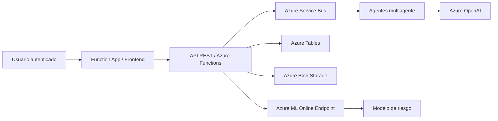

# Plataforma de permanencia estudiantil con IA y despliegue en Azure

## Resumen ejecutivo

Este proyecto desarrolla una plataforma de apoyo para la permanencia estudiantil basada en inteligencia artificial, agentes de análisis y un dashboard operativo. La solución está orientada a identificar estudiantes con riesgo de deserción o permanencia comprometida a partir de variables académicas, socioeconómicas, de bienestar y de participación institucional.

La arquitectura implementada integra un pipeline de ingeniería de variables, un modelo predictivo tabular, una capa de agentes de análisis y una interfaz web operativa desplegada en Azure. La solución actual funciona en modo sintético y se ejecuta sobre un gemelo digital con 5.000 estudiantes ficticios, con la intención de validar la arquitectura, el flujo end-to-end, la inferencia y la experiencia de usuario antes de una futura integración institucional con datos reales.

## 1. Contexto y objetivo

El problema central es apoyar la toma de decisiones institucionales tempranas para detectar estudiantes en riesgo. La estrategia del proyecto no es reemplazar la evaluación humana, sino priorizar intervenciones para quienes presentan mayor probabilidad de deserción o dificultad de permanencia. En este sentido, el sistema combina modelos predictivos con análisis de contexto y recomendaciones accionables.

La propuesta está enfocada en un caso de uso operativo y de validación técnica:

- detectar riesgo académico y socioeconómico temprano,
- priorizar casos de mayor urgencia,
- apoyar la intervención de consejeros, tutores y bienestar universitario,
- visualizar el riesgo en un dashboard y un perfil individual del estudiante,
- desplegar la solución en Azure con endpoint de inferencia y frontend conectado.

## 2. Arquitectura desplegada en Azure

La solución quedó desplegada en la suscripción `reverse05` y se compone de los siguientes elementos:

### Componentes principales

- Azure Machine Learning: endpoint de inferencia online para el modelo de riesgo.
- Function App: servicio principal de backend y frontend estático.
- Azure Tables: almacenamiento del digital twin sintético y perfiles de estudiantes.
- Azure Blob Storage: artefactos y datos asociados.
- Azure Service Bus: orquestación de análisis y eventos de procesamiento.
- Azure OpenAI: apoyo con agentes de análisis y síntesis LLM.
- Dashboard web: visualización de estudiantes, métricas, alertas y perfiles.

## 3. Datos y generación sintética

El sistema usa un digital twin sintético para modelar estudiantes por programa, sede, jornada, riesgo financiero, bienestar, desempeño académico y continuidad. El conjunto de datos se generó con una lógica de cobertura amplia, perfiles ficticios y un volumen escalado a 5.000 estudiantes.

La estrategia sintética permite:

- mantener la validación funcional sin depender de datos personales reales,
- probar el flujo end-to-end en Azure,
- evaluar la arquitectura de scoring, UI y agentes en un escenario operativo realista,
- escalar la carga sin afectar la privacidad ni la seguridad institucional.

## 4. Pipeline predictivo

El pipeline sigue estas etapas:

1. ingestión y preparación del dataset sintético,
2. validación de calidad y consistencia,
3. feature engineering,
4. partición temporal para entrenamiento y evaluación,
5. entrenamiento de modelos candidatos,
6. comparación de métricas por recall, precision, F1 y AUC-ROC,
7. ajuste del umbral de decisión,
8. despliegue del modelo en Azure ML,
9. consumo desde la Function App para inferencia online.

La ingeniería de variables incluye indicadores académicos, financieros, de bienestar, de participación y de riesgo acumulado. El modelo principal se entrenó con enfoque orientado a la reducción de falsos negativos, priorizando Recall en un escenario donde la detección temprana se considera más valiosa que una alta precisión puntual.

## 5. Resultados de evaluación

La evaluación ejecutada en el flujo actual del proyecto reporta los siguientes indicadores del modelo en contexto sintético:

| Indicador | Valor |
|---|---:|
| Recall | 0.7318 |
| Precision | 0.1385 |
| F1-score | 0.2330 |
| AUC-ROC | 0.6507 |
| Brier score | 0.1820 |
| Umbral de decisión | 0.35 |
| Registros evaluados | 27.975 |
| Riesgo global observado | 27.61% |

### Interpretación

Los resultados muestran una capacidad razonable para detectar estudiantes con mayor riesgo de permanencia comprometida, especialmente en un entorno donde la prioridad operativa es evitar falsos negativos. El recall de 0.7318 refleja que el modelo identifica de manera aceptable la población de riesgo, aunque la precisión sigue siendo baja por diseño, dado que se prioriza la sensibilidad frente a la exactitud global.

Este comportamiento es coherente con la lógica de apoyo institucional: la herramienta no reemplaza la decisión humana, sino que prioriza a los estudiantes que requieren revisión y acompañamiento. El valor de AUC-ROC (0.6507) indica una discriminación moderada, y el Brier score (0.1820) sugiere una estimación de probabilidad relativamente útil dentro del contexto sintético del piloto.

## 6. Estado actual del proyecto en nube

El proyecto se encuentra operando en Azure en la suscripción `reverse05` con una implementación funcional y validada, incluyendo:

- Azure ML endpoint activo y consumible,
- Function App conectada al endpoint,
- dashboard web funcionando con perfiles, alertas y análisis,
- datos sintéticos con 5.000 estudiantes ficticios,
- configuración operativa del sistema con volumen escalado,
- flujo end-to-end validado de inferencia y visualización.

La solución mantiene el modo `DATA_MODE=synthetic` y no procesa datos reales de estudiantes. El caso de uso actual es una validación técnica y operativa de la arquitectura, con foco en la funcionalidad de negocio, la estimación de riesgo y la experiencia de usuario.

## 7. Conclusiones

El sistema implementado demuestra que la arquitectura de permanencia estudiantil con IA puede operar de manera end-to-end, con diagnóstico predictivo, capa de consumo, agentes de apoyo y dashboard funcional. La combinación de Azure ML, Function App y agentes LLM permite validar la hipótesis de una solución de apoyo institucional para identificación temprana de riesgo.

Los resultados actuales no deben interpretarse como un modelo listo para decisiones institucionales automáticas con datos reales, sino como una base sólida para un piloto técnico y una validación funcional en entorno controlado. La sensibilidad del modelo y la estrategia de priorización permitieron desarrollar una solución útil para revisión humana, atención temprana y gestión de casos prioritarios.

La evidencia disponible muestra un desempeño razonable en el contexto sintético y deja la base técnica lista para continuidad: re-despliegue, validación adicional, mejora del modelo y, posteriormente, adopción con datos institucionales bajo gobernanza y seguridad apropiadas.

## 8. Referencias internas

- [README.md](./README.md)
- [docs/CloudDeploymentArchitecture.md](./docs/CloudDeploymentArchitecture.md)
- [docs/AIArchitecture.md](./docs/AIArchitecture.md)
- [docs/DataArchitecture.md](./docs/DataArchitecture.md)
- [docs/SyntheticDataStrategy.md](./docs/SyntheticDataStrategy.md)
- [docs/PredictiveModel.md](./docs/PredictiveModel.md)
- [docs/UI-Architecture-SAT-DE.md](./docs/UI-Architecture-SAT-DE.md)
