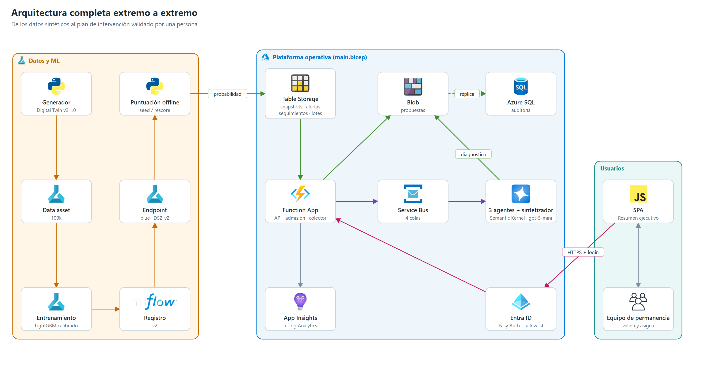

# 00 | Resumen ejecutivo — SAT-FUMC

> Paquete documental técnico del Sistema de Alerta Temprana de deserción de la Fundación Universitaria María Cano (SAT-FUMC). Describe **solo lo implementado** en el repositorio al **2026-11-12** (árbol de trabajo, incluidos archivos aún no confirmados en git) y la evidencia de despliegue registrada en [12 §9](./12_Guia_Operacion.md#9-validación-e2e-del-2026-11-12). Todos los datos son **sintéticos**.

## 1. Qué es

Una prueba de concepto que:

1. **Genera** una población universitaria sintética (Digital Twin) con trayectorias académicas, financieras y de bienestar.
2. **Entrena** un modelo LightGBM calibrado en Azure Machine Learning que estima la probabilidad de deserción en los dos periodos siguientes.
3. **Puntúa** la cohorte operativa (15.000 estudiantes) con el endpoint gestionado de Azure ML y guarda el resultado en Azure Table Storage.
4. **Analiza** los casos prioritarios con tres agentes especializados (socioeconómico, académico y bienestar) y un sintetizador sobre Azure OpenAI GPT-5-mini, orquestados por Azure Service Bus.
5. **Presenta** a directivos y al equipo de permanencia una vista ejecutiva por estudiante (riesgo, prioridad, diagnóstico único, acciones) y exige **validación humana** antes de crear una intervención.
6. **Audita** predicciones, ejecuciones de agentes, propuestas y decisiones en Azure SQL.

## 2. Visión y principios

El SAT-FUMC busca que los equipos de permanencia revisen a tiempo señales académicas, financieras y de bienestar. Prioriza el **acompañamiento**: no etiqueta de forma punitiva ni decide en lugar de las personas. La experiencia objetivo es que un profesional autenticado vea, en una sola aplicación, la probabilidad del modelo junto con la evidencia, las incertidumbres y las propuestas de los agentes, decida, y que su decisión y el seguimiento queden auditados.

Principios que rigen el diseño:

1. Minimizar datos y usar identificadores seudónimos.
2. Usar solo señales disponibles a la fecha de corte; separar target y predictores.
3. Presentar el score como estimación, no como causa ni decisión.
4. Exigir revisión profesional para cada recomendación.
5. Evaluar recall, precisión, calibración, capacidad de intervención y equidad **con cohortes reales** antes de cualquier uso institucional.
6. No presentar datos, tendencias o métricas sintéticas como evidencia institucional.
7. Mantener la SPA autenticada como único punto de acceso operativo; la exportación CSV es una función de la SPA, no una segunda interfaz.

## 3. Estado verificado

| Capacidad | Estado | Evidencia |
|---|---|---|
| Generador sintético | v2.1.0, escalable de 5k a 100k estudiantes | `configs/synthetic_data.json`, `src/data_generation/` |
| Modelo predictivo | `SAT_FUMC_LightGBM_Model` v2 desplegado en `sat-fumc-endpoint/blue` | `azure/endpoints/deployment.yaml`; cohorte de 15.000 puntuada |
| Plataforma de agentes | Function App Flex Consumption, 35 funciones, 23 rutas HTTP | `azure/agent_platform/function_app.py` |
| Flujo multiagente | Lote de 20 casos: 20 procesados, 0 fallidos (2026-11-12) | [12 §9](./12_Guia_Operacion.md#9-validación-e2e-del-2026-11-12) |
| Auditoría SQL | 10 tablas; escritura desde la app verificada | `infra/sql_schema.sql`, `sat_agents/audit_sql.py` |
| Autenticación | Easy Auth (Entra ID) + allowlist de revisores | `main.bicep`, `_authorize_reviewer` |
| Pruebas | 118 aprobadas, 1 omitida (requiere SQL en vivo) | `tests/` |

## 4. Cifras clave del modelo (sintéticas)

- Regla de promoción del código: recall ≥ 0,80 con tasa de alertas ≤ máximo configurado (0,50 en `job.yaml`). **Ninguna corrida registrada la cumple**; el modelo v2 está desplegado como POC, no como modelo promovido.
- Pipeline local (dataset heredado de 6.000 estudiantes): LightGBM recall 0,81, precisión 0,14, AUC-ROC 0,68 con 61 % de alertas.
- Recalibración 5k–100k ([04](./04_Arquitectura_ML.md)): el techo de AUC ≈ 0,68 coincide con el "oráculo" del generador; recall 0,80 exige alertar ≈ 62–65 % de la población. El límite es de los datos sintéticos, no del ajuste.

## 5. Riesgos y brechas principales

| # | Hallazgo | Impacto | Documento |
|---|---|---|---|
| 1 | `POST /api/cases` (flujo Durable heredado) nunca finaliza: espera eventos que ningún código emite | Consume 3 llamadas LLM y bloquea el único cupo concurrente 15 min | [05](./05_Arquitectura_MultiAgente.md) |
| 2 | Dos esquemas de bandas de riesgo: endpoint y pipeline local 0,25/0,50/0,75; plataforma 0,30/0,60 (+ crítico ≥ 0,80) | Etiquetas distintas para la misma probabilidad | [04](./04_Arquitectura_ML.md) |
| 3 | CI instala el `requirements.txt` raíz, que no incluye `azure-functions` ni `semantic-kernel` | Las pruebas que importan `function_app` pueden fallar en GitHub Actions | [11](./11_DevOps_CICD.md) |
| 4 | Despliegue manual; `deploySubpath` de VS Code y `deploy-updated.zip` omiten `src/` | Un despliegue desde VS Code rompería el arranque | [11](./11_DevOps_CICD.md) |
| 5 | `/api/model/feedback` escribe en un archivo local | Datos no persistentes en Flex Consumption | [07](./07_Arquitectura_Backend.md) |
| 6 | `outputs/backups/` no está en `.gitignore` | Riesgo de versionar exportaciones de tablas | [10](./10_Seguridad_Gobierno.md) |
| 7 | Sin VNet ni private endpoints; endpoint AML con clave | Aceptable para datos sintéticos, no para datos reales | [10](./10_Seguridad_Gobierno.md) |
| 8 | El dashboard lanza un lote automático la primera vez que una cohorte no tiene análisis | Consumo de Azure OpenAI sin clic explícito (una vez por cohorte) | [06](./06_Arquitectura_Frontend.md) |

## 6. Mapa del paquete documental

| Documento | Para quién | Contenido |
|---|---|---|
| [01 Estructura del repositorio](./01_Estructura_Repositorio.md) | Todos | Árbol, ficha de cada carpeta |
| [02 Arquitectura general](./02_Arquitectura_General.md) | Arquitectos, jurado | Capas, flujos y decisiones |
| [03 Arquitectura de datos](./03_Arquitectura_Datos.md) | Científicos de datos | Generador, modelo de datos, target, flujo |
| [04 Arquitectura ML](./04_Arquitectura_ML.md) | Científicos de datos | Entrenamiento, inferencia, métricas |
| [05 Arquitectura multiagente](./05_Arquitectura_MultiAgente.md) | Arquitectos, IA | Agentes, orquestación, consolidación |
| [06 Arquitectura frontend](./06_Arquitectura_Frontend.md) | Desarrolladores | SPA, vistas, API consumida |
| [07 Arquitectura backend](./07_Arquitectura_Backend.md) | Desarrolladores | API, disparadores, módulos |
| [08 Arquitectura de base de datos](./08_Arquitectura_BD.md) | Desarrolladores, DBA | SQL, Tables, Blob |
| [09 Arquitectura Azure](./09_Arquitectura_Azure.md) | Arquitectos cloud | Recursos, identidades, costos |
| [10 Seguridad y gobierno](./10_Seguridad_Gobierno.md) | Seguridad, jurado | Controles, brechas |
| [11 DevOps y CI/CD](./11_DevOps_CICD.md) | DevOps | Pipeline, despliegue |
| [12 Guía de operación](./12_Guia_Operacion.md) | Operación | Ejecutar, desplegar, pausar, escalar, diagnosticar |

Diagramas: [`diagramas/`](./diagramas/) (SVG fuente, regenerables) e [`imagenes/`](./imagenes/) (PNG). Los documentos anteriores se integraron en este paquete y se conservan como histórico en [`archivo/`](./archivo/).

## 7. Alcance y límites

La plataforma opera en `DATA_MODE=synthetic`. No está habilitada para datos institucionales: faltan fuentes aprobadas, gobierno de datos, red privada, CD con aprobaciones y un modelo que cumpla la regla de promoción. Toda recomendación es un borrador que una persona valida; el sistema no envía mensajes ni ejecuta intervenciones.

| Ámbito | Contenido |
|---|---|
| **Implementado (POC)** | Digital Twin sintético; entrenamiento local y job de Azure ML; endpoint gestionado que puntúa la cohorte; Functions + Service Bus con agentes socioeconómico, académico y de bienestar y sintetizador GPT-5-mini; auditoría en Azure SQL; SPA autenticada con revisión humana |
| **Diseño objetivo (no implementado)** | Ingesta autorizada de snapshots de Académica, Finanzas, Bienestar y LMS con validación de calidad, seudonimización y corte temporal; inferencia AML y agentes sobre el mismo snapshot versionado; datos históricos en ADLS/Blob y Data Assets; CI/CD con evaluación ML/LLM y aprobación de despliegue. Detalle en [02](./02_Arquitectura_General.md) |
| **Fuera de alcance hasta contar con aprobación** | Conectores a sistemas reales (SIS, LMS, finanzas, bienestar), identificadores directos o notas clínicas; decisiones o intervenciones automáticas, contacto al estudiante, asignación automática de becas o acciones académicas; afirmar desempeño institucional a partir del Digital Twin |

El recall ≥ 0,80 es un **criterio de aceptación pendiente de demostrar** con datos institucionales, no un compromiso que pueda garantizarse con el dataset sintético. Los criterios completos de habilitación están en [02 §8](./02_Arquitectura_General.md).

## 8. Antecedentes del proyecto

Una auditoría estática del repositorio (2026-11-09, "Fase 2") fijó el punto de partida: generador con límites fijos y semilla global, target muestreado en el mismo periodo que los predictores (sin horizonte futuro), agentes orquestados con Durable Functions, persistencia solo en Tables/Blob, sin Azure SQL conectado y 60 pruebas unitarias. A partir de ella se parametrizó el generador (v2.1.0, 5k–100k), se definió un target a horizonte futuro con madurez, se ejecutaron los experimentos de escala y recalibración, se reemplazó Durable por lotes sobre Service Bus + Azure Tables y se conectó la auditoría en Azure SQL (2026-11-12). La matriz histórica se conserva en [`archivo/Phase2Audit.md`](./archivo/Phase2Audit.md).
