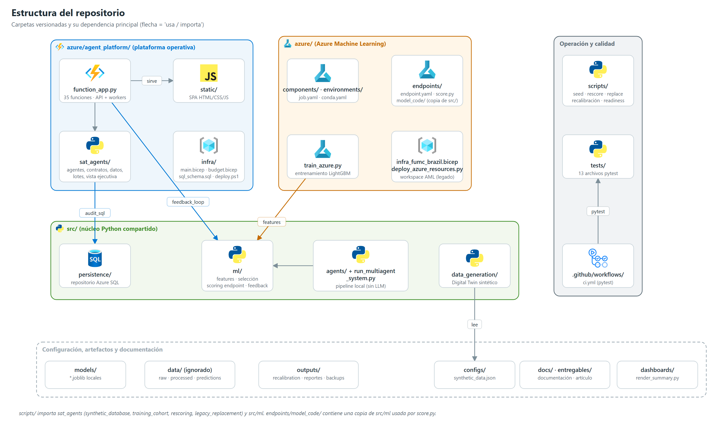

# 01 | Estructura del repositorio

> Árbol de archivos versionados o no ignorados al 2026-11-12. Se excluyen entornos virtuales (`.venv/`, `.python_packages/`), cachés, `data/`, `mlruns/` y los logos de `docs/imagenes/logos/`. Varias piezas activas aún no están confirmadas en git (marcadas *(sin confirmar)*).



## 1. Árbol

```text
/
├── .github/workflows/ci.yml          # CI: pytest en push/PR
├── .vscode/                          # depuración local de Functions
├── azure/
│   ├── agent_platform/               # PLATAFORMA OPERATIVA (Azure Functions)
│   │   ├── function_app.py           # 35 funciones: API, workers, timers
│   │   ├── host.json · requirements.txt · local.settings.example.json · .funcignore
│   │   ├── infra/                    # main.bicep · budget.bicep · sql_schema.sql · deploy.ps1
│   │   ├── sat_agents/               # dominio: agentes, contratos, datos, lotes, vista ejecutiva
│   │   │   ├── agents.py · contracts.py · policy.py · executive.py
│   │   │   ├── synthetic_database.py · batch_flow.py* · pilot_limits.py
│   │   │   ├── reviews.py · usage.py · audit_sql.py*
│   │   │   └── training_cohort.py* · rescoring.py* · legacy_replacement.py*
│   │   └── static/                   # SPA: index.html · dashboard.js · styles.css · logos
│   ├── components/                   # job.yaml (entrenamiento) · scoring_job.yaml (legado)
│   ├── endpoints/                    # endpoint.yaml · deployment.yaml · score.py · model_code/
│   ├── environments/                 # conda*.yaml · online-environment.yaml
│   ├── train_azure.py                # entrenamiento LightGBM en Azure ML
│   ├── deploy_azure_resources.py     # registro inicial de assets AML (legado)
│   ├── connect_workspace.py · config.json
│   └── infra_fumc_brazil.bicep       # workspace AML (legado)
├── configs/synthetic_data.json       # parámetros del Digital Twin
├── dashboards/render_summary.py      # informe HTML agregado
├── docs/                             # documentación · diagramas/ · imagenes/
├── entregables/                      # artículo del trabajo de grado
├── models/                           # *.joblib locales
├── outputs/                          # recalibration/ · reportes · backups/
├── scripts/                          # operación y experimentos *(sin confirmar)*
├── src/
│   ├── agents/                       # pipeline local por agentes (sin LLM)
│   ├── data_generation/              # generate_digital_twin.py
│   ├── ml/                           # features · selección · scoring endpoint* · feedback
│   ├── persistence/                  # repositorio Azure SQL
│   └── run_multiagent_system.py
├── tests/                            # 13 archivos pytest
├── config.json · requirements.txt · README.md · .gitignore · .amlignore
└── articulo_trabajo_grado.{md,docx}
```
`*` = archivo *(sin confirmar)* en git.

## 2. Ficha por carpeta

Criticidad: **Alta** = sin ella la plataforma no funciona; **Media** = necesaria para entrenar, desplegar o validar; **Baja** = soporte o documentación.

### `azure/agent_platform/` — Plataforma operativa

| Campo | Detalle |
|---|---|
| Objetivo | Servir la SPA y la API protegida, orquestar el análisis multiagente y persistir resultados |
| Responsabilidad | Autorización, admisión de lotes, workers de agentes, colector, síntesis, vista ejecutiva, aprobación humana, auditoría |
| Tecnologías | Azure Functions v4 (Python 3.11, Flex Consumption), `azure-functions-durable`, Service Bus, Semantic Kernel, Azure OpenAI, Azure Tables/Blob, pyodbc |
| Dependencias | `src/ml/feedback_loop.py` (importado al arrancar), `src/persistence/` (vía `audit_sql`), servicios Azure de `main.bicep` |
| Componentes | `function_app.py`, `sat_agents/`, `static/`, `infra/`, `host.json` |
| Flujo | SPA → API → Service Bus → workers → `agent-results` → colector → sintetizador → Blob + SQL → SPA |
| Criticidad | **Alta** |
| Estado | Desplegada y verificada E2E (2026-11-12). Cambios sin confirmar en git |

### `azure/agent_platform/sat_agents/` — Dominio

| Módulo | Responsabilidad |
|---|---|
| `agents.py` | 4 agentes Semantic Kernel (socioeconómico, académico, bienestar, sintetizador); RAG opcional con AI Search (deshabilitado) |
| `contracts.py` · `policy.py` | Contrato del caso, saneamiento y validación de salidas, umbrales de riesgo, acciones permitidas, límites de brevedad |
| `executive.py` | Vista ejecutiva determinista: riesgo, prioridad, estado, diagnóstico, factores, acciones, línea de tiempo |
| `synthetic_database.py` | Tablas `Synthetic*`: cohorte, snapshots, alertas, seguimientos, dashboard, control de la POC |
| `batch_flow.py` | Estado de lotes (`SyntheticBatches`) y resultados de agentes (`SyntheticAgentResults`) |
| `pilot_limits.py` | Contador de evaluaciones con concurrencia optimista (ETag) en Blob |
| `reviews.py` · `usage.py` | Propuestas y aprobaciones en Blob; uso de tokens y costo estimado |
| `audit_sql.py` | Doble escritura no bloqueante a Azure SQL |
| `training_cohort.py` · `rescoring.py` · `legacy_replacement.py` | Usados solo por `scripts/`: sembrar, repuntuar y reemplazar la cohorte |

Criticidad **Alta**; estado: activo.

### `azure/agent_platform/static/` — Frontend

SPA en HTML/CSS/JavaScript sin framework (`index.html`, `dashboard.js`, `styles.css`). Consume la API same-origin; servida por `serve_index`/`serve_static_asset`. Criticidad **Alta**. Detalle en [06](./06_Arquitectura_Frontend.md).

### `azure/agent_platform/infra/` — Infraestructura como código

| Campo | Detalle |
|---|---|
| Componentes | `main.bicep` (stack operativo), `budget.bicep` (presupuesto de suscripción), `sql_schema.sql` (10 tablas), `deploy.ps1`, `main.parameters.example.json` |
| Tecnologías | Bicep, T-SQL, PowerShell, Azure CLI |
| Criticidad | **Alta** |
| Estado | Activo. Su `README.md` mantiene cifras anteriores (33 funciones, 50 casos, "sin timers", SQL no usado); la versión vigente está en [09](./09_Arquitectura_Azure.md) |

### `azure/` (raíz), `components/`, `endpoints/`, `environments/` — Azure Machine Learning

| Campo | Detalle |
|---|---|
| Objetivo | Entrenar, registrar y servir el modelo predictivo |
| Componentes | `train_azure.py`, `components/job.yaml`, `endpoints/{endpoint,deployment}.yaml`, `endpoints/score.py`, `endpoints/model_code/` (copia de `src/ml` para el endpoint), `environments/*.yaml` |
| Tecnologías | Azure ML SDK v2, MLflow, LightGBM, scikit-learn, SHAP, conda |
| Dependencias | `src/ml/`, `src/agents/` (ingesta y calidad), data asset `sat-fumc-synthetic-100k:1` |
| Criticidad | **Media** (el endpoint es necesario para repuntuar) |
| Estado | Endpoint `blue` con modelo v2 activo. `deploy_azure_resources.py`, `infra_fumc_brazil.bicep` y `scoring_job.yaml` son legado; `model_code/src/` contiene copias desactualizadas de `train_pipeline.py` y del generador que el endpoint no usa |

### `src/` — Núcleo Python compartido

| Subcarpeta | Objetivo | Usada por | Estado |
|---|---|---|---|
| `data_generation/` | Digital Twin sintético v2.1.0 | operación, experimentos | Activo |
| `ml/` | `feature_engineering` (contrato de 52 variables crudas → 59), `model_selection` (umbral), `train_pipeline` (local), `endpoint_scoring` *(sin confirmar)*, `feedback_loop` | `train_azure.py`, `score.py`, `scripts/`, `function_app.py` | Activo |
| `persistence/` | `AzureSqlRepository` + conexión con token Entra | `audit_sql.py`, `validate_readiness.py` | Activo |
| `agents/` + `run_multiagent_system.py` | Pipeline **local** por agentes deterministas (ingesta, calidad, features, predicción, explicabilidad, monitoreo); no usa LLM | `train_azure.py` (ingesta/calidad) | Legado parcial |

Criticidad **Alta** (`function_app.py` importa `src.ml.feedback_loop` al arrancar).

### `scripts/` — Operación y experimentos *(sin confirmar)*

| Script | Función |
|---|---|
| `seed_operational_data.py` | Construye la cohorte operativa desde un dataset del generador y la puntúa con el endpoint |
| `rescore_students.py` | Repuntúa snapshots existentes desde `FeaturesJson` |
| `replace_legacy_cohort.py` | Respaldo → puntuación → borrado de filas heredadas → resiembra |
| `evaluate_model.py` | Evaluación independiente del modelo registrado |
| `recalibration_*.py` | Estudio de recalibración 5k–100k (no productivo) |
| `validate_readiness.py` | Lista de preparación; escribe `outputs/readiness_report.md` |

Criticidad **Media**. Dependencias no incluidas en `requirements.txt`: `imbalanced-learn`, `azure-data-tables`, `azure-storage-blob`.

### `tests/` — Calidad

13 archivos, 118 pruebas aprobadas y 1 omitida (`test_sql_live_roundtrip`, requiere SQL en vivo). Cubren contratos de agentes, vista ejecutiva a escala, persistencia SQL con conexión simulada, generador, selección de modelo, scoring operativo, reemplazo de cohorte e infraestructura. Criticidad **Media**.

### `.github/workflows/` — CI

`ci.yml`: Python 3.11, `pip install -r requirements.txt`, `pytest -q`. Sin despliegue. Criticidad **Media**. Detalle en [11](./11_DevOps_CICD.md).

### Configuración, artefactos y documentación

| Carpeta | Contenido | Versionado | Criticidad |
|---|---|---|---|
| `configs/` | `synthetic_data.json` (generador) | Sí | Media |
| `models/` | `model_{LightGBM,XGBoost,champion}.joblib` del pipeline local | Sí | Baja |
| `data/` | `raw/` (dataset heredado de 6.000 estudiantes), `processed/`, `predictions/`, `synthetic_runs/` | **No** (`.gitignore`) | Media (local) |
| `mlruns/` | Experimento MLflow local `SAT_FUMC_Desercion_v1` | **No** | Baja |
| `outputs/` | `recalibration/`, `readiness_report.md`, reportes del pipeline local, `backups/` | Parcial; `backups/` **no está ignorado** | Baja |
| `dashboards/` | `render_summary.py` (HTML agregado con gráficos matplotlib) | Sí | Baja |
| `docs/` | Este paquete, documentos de detalle, `diagramas/` (SVG + generador) e `imagenes/` (PNG + logos) | Sí | Baja |
| `entregables/` | Artículo del trabajo de grado y su generador DOCX | Sí | Baja |
| `.vscode/` | Tareas y depuración de Functions; `deploySubpath` apunta a `azure/agent_platform` (omite `src/`) | Sí | Baja |

## 3. Relaciones clave entre carpetas

- `function_app.py` → `sat_agents/*` → `src/persistence` (auditoría SQL) y `src/ml/feedback_loop`.
- `train_azure.py` → `src/agents` (ingesta, calidad) → `src/ml` (features, selección).
- `endpoints/score.py` → `endpoints/model_code/src/ml/feature_engineering.py` (copia idéntica a `src/ml`).
- `scripts/*` → `sat_agents/{synthetic_database, training_cohort, rescoring, legacy_replacement}` + `src/ml/endpoint_scoring`.
- `tests/*` → todas las anteriores; `.github/workflows/ci.yml` → `tests/`.
