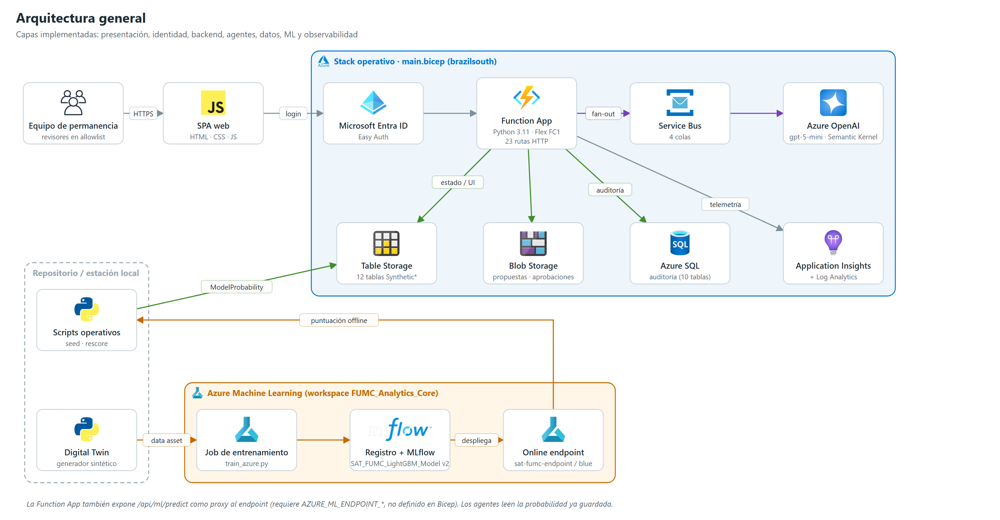
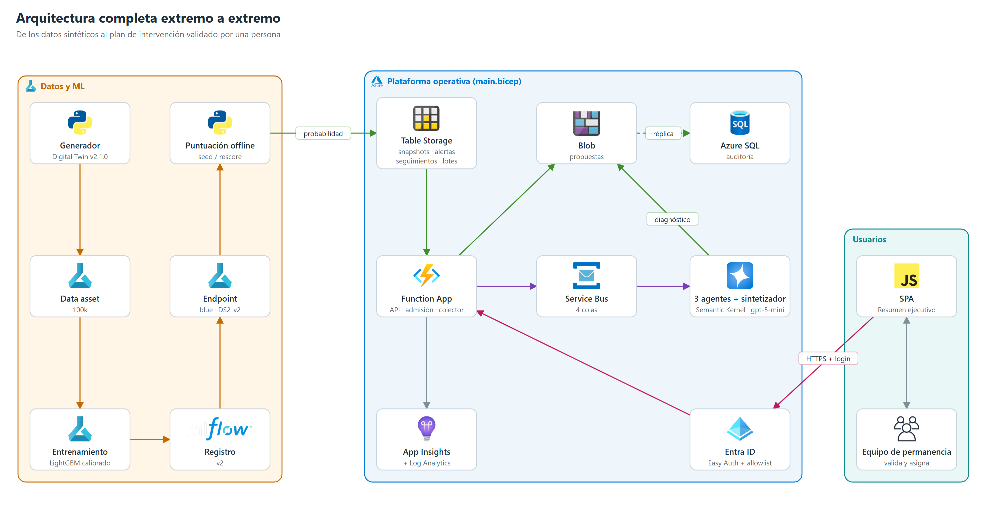

# 02 | Arquitectura general

## 1. Capas

| Capa | Componentes implementados | Tecnología |
|---|---|---|
| Presentación | SPA con dashboard, estudiantes, perfil 360° (resumen ejecutivo), alertas, seguimientos, analítica, reportes, configuración | HTML/CSS/JavaScript, SVG |
| Identidad | Easy Auth (`authsettingsV2`) + allowlist de object IDs en código | Microsoft Entra ID |
| Backend | 23 rutas HTTP, 4 disparadores Service Bus, 2 timers, 2 orquestadores y 4 actividades Durable heredados | Azure Functions v4, Python 3.11, Flex Consumption |
| Agentes | 3 agentes especializados + sintetizador; consolidación determinista en vista ejecutiva | Semantic Kernel, Azure OpenAI GPT-5-mini, Service Bus |
| Datos operativos | 12 tablas `Synthetic*`, propuestas y aprobaciones en Blob | Azure Table Storage, Blob Storage |
| Auditoría | 10 tablas relacionales | Azure SQL Database serverless |
| ML | Entrenamiento, registro y endpoint del modelo; puntuación offline de la cohorte | Azure Machine Learning, MLflow, LightGBM |
| Observabilidad | Telemetría de Functions | Application Insights + Log Analytics |

## 2. Flujos principales

1. **Preparación del modelo (offline).** Digital Twin → data asset → job de entrenamiento → MLflow/registro → endpoint `sat-fumc-endpoint/blue`. Ver [04](./04_Arquitectura_ML.md).
2. **Puntuación de la cohorte (offline).** `scripts/seed_operational_data.py` o `rescore_students.py` envían las variables al endpoint por lotes de 200 y escriben `ModelProbability`, `RiskLevel` y la versión del modelo en `SyntheticSnapshots`. La interfaz y los agentes **leen** esa probabilidad; no la recalculan.
3. **Consulta.** El usuario inicia sesión con Entra ID; la SPA consulta el dashboard, listados y el perfil. El perfil incluye la vista ejecutiva calculada en `executive.py`.
4. **Análisis multiagente (bajo demanda).** `POST /api/batches` admite hasta 20 casos de mayor riesgo, publica 3 mensajes por caso en Service Bus; los workers llaman a Azure OpenAI; el colector reúne las 3 respuestas, llama al sintetizador y guarda la propuesta en Blob y en SQL. Ver [05](./05_Arquitectura_MultiAgente.md).
5. **Decisión humana.** El revisor valida o descarta el plan (`POST /api/reviews/{id}/approval`). Si lo valida, se crea un seguimiento y se registran `HumanDecision`, `Intervention` y `AuditEvent` en SQL.

## 3. Decisiones de arquitectura (vigentes en el código)

| Decisión | Motivo | Consecuencia |
|---|---|---|
| Probabilidad calculada offline y almacenada | Desacoplar la UI del endpoint y controlar costo | La UI no hace inferencia en tiempo real; `/api/ml/predict` existe como proxy pero no está configurado en Bicep |
| Lotes sobre Service Bus + Tables, sin Durable | Las actividades Durable no se indexaban en Flex; el estado en Tables es inspeccionable | El flujo Durable `POST /api/cases` quedó huérfano (no finaliza) |
| Table Storage como fuente de verdad de la UI; SQL como auditoría | Disponibilidad de la UI aunque SQL falle o esté en pausa | Doble escritura no bloqueante; SQL puede quedar incompleto sin afectar a la UI |
| Agentes como motores internos; una sola vista ejecutiva | Lectura en menos de 15 s por directivos | Las salidas por agente se guardan para auditoría pero no se muestran |
| Humano en el ciclo obligatorio | Las recomendaciones no son decisiones | `automated_decision=false`; aprobación de una sola escritura |
| Identidad administrada para todos los servicios de datos | Sin secretos en código | Excepción: el endpoint AML usa clave |
| Modo sintético forzado (`DATA_MODE=synthetic`) | POC sin datos reales | Todas las rutas devuelven 503 si cambia el modo |

## 4. Implementación paralela heredada

`src/agents/` + `src/run_multiagent_system.py` es un pipeline local por "agentes" deterministas (sin LLM) que ingiere parquet, valida calidad, construye variables, predice con un `joblib` local, genera explicaciones por reglas y monitorea tasas por sede y programa. Comparte con la plataforma solo `src/ml/feature_engineering` y el artefacto del modelo. Sus módulos de ingesta y calidad siguen usándose en el entrenamiento de Azure ML. No forma parte del flujo operativo.

## 5. Atributos de calidad

| Atributo | Implementación actual |
|---|---|
| Escalabilidad | Cohorte configurable hasta 100.000 estudiantes; vista ejecutiva de tamaño constante (validada 5k–100k). Function App limitada a 1 instancia; un lote activo a la vez |
| Resiliencia | Service Bus con 5 reintentos y dead-letter; `batch_reaper` cierra lotes > 20 min; reutilización de respuestas de agentes por caso; SQL no bloqueante |
| Costo | SQL serverless con autopausa 60 min; Flex Consumption; presupuesto con alertas 50/80/100 USD (no es tope) |
| Trazabilidad | `AgentExecution` por agente con tokens y modelo; `AuditEvent`; versión del modelo en cada snapshot |
| Seguridad | Ver [10](./10_Seguridad_Gobierno.md) |

## 6. Arquitectura objetivo (no implementada)

> Esta sección describe el **diseño objetivo** para un eventual uso institucional. Nada de lo que sigue está implementado salvo donde se indica; las secciones 1–5 son la referencia de lo que existe.

### 6.1 Flujo objetivo

1. **Ingesta y snapshot.** Fuentes institucionales autorizadas (Académica, Finanzas, Bienestar, LMS) se validan contra contratos versionados y se consolidan en un snapshot por `(id seudónimo, periodo, corte)` con fecha `as_of`. La calidad bloquea llaves duplicadas, targets inválidos, fuga temporal y esquemas incompatibles; faltantes y reglas no evaluables se reportan. El target se guarda aislado y nunca llega a inferencia ni a agentes.
2. **Ramas paralelas sobre el mismo snapshot.** *Predictiva*: Azure ML ejecuta la versión aprobada del modelo y devuelve probabilidad, nivel, umbral versionado, versión del modelo y factores. Si la versión no está aprobada o el servicio falla, el caso queda en error/reintento; nunca se sustituye por una regla o un score inventado. *Generativa*: los agentes reciben el mismo snapshot y el resultado ML, describen evidencia y límites y no recalculan el score.
3. **Consolidación versionada.** La unión se correlaciona por un `case_id` opaco y guarda versiones de datos, modelo, umbral, prompt/agente y marcas de tiempo.
4. **Revisión y seguimiento.** Igual que en la POC: solo una acción aprobada o editada crea un seguimiento, con actor, fecha y motivo auditados.
5. **Retroalimentación y MLOps.** El feedback del revisor es una señal de proceso, **no una etiqueta de deserción**. El target solo se actualiza cuando la fuente institucional confirma el resultado al cerrar la ventana de observación. El reentrenamiento es un job versionado con aprobación (split temporal y por estudiante, recall/precisión/F1/AUC/calibración, tasa de alertas, equidad por cohorte, comparación candidato/champion, promoción con rollback). No hay aprendizaje en línea a partir de cada revisión.

### 6.2 Diferencias respecto a lo implementado

| Aspecto | Objetivo | POC actual |
|---|---|---|
| Origen de datos | Fuentes institucionales autorizadas | Digital Twin sintético |
| Inferencia | AML sobre cada snapshot, en paralelo con los agentes | Cohorte puntuada offline por script contra el endpoint v2; la UI y los agentes leen la probabilidad almacenada |
| Datos de entrenamiento | ADLS Gen2/Blob con manifiesto, hash, versión y linaje + Data Assets | Parquet local y data assets cargados manualmente |
| Persistencia operativa | Azure SQL como almacén operacional | Tables/Blob como fuente de verdad; SQL solo como auditoría (doble escritura) |
| Retroalimentación | Target institucional maduro alimenta reentrenamientos aprobados | Feedback en archivo local, sin conexión al reentrenamiento |
| Evaluación de agentes | Azure AI Foundry para evaluación y versionado de prompts | Semantic Kernel sobre Azure OpenAI; sin Foundry Agent Service ni evaluación automatizada |
| Entrega | CI/CD con gates de evaluación ML/LLM, entornos y rollback | CI con pytest; despliegue manual |

### 6.3 Plataforma Azure objetivo

| Capacidad | Servicio objetivo | Responsabilidad |
|---|---|---|
| API y orquestación | Azure Functions + Service Bus + Azure Tables | API, procesos asíncronos, reintentos, DLQ, idempotencia |
| Modelo y MLOps | Azure Machine Learning | Data Assets, jobs, MLflow, registro, endpoints o batch scoring, promoción y rollback |
| Agentes y evaluación | Semantic Kernel + Azure OpenAI; Azure AI Foundry para evaluación y gobierno | Fan-out/fan-in, pruebas de calidad, versionado de prompts |
| Datos operacionales | Azure SQL | Casos, predicciones, decisiones, seguimiento, auditoría |
| Datos históricos | ADLS Gen2 / Blob | Snapshots inmutables, datasets, artefactos ML |
| Secretos e identidad | Key Vault + identidad administrada; Entra ID + RBAC mínimo | Sin claves en código, UI ni logs; separación de roles |
| Telemetría | Application Insights + Log Analytics | Correlación por `case_id` seudónimo, latencia, errores, costo, alertas |

Red privada, private endpoints, región, residencia, retención, cuotas, SLA y capacidad deben acordarse con TI y gobierno de datos antes de crear el entorno institucional.

## 7. Fundamentos de la arquitectura de IA

| Principio | Aplicación |
|---|---|
| Separación de responsabilidades | El modelo tabular produce la probabilidad; el LLM no la calcula, modifica ni interpreta como causa |
| Agentes descriptivos | Describen evidencia disponible, faltantes y límites; no infieren diagnósticos, mérito ni causas personales |
| Trazabilidad | La síntesis valida su esquema y conserva modelo, prompt, fuentes permitidas y tokens |
| Borrador, no decisión | Ninguna comunicación ni intervención se ejecuta automáticamente |
| Aislamiento del target | El target no forma parte de predictores ni de entradas de agentes |

**Criterios de evaluación.** El umbral se calibra en una ventana temporal separada del holdout. Un recall alto obtenido marcando a casi toda la población como positiva **no** habilita la promoción. Los agentes se evalúan con casos aprobados y datos no identificables por validez de JSON, fidelidad a la evidencia, citas, seguridad, sesgo, tasa de abstención, costo y latencia. Ningún resultado sintético se presenta como eficacia sobre estudiantes reales.

## 8. Criterios de habilitación institucional

Hasta cumplir todos los criterios el sistema permanece como demostración sintética y no debe usarse para priorizar personas reales.

| # | Criterio | Estado al 2026-11-12 |
|---|---|---|
| 1 | Fuente, finalidad, base legal, minimización, retención, seudonimización y evaluación de impacto aprobadas | Pendiente |
| 2 | Target institucional, ventanas de observación y variables disponibles en cada corte definidos; historial suficiente y representativo | Pendiente (solo definido para el Digital Twin) |
| 3 | Evaluación temporal y por estudiante/cohorte sin leakage: recall ≥ 0,80 en holdout real con precisión, F1, calibración, tasa de alertas/capacidad y equidad; si falla, no promover | Pendiente; ninguna corrida sintética cumple la regla |
| 4 | Endpoint AML y aplicación consumen el mismo contrato, versión, umbral y modelo, con pruebas E2E automatizadas | Parcial: cohorte puntuada por script; sin inferencia por snapshot ni E2E automatizada |
| 5 | Esquema SQL, migraciones, RBAC, backup/restore, auditoría y retención aprobados | Parcial: esquema y escritura verificados; backup/restore y retención sin verificar |
| 6 | Evaluación humana de calidad, seguridad y sesgo de los agentes; revisión obligatoria antes de cualquier intervención | Revisión obligatoria implementada; evaluación de agentes pendiente |
| 7 | CI/CD con OIDC, entornos separados, aprobaciones, pruebas de carga y seguridad, monitoreo, rollback y responsable operativo | Pendiente |
| 8 | Aceptación formal por FUMC | Pendiente |
