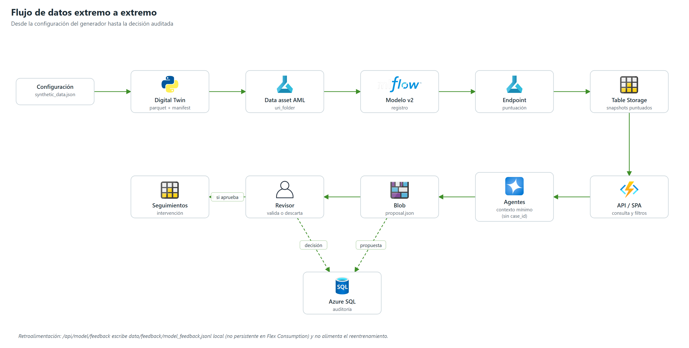

# 03 | Arquitectura de datos

## 1. Origen: Digital Twin sintético

`src/data_generation/generate_digital_twin.py` (versión 2.1.0) genera una población universitaria ficticia. No hay fuentes institucionales conectadas.

**Principio rector:** solicitar datos amplios, pero entrenar solo con variables disponibles antes de cada corte predictivo. Cada fila de la tabla principal representa lo que se sabía de un estudiante en un momento del semestre, sin información posterior. El Digital Twin respeta la estructura institucional (sedes, programas, jornadas), simula 10 periodos (5 años × 2 semestres) y está pensado para ser reemplazable por datos reales sin modificar el pipeline (sección 7).

### 1.1 Configuración (`configs/synthetic_data.json`)

| Parámetro | Valor | Variable de entorno |
|---|---|---|
| `students` | 30.000 | `SAT_SYNTHETIC_STUDENTS` |
| `seed` | 42 | `SAT_SYNTHETIC_SEED` |
| `start_period` · `period_count` | 2021-1 · 10 (hasta 2025-2) | `SAT_SYNTHETIC_PERIODS` |
| `cohort_start_periods` | 4 (ingresos 2021-1 a 2022-2) | — |
| `max_snapshot_rows` | 1.000.000 | `SAT_MAX_SNAPSHOT_ROWS` |
| `scenarios` | `low_prevalence` 0,6 · `baseline` 1,0 · `high_prevalence` 1,5 (multiplicador de riesgo) | `SAT_SYNTHETIC_SCENARIO` |
| `target.horizon_periods` | 2 | — |
| `target.observation_cut` | `CIERRE` | — |
| `outcome_followup_periods` · `followup_alignment` | 2 · `aligned` | — |

Salida por defecto: `data/synthetic_runs/<UTC>_<escenario>_<N>students/` (ruta ignorada por git), o `SAT_OUTPUT_DIR`.

**Distribución institucional simulada** (constantes `SEDES` y `PROGRAMAS` del generador):

| Sede | % matrícula | Modalidad principal |
|---|---:|---|
| Medellín (MED) | 45 % | Presencial |
| Virtual (VIR) | 25 % | Virtual |
| Cali (CAL) | 12 % | Presencial |
| Neiva (NEI) | 10 % | Presencial |
| Popayán (POP) | 8 % | Híbrida |

| Facultad | Programa (código) | % matrícula | Riesgo base por periodo |
|---|---|---:|---:|
| Ciencias de la Salud (40 %) | Fisioterapia (FIS) | 10 % | 3,5 % |
| | Fonoaudiología (FON) | 8 % | 3,2 % |
| | Terapia Ocupacional (TOP) | 8 % | 3,3 % |
| | Nutrición y Dietética (NUT) | 7 % | 3,2 % |
| | Actividad Física y Deporte (AFD) | 7 % | 3,8 % |
| Ciencias Empresariales (30 %) | Administración de Empresas (ADE) | 14 % | 4,5 % |
| | Contaduría Pública (CON) | 11 % | 4,8 % |
| | Administración en Salud, virtual (ASV) | 5 % | 6,0 % |
| Ingeniería (15 %) | Ingeniería de Software (SWE) | 15 % | 5,0 % |
| Ciencias Sociales (15 %) | Psicología (PSI) | 15 % | 4,2 % |

Todos los programas tienen 10 semestres; jornadas Diurna, Nocturna, Mixta y Virtual. Catálogos auxiliares: 9 tipos de financiación (recursos propios, ICETEX crédito/subsidio, becas de mérito, deporte y bienestar, crédito bancario, empresa, fondo territorial), 8 tipos de apoyo de bienestar, 9 tipos de solicitud y 20 municipios de residencia.

### 1.2 Tablas generadas (parquet)

| Archivo | Grano | Contenido |
|---|---|---|
| `estudiante_periodo_corte` | estudiante × periodo (corte único `CIERRE`) | 64 columnas: demografía, programa, sede, jornada, modalidad, académico, financiero, bienestar, LMS agregado, solicitudes |
| `target_trazabilidad` | estudiante × periodo | `target_desercion`, `target_observado`, `horizonte_periodos`, `periodo_inicio/fin_horizonte`, `evento_simulado`, reinscripción, graduación, transferencia, aplazamiento |
| `estudiante_asignatura_periodo` | estudiante × asignatura × periodo | Notas y asistencia por asignatura |
| `financiera_estudiante_evento` | evento | `liquidacion`, `pago_parcial`, `mora`; `bloqueo_activo` |
| `bienestar_acompanamiento` | sesión | `num_sesiones`, `canal`, `asistio`, `estado_seguimiento` |
| `solicitudes_estudiantiles` | solicitud | Trámites del periodo |
| `catalogos_programas` · `catalogos_sedes` · `catalogos_asignaturas` · `calendario_academico` | catálogo | 10 programas en 4 facultades; sedes MED, CAL, NEI, POP, VIR; ≈ 443 asignaturas |
| `generator_config.json` · `data_quality_report.json` · `dataset_manifest.json` | metadatos | SHA-256 por archivo; `dataset_version` = hash de configuración + archivos |

Identificadores con formato `ST-000001`. No se genera tabla LMS semanal ni cortes intermedios (INICIO, SEMANA_2/4/8). El catálogo de variables del diccionario institucional se conserva en `variables_catalog.txt`.

**Volúmenes registrados.** El dataset heredado de `data/raw/` (6.000 estudiantes) tiene 27.975 filas en `estudiante_periodo_corte` y en `target_trazabilidad`, 120.734 en `estudiante_asignatura_periodo`, 62.877 en `financiera_estudiante_evento`, 9.969 en `bienestar_acompanamiento` y 13.849 en `solicitudes_estudiantiles`; 3.025 positivos (10,8 %). La corrida de 100.000 estudiantes (generador 2.0.0) produjo 552.847 snapshots, 485.421 targets maduros y 2.394.881 filas de detalle académico. Las corridas por escala (6k–100k, versiones 2.0.0 y 2.1.0) con sus `dataset_version` y prevalencias están en [04](./04_Arquitectura_ML.md) §8.1, §9.2 y §9.9. Estos datos no se envían a los agentes LLM.

### 1.3 Definición del target

`target_desercion = 1` si ocurre un evento simulado de deserción en la ventana (T, T+2]. Graduación, transferencia o aplazamiento formal en la ventana dan 0. Si la ventana no se observó completa, `target_observado = False` y la etiqueta es nula; el entrenamiento **solo usa targets maduros**.

El riesgo simulado parte de una tasa base por programa (3,2 %–6,0 % por periodo) multiplicada por factores (primer semestre 1,45; jornada nocturna 1,30; estrato ≤ 2 1,35; mora 1,5; promedio < 3,0 1,6; virtual 1,25; beca 0,7; acompañamiento previo 0,88; entre otros), por el escenario, y acotada a [0,01; 0,95].

Factores completos (`generate_digital_twin.py`): primer semestre 1,45; jornada nocturna 1,30; estrato 1–2 1,35; mora activa 1,50; sin participación en "Te quiero en la U" 1,20; promedio < 3,0 1,60; modalidad virtual 1,25; trabaja 1,18; jefe de hogar 1,22; discapacidad 1,15 (solo ajuste estadístico); rezago > 2 semestres 1,40; historial de prueba académica 1,55; beca 0,70.

> **Diseño original (reemplazado).** La estrategia inicial proponía tasas aditivas: primer semestre 22 %; +8 % jornada nocturna; +10 % estrato 1–2; +15 % mora; +6 % sin "Te quiero en la U"; +20 % promedio < 3,0; +5 % Ingeniería de Software; +12 % virtual. El generador implementa en su lugar el modelo multiplicativo anterior.

### 1.3.1 Versión 2.1.0: alineación del seguimiento

Hasta la versión 2.0.0, el primer evento del seguimiento posterior al último snapshot se colocaba en el mismo periodo que el sorteo del propio último snapshot: las etiquetas de los dos últimos periodos acumulaban un sorteo de deserción adicional (prevalencia 27–30 % frente a 19–22 % en el resto). La 2.1.0 añade `followup_alignment`: `aligned` (por defecto) ubica los eventos de seguimiento un periodo después del snapshot virtual; `legacy` reproduce los datasets 2.0.0. Con `aligned`, la prevalencia de los dos últimos periodos queda en 0,197–0,218 en los siete tamaños evaluados (5k–100k), con prevalencia global 0,191–0,198. `tests/test_synthetic_generator.py` lo verifica con una prueba de regresión. Los datasets 2.0.0 y 2.1.0 no son comparables (detalle en [04](./04_Arquitectura_ML.md) §9.9).

### 1.4 Validaciones incorporadas

Clave primaria única, todas las sedes presentes, promedio en [0, 5], créditos ≥ 0, ambas clases del target presentes y target ausente de la tabla de predictores.

En el entrenamiento, `AgentQuality` (`src/agents/agent_quality.py`) evalúa 13 reglas, cada una con estado `cumple`, `no_cumple` o `no_evaluable`:

| Regla | Severidad |
|---|---|
| PK estudiante-periodo | Crítica |
| Integridad de sedes | Crítica |
| Fecha de corte y ausencia de fuga | Crítica |
| Consistencia temporal | Alta |
| Rangos académicos y porcentajes (promedios 0–5, porcentajes 0–100, créditos ≥ 0) | Alta |
| Catálogos normalizados (programa, modalidad, jornada, sede) | Alta |
| Faltantes explícitos | Alta |
| Cobertura histórica de cinco años | Alta |
| Tablas anexas relacionadas | Alta |
| Sesgo y equidad | Alta |
| Desbalance de clases | Alta |
| Reglas contables básicas (`creditos_aprobados + creditos_reprobados ≤ creditos_inscritos`) | Media |
| Versionado del dataset | Media |

Criterios de validez del Digital Twin fijados en el diseño, con su estado:

| Criterio | Estado |
|---|---|
| Tasa de deserción global 15–30 % (referencia Colombia); desertores ≈ 20–25 % | 2.1.0: prevalencia 19–20 % por snapshot; dataset heredado `data/raw`: 10,8 % |
| Promedios con media ≈ 3,5, desviación ≈ 0,6, escala 0–5 | Rango validado; media y desviación no verificadas en este documento |
| Cobertura de las 5 sedes y los 10 programas | Cumple (validación incorporada) |
| Correlaciones coherentes (estrato bajo ↔ mora ↔ deserción) | Por construcción del riesgo multiplicativo |
| Reglas críticas y altas de `AgentQuality` | Se evalúan en cada corrida |
| Modelos con F1 ≥ 0,70 | **No alcanzado de forma válida**: F1 0,24–0,50 en las corridas comparables; los F1 0,82–0,84 de las variantes 30k censurada y 100k (generador 2.0.0) van con 77–79 % de alertas y Brier 0,24–0,44 y no se reprodujeron (ver [04](./04_Arquitectura_ML.md) §5, §8–9) |

## 2. Contrato de variables del modelo

`src/ml/feature_engineering.py` define el contrato común a entrenamiento, endpoint y puntuación operativa:

- **52 variables crudas** (`REQUIRED_RAW_FEATURES`): 45 numéricas y 7 categóricas (`programa`, `sede`, `jornada`, `modalidad`, `genero`, `tipo_financiacion`, `tipo_ingreso`).
- **7 derivadas** (`engineer_features`): `mora_x_prueba`, `estrato_x_mora`, `engagement_x_promedio`, `riesgo_financiero_academico`, `desconexion_lms`, `primer_semestre`, `estudiante_vulnerable`.
- **Total: 59 entradas.** `promedio_semestre` no es variable, pero es reconstruible (`promedio_semestre_anterior + tendencia_promedio`), y `indice_riesgo_academico` y `en_prueba_academica_actual` incorporan información del semestre en curso: riesgo de fuga a considerar si se usan datos reales.

## 3. Datos operativos de la plataforma

La cohorte que ve la interfaz vive en Azure Table Storage (detalle en [08](./08_Arquitectura_BD.md)):

| Tabla | Contenido |
|---|---|
| `SyntheticStudents` | Perfil del estudiante (nombre ficticio, programa, sede, semestre, estrato) |
| `SyntheticSnapshots` | Periodo 2025-2, corte `SEMANA_4`: `ModelProbability`, `RiskLevel`, `ModelName`, `ModelVersion`, `ScoredAt`, `FeaturesJson`, `Status`, `ReviewId` |
| `SyntheticAcademic` · `SyntheticFinance` · `SyntheticWellbeing` | Señales que reciben los agentes |
| `SyntheticTargets` | Target separado; **los agentes nunca lo consultan** |
| `SyntheticAlerts` · `SyntheticFollowups` | Alertas por regla de riesgo y seguimientos |
| `SyntheticDashboardTrends` · `SyntheticControl` | Tendencia simulada y control de la POC |
| `SyntheticBatches` · `SyntheticAgentResults` | Estado de lotes y respuestas de agentes |

**Tamaño:** por defecto 20.000 estudiantes (`SYNTHETIC_STUDENT_COUNT`, máximo 100.000; arranque en frío 5.000). La cohorte desplegada tiene **15.000 estudiantes** puntuados con el modelo v2. Las etiquetas de snapshot `SEMANA_4` se construyen a partir de variables generadas en el corte `CIERRE`.

Existen dos orígenes de cohorte en el código: `training_cohort.py` (desde un dataset del generador, puntuada por el endpoint; vigente) y `synthetic_database._generate_entities` (arranque en frío con probabilidad heurística; reemplazado por `scripts/replace_legacy_cohort.py`).

La cohorte de 15.000 reemplazó a la inicial de 5.000 el 2026-11-10. Conteo observado en Azure el 2026-11-12: 15.000 filas en estudiantes, snapshots, targets, finanzas y bienestar, y 44.994 registros académicos. Esta cohorte operativa es una población distinta de los datasets de investigación (sección 1.2): no se suman ni se presentan como una sola población. El libro `diccionario_datos_SAT_desercion_FUMC.xlsx` es el diccionario y contrato de tablas; no contiene filas de estudiantes.

## 4. Zonas de datos

| Zona | Ubicación | Gobierno |
|---|---|---|
| Datos crudos sintéticos | `data/raw/` (heredado, 6.000 estudiantes) · `data/synthetic_runs/` | Local, ignorado por git |
| Procesados | `data/processed/` (calidad, fairness, SHAP, promoción) | Local, ignorado |
| Entrenamiento en la nube | Data asset `sat-fumc-synthetic-100k:1` | Azure ML |
| Predicciones | `SyntheticSnapshots` (operativo); `data/predictions/` (local) | Tables / local |
| Propuestas y decisiones | Blob `student-case-reviews` | Escritura única para aprobaciones |
| Auditoría | Azure SQL `SATFUMCOperational` | Sin identificadores directos |
| Retroalimentación | `data/feedback/model_feedback.jsonl` | Local a la instancia; **no persistente en Flex Consumption** y no alimenta el reentrenamiento |

## 5. Minimización hacia el LLM

`AnalysisCase.agent_context()` envía solo: probabilidad, mora (meses y saldo), estrato, ciudad, contexto familiar, señales por asignatura (código, nota, asistencia) y bienestar (tipo de apoyo, sesiones, asistencia, canal). No envía `case_id`, nombre, documento ni el target.

## 6. Cortes predictivos del diseño (objetivo, no implementado)

El diseño preveía un snapshot por `(estudiante, periodo, corte)` con solo las variables disponibles antes de cada corte. El generador produce únicamente `CIERRE`; los demás cortes requieren datos institucionales con marca temporal.

| Corte | Momento | Variables disponibles | Uso operativo previsto |
|---|---|---|---|
| `INICIO` | Inicio del semestre | Historial, matrícula, trayectoria, sociodemografía | Priorización preventiva |
| `SEMANA_2` | Semana 2 | + LMS semana 2, pago inicial, asistencia inicial | Alertas de desconexión |
| `SEMANA_4` | Semana 4 | + LMS y asistencia semana 4, mora, solicitudes | Alerta temprana operativa principal |
| `PRIMER_CORTE` | Tras el primer corte evaluativo | + notas del primer corte, cursos en riesgo | Riesgo académico-financiero |
| `SEMANA_8` | Semana 8 | + todo lo acumulado | Seguimiento intermedio |
| `CIERRE` | Fin de semestre | Datos finales completos | Análisis retrospectivo (único corte implementado) |

Tablas del diseño que el generador no produce: `lms_estudiante_curso_semana` (accesos, días activos, tareas vencidas, entregas, foros y evaluaciones por curso y semana) y `perfilamiento_calidad_datos` (cobertura, faltantes y cambios de definición por variable).

## 7. Plan de transición a datos reales

1. `AgentIngestion` reemplaza la ruta del dataset sintético por la fuente institucional autorizada.
2. `AgentQuality` aplica las mismas reglas; el diccionario de datos es la fuente de verdad.
3. `engineer_features` y el contrato de variables se mantienen sin cambios.
4. Se reentrena el modelo con datos reales y se versiona en MLflow / Azure ML.
5. El Digital Twin se archiva para referencia y auditoría.
