# 04 | Arquitectura de Machine Learning

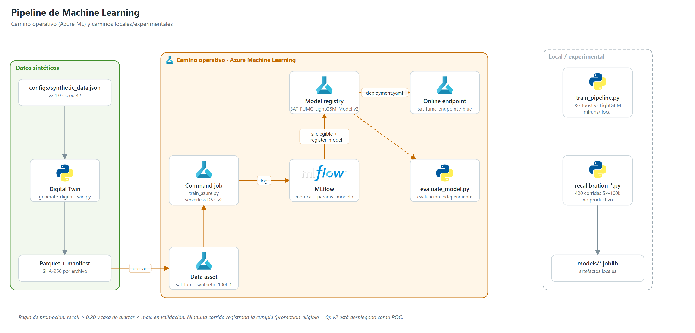

## 1. Caminos de entrenamiento

| Camino | Código | Algoritmos | Estado |
|---|---|---|---|
| **Operativo (Azure ML)** | `azure/train_azure.py` + `azure/components/job.yaml` | LightGBM calibrado (6 candidatos) | Produjo el modelo desplegado v2 |
| Local | `src/ml/train_pipeline.py` | XGBoost vs LightGBM | Artefactos en `models/`, `mlruns/` |
| Experimental | `scripts/recalibration_*.py` | LightGBM, XGBoost, regresión logística; ponderación, remuestreo, calibración OOF | No productivo |

## 2. Flujo de entrenamiento operativo

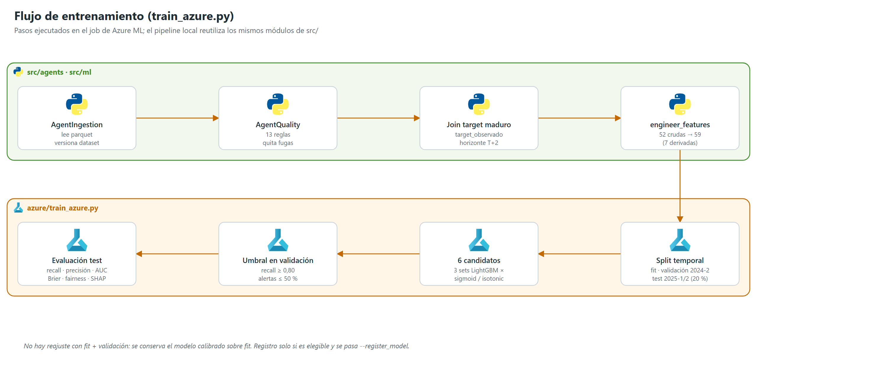

1. **Ingesta** (`AgentIngestion`): lee el parquet y calcula la versión del dataset (SHA-256).
2. **Calidad** (`AgentQuality`): 13 reglas; elimina columnas con fuga.
3. **Unión del target maduro**: solo filas con `target_observado = True`.
4. **Variables**: `engineer_features` (52 → 59).
5. **Partición temporal por estudiante** (`temporal_group_train_validation_test_split`): test = 20 % de estudiantes en los dos últimos periodos (2025-1/2); validación = 20 % de otros estudiantes en 2024-2; *fit* = periodos anteriores sin esos estudiantes.
6. **Candidatos**: 3 configuraciones LightGBM (350 árboles, lr 0,04, profundidad 7, 31 hojas, y variantes ×0,75 / ×1,25) × calibración sigmoide o isotónica (`CalibratedClassifierCV`, cv=3), `class_weight='balanced'`.
7. **Umbral** (`select_recall_threshold`): en validación, el de mayor precisión con recall ≥ 0,80 y tasa de alertas ≤ `max_alert_rate` (0,50 en `job.yaml`).
8. **Evaluación en test**: recall, precisión, F1, AUC-ROC, AUC-PR, Brier, tasa de alertas, matriz de confusión, brechas de recall por género/estrato/programa/modalidad/sede, importancia SHAP.
9. **Registro**: solo si el candidato es elegible **y** se pasa `--register_model` → `SAT_FUMC_LightGBM_Model` en MLflow/Azure ML.

No se reajusta con *fit* + validación: se conserva el modelo calibrado sobre *fit*.

**Infraestructura del job**: cómputo serverless `Standard_DS3_v2`, imagen `mcr.microsoft.com/azureml/openmpi4.1.0-ubuntu22.04`, entorno `conda.yaml` (mlflow 2.17.2, lightgbm 4.5.0, scikit-learn 1.5.2, shap 0.46.0). Experimento `SAT-FUMC-Desercion-Foundry` (YAML) / `SAT-FUMC-Foundry` (código).

## 3. Flujo de inferencia

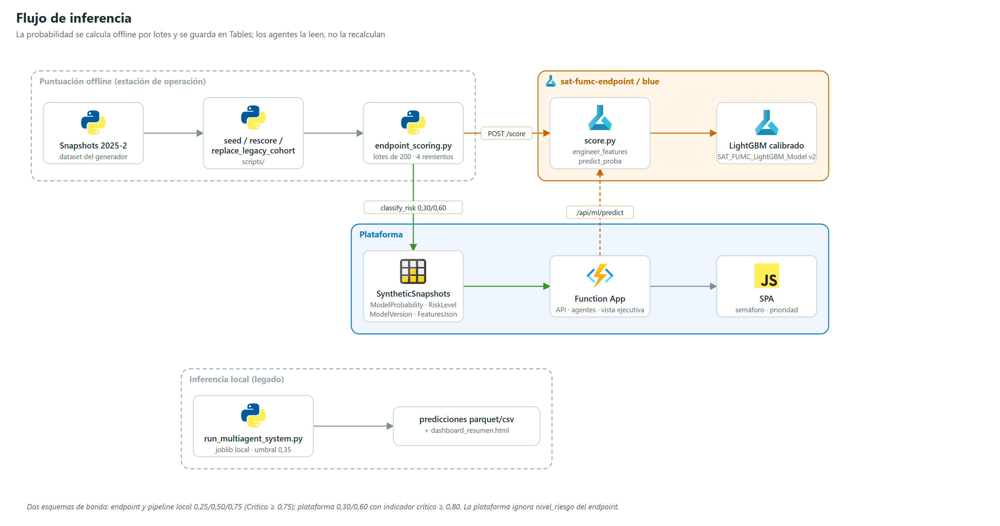

### 3.1 Endpoint gestionado

| Elemento | Valor |
|---|---|
| Endpoint | `sat-fumc-endpoint` (`auth_mode: key`) |
| Despliegue | `blue`, `Standard_DS2_v2` × 1, entorno `sat-fumc-online:4` |
| Modelo | `SAT_FUMC_LightGBM_Model:2` |
| Código | `endpoints/model_code/score.py` |
| Entrada | `{"data": [{…52 variables…}]}`, 1–1000 registros (`MAX_BATCH_SIZE=1000`) |
| Salida | `{"status":"success","predictions":[{"probabilidad_desercion", "nivel_riesgo", "alerta_activa"}]}` |
| Umbral | `decision_threshold_` del modelo (0,35 si falta), sobrescribible con `ALERT_THRESHOLD` |

### 3.2 Puntuación operativa (offline)

`src/ml/endpoint_scoring.py` envía lotes de 200 con 4 reintentos (backoff 2 s·2ⁿ ante 408/429/5xx). Los scripts `seed_operational_data.py`, `rescore_students.py` y `replace_legacy_cohort.py` escriben en `SyntheticSnapshots` la probabilidad, el nivel de riesgo (recalculado con `policy.classify_risk`), el nombre y versión del modelo y las variables usadas (`FeaturesJson`). Ejecución registrada: **15.000 estudiantes puntuados con v2** el 2026-11-09.

### 3.3 Otras rutas

- `POST /api/ml/predict`: proxy autenticado al endpoint; requiere `AZURE_ML_ENDPOINT_URL/KEY`, que Bicep no define. La SPA no lo usa.
- `src/run_multiagent_system.py`: inferencia local con `joblib` (umbral 0,35) y salida a parquet/CSV + `dashboard_resumen.html`.

## 4. Bandas de riesgo: dos esquemas en el código

| Componente | Bajo | Medio | Alto | Crítico |
|---|---|---|---|---|
| Endpoint (`score.py`), `train_azure`, `train_pipeline`, `AgentPrediction` | < 0,25 | ≥ 0,25 | ≥ 0,50 | ≥ 0,75 |
| Plataforma (`policy.classify_risk`, `executive.risk_band`) | < 0,30 | ≥ 0,30 | ≥ 0,60 | ≥ 0,80 (indicador operativo) |

La plataforma ignora `nivel_riesgo` del endpoint y reclasifica la probabilidad. Unificar los umbrales es una tarea pendiente.

## 5. Resultados registrados (datos sintéticos)

**Pipeline local** (dataset heredado `data/raw`, test de 1.404 filas):

| Modelo | Recall | Precisión | F1 | AUC-ROC | AUC-PR | Brier | Alertas | Umbral | Elegible |
|---|---|---|---|---|---|---|---|---|---|
| LightGBM | 0,808 | 0,142 | 0,241 | 0,676 | 0,235 | 0,163 | 61,3 % | 0,283 | No |
| XGBoost | 0,768 | 0,136 | — | 0,676 | — | — | 61,0 % | 0,258 | No |

Detalle de `data/processed/model_promotion.json` (LightGBM): `dataset_version` `74c47f95ff2083592b9c06c03113d5655f84119df444a03c8be3d1f7f4f3118e`; test 2025-1/2025-2; umbral elegido en 2024-2 (0,283308; recall de validación 0,809); recall mínimo 0,80 sin tope de alertas (`max_alert_rate = null`); `promotion_eligible = false`.

| | Predicho 0 | Predicho 1 |
|---|---:|---:|
| **Real 0** | 515 (VN) | 738 (FP) |
| **Real 1** | 29 (FN) | 122 (VP) |

**Modelo desplegado v2**: sus métricas viven en la corrida de Azure ML; `scripts/evaluate_model.py` las reproduce de forma independiente.

**Experimentos de escala y recalibración 5k–100k** (detalle completo en las secciones 8 y 9): AUC 0,63–0,69; con política de capacidad del 40 % de alertas, recall 0,54–0,60; con recall 0,80 en validación, 51–58 % de alertas. El AUC del modelo coincide con el del "oráculo" del generador (diferencia ≤ 0,007): el techo es propiedad de los datos sintéticos.

**Regla de promoción** (`train_azure.py`): recall ≥ 0,80 y alertas ≤ máximo. **Ninguna corrida la cumple** (`promotion_eligible = 0`); la configuración experimental final (regresión logística + política de capacidad) no está implementada en producción.

## 6. MLOps

| Práctica | Estado |
|---|---|
| Versionado de datos | `dataset_manifest.json` con SHA-256; data assets AML versionados |
| Seguimiento de experimentos | MLflow (AML y `mlruns/` local) |
| Registro de modelos | Azure ML Model Registry (v1 carga manual, v2 desplegado) |
| Despliegue | Manual con `deployment.yaml` |
| Trazabilidad de predicciones | `ModelName`/`ModelVersion`/`ScoredAt` por snapshot; `ModelRelease`/`Prediction` en SQL |
| Equidad | Brechas de recall por grupo en cada corrida; `fairness_report` |
| Retroalimentación | Registro local de feedback de revisores; no conectado al reentrenamiento |
| Reentrenamiento automático, monitoreo de deriva | No implementados |

## 7. Diseño metodológico del modelo (objetivos y estado de implementación)

Esta sección conserva el diseño metodológico original del modelo. Lo marcado como **objetivo** o **no implementado** no describe el comportamiento actual del código; el comportamiento real está en las secciones 1–6.

### 7.1 Definición formal del problema

| Elemento | Diseño | Estado |
|---|---|---|
| Tipo de tarea | Clasificación binaria supervisada sobre `target_desercion` ∈ {0, 1} | Implementado |
| Unidad de predicción | Estudiante × periodo × corte | Implementado con corte único `CIERRE` (ver [03](./03_Arquitectura_Datos.md)) |
| Momento de predicción | Antes de cada corte predictivo (inicio, semana 2, 4, 8, primer corte) | **Objetivo, no implementado** |
| Target | 1 si estaba matriculado en T y no se reinscribe en T+1 ni T+2, sin graduación, transferencia interna formal ni aplazamiento aprobado hasta T+2 | Implementado como evento simulado en (T, T+2] con `target_observado` |

### 7.2 Grupos de variables del diseño original

| Grupo | Variables previstas | En el contrato actual (`feature_engineering.py`) |
|---|---|---|
| A — críticas (V1, desde el inicio del semestre) | `cohorte_ingreso`, `semestres_cursados`, `avance_plan_pct`, `rezago_academico`, `promedio_semestre_anterior`, `historial_prueba_academica`, `creditos_inscritos`, `num_materias_perdidas`, `estrato_socioeconomico`, `trabaja`, `jornada`, `modalidad`, `sede`, `programa`, `tipo_financiacion`, `puntaje_matematicas`, `puntaje_global_prueba_ingreso` | Todas salvo `cohorte_ingreso` |
| B — señales tempranas (semanas 2–4) | `engagement_lms`, `asistencia_pct_semana4`, `saldo_mora`, `bloqueo_financiero`, `num_solicitudes_radicadas`, `tareas_vencidas_semana4` | `engagement_lms`, `saldo_mora`, `bloqueo_financiero`; equivalentes agregados por semestre `num_solicitudes_periodo` y `tareas_vencidas`. Las variables por semana **no existen** |
| C — riesgo académico (tras el primer corte) | `nota_primer_corte_promedio`, `num_cursos_nota_menor_3`, `creditos_en_riesgo` | **No implementadas** |
| D — derivadas recomendadas | `tasa_aprobacion` (= aprobados / inscritos), `intensidad_perdida` (= perdidas / inscritas), `indice_riesgo_academico` (= f(promedio, rezago, historial de prueba)), `tendencia_financiera` (= Δ `saldo_mora`), `participacion_te_quiero_en_la_u`, `periodo_ordinal_estudiante`, `antiguedad_institucional_periodos` | Todas salvo `periodo_ordinal_estudiante`; la participación entra como `asistio_tquieroenlaU` |

### 7.3 Variables prohibidas

Nunca deben entrar como predictores. `AgentQuality.VARS_PROHIBIDAS` (`src/agents/agent_quality.py`) las elimina por coincidencia de nombre:

| Variable | Motivo |
|---|---|
| `target_desercion`, `target_observado`, `horizonte_periodos`, `periodo_inicio/fin_horizonte`, `evento_simulado` | Objetivo y su trazabilidad |
| `reinscrito_t1/t2`, `no_reinscrito_t1/t2`, `graduado_hasta_t2`, `transferencia_interna_hasta_t2`, `aplazamiento_formal_hasta_t2` | Información posterior al momento de predicción |
| `fecha_retiro`, `motivo_retiro`, `tipo_retiro`, `causa_no_continuidad*`, `fecha_graduacion`, `fecha_egreso`, `cumple_requisitos_grado` | Revelan el desenlace |
| `estado_academico_t`, `condicion_academica_cierre`, `promedio_final_periodo`, `estado_financiero_t`, `estado_financiero_cierre_periodo` | Estado al cierre, posterior al corte |
| `probabilidad_riesgo_simulada`, `nivel_riesgo_simulado` | Salidas del generador |

El diseño también excluía `nota_final` y `promedio_semestre` del periodo en curso en modelos tempranos. `promedio_semestre` no es variable del contrato, aunque es reconstruible (ver [03](./03_Arquitectura_Datos.md) §2).

### 7.4 Preprocesamiento implementado

`train_azure.py` y `train_pipeline.py` usan el mismo `ColumnTransformer`: numéricas con `SimpleImputer(median)` + `StandardScaler`; categóricas con `SimpleImputer(most_frequent)` + `OrdinalEncoder(handle_unknown="use_encoded_value", unknown_value=-1)`. El diseño original preveía *target encoding* para `programa` y `sede`; **no se implementó**.

### 7.5 Metas de evaluación (objetivo, no alcanzadas)

Criterios de aceptación del diseño, no resultados. Ninguna corrida registrada los cumple (secciones 5 y 8–9); la regla de promoción implementada es solo recall ≥ 0,80 + tope de alertas.

| Métrica | Meta | Justificación |
|---|---|---|
| Recall | ≥ 0,80 | No perder desertores reales (alto costo del falso negativo) |
| F1 | ≥ 0,75 | Balance precisión-recall |
| AUC-ROC | ≥ 0,80 | Discriminación global |
| Precisión | ≥ 0,70 | Evitar sobrecarga de consejería |
| Brier | ≤ 0,15 | Calibración |
| Equidad (ΔRecall) | ≤ 0,10 entre grupos | Sedes, programas, géneros |

### 7.6 Desbalance de clases

La documentación preliminar estimaba 20–25 % de desertores; el snapshot heredado de `data/raw` tenía 3.025 positivos en 27.975 registros (10,8 %). Los datasets 2.1.0 tienen prevalencia 19–20 % (sección 9.9).

| Estrategia | Estado |
|---|---|
| `class_weight='balanced'` | Implementada (LightGBM en AML y local) |
| `scale_pos_weight = n_neg / n_pos` | Implementada en XGBoost local |
| Umbral desplazado por debajo de 0,5 | Implementado: umbral elegido en validación; 0,35 como valor por defecto del endpoint |
| SMOTE | **No implementado ni probado** (las categóricas ordinales lo hacen poco apropiado) |
| Pesos, sub/sobremuestreo | Evaluados en la recalibración: no mejoran el ranking (sección 9.4) |

### 7.7 Acción recomendada por nivel de riesgo (propuesta operativa)

Usa las bandas de la plataforma (`policy.classify_risk`). Las acciones y plazos son una propuesta del diseño, no un flujo automatizado.

| Nivel | Probabilidad | Acción recomendada | Urgencia |
|---|---|---|---|
| Bajo | < 0,30 | Seguimiento rutinario | Próxima semana |
| Medio | 0,30–0,60 | Contacto preventivo del consejero | Esta semana |
| Alto | 0,60–0,80 | Intervención directa y plan de acción | 48 horas |
| Crítico | ≥ 0,80 | Intervención inmediata y escalamiento a coordinación | Hoy |

## 8. Experimentos de escala (generador 2.0.0, corte 2026-11-10)

Corridas aisladas en directorios temporales (`%TEMP%\fumc-phase2-*`) y MLflow local. Todas son sintéticas, con el generador 2.0.0 (etiquetas de los dos últimos periodos con un sorteo de deserción adicional, prevalencia 27–30 % frente a 19–22 %; ver sección 9.3, C2) y **no son comparables** con las cifras del generador 2.1.0. Ninguna es elegible para promoción. Las métricas de experimentos distintos no se promedian; cada una debe informarse con `dataset_version`, target maduro, partición, modelo/calibración, umbral y tasa de alertas.

### 8.1 Generación de datos por escala

| Estudiantes solicitados | Escenario/semilla | Snapshots | Etiquetas maduras | Etiquetas inmaduras | Filas de asignaturas | Prevalencia madura | Estado |
|---:|---|---:|---:|---:|---:|---:|---|
| 6.000 | baseline / 42 | 33.122 en la generación corregida calibrada | 33.122 | 0 | 143.328 | 21,12 % | Generación aislada en TEMP; usada en un run calibrado de 6k |
| 10.000 | baseline / 42 | 55.105 | 55.105 | 0 | 238.518 | 20,86 % | Generado, evaluado con LightGBM local y subido al Workspace AML |
| 30.000 | baseline / 42 | 166.163 en una variante calibrada; 165.626 en la variante censurada final | 166.163 / 165.626 | 0 / 20.352 | 719.912 / 717.489 | 20,79 % / 21,72 % | Más de una versión de dataset; no combinar sus métricas |
| 50.000 | baseline / 42 | 277.814 | 260.668 | 17.146 | 1.203.610 | 20,11 % | Generación completa; sin run de modelo |
| 100.000 | baseline / 42 | 552.847 | 485.421 | 67.426 | 2.394.881 | 21,78 % | Generación optimizada completa; modelo evaluado en local y artefactos subidos al Workspace AML |

`dataset_version` de 100k: `f20993a132c5cea0c50dd682c444e42e2785a3e1dc7ad35372516a5793348cbe`; de 50k: `36182991a506b11ae2d9815a69591fe79dbfdd9941dafb09849427639bd3c219`. Los Parquet completos quedaron fuera del repositorio. El dataset heredado de `data/raw/` (6.000 estudiantes, 27.975 snapshots) es otro artefacto, distinto de las corridas temporales de 6k (33.122–33.228 snapshots).

### 8.2 Comparación baseline por escala (LightGBM, MLflow local)

Escenario baseline, semilla común. El número de estudiantes es la escala solicitada, no el tamaño del test; el umbral no se elige en test.

| Escala | `dataset_version` (prefijo) | Recall test | Precisión | F1 | AUC-ROC | AUC-PR | Brier | Tasa de alertas | Elegible |
|---:|---|---:|---:|---:|---:|---:|---:|---:|---|
| 6k | `64c9f682` | 0,6971 | 0,3194 | 0,4381 | 0,6071 | 0,3929 | 0,2348 | 62,52 % | No |
| 15k | `45d5bab6` | 0,8069 | 0,3090 | 0,4469 | 0,6456 | 0,3827 | 0,2328 | 65,32 % | No |
| 30k | `26a379ce` | 0,7731 | 0,3313 | 0,4639 | 0,6679 | 0,4236 | 0,2333 | 61,31 % | No |

El 15k supera recall 0,80, pero con más de 65 % de alertas y `promotion_eligible = 0`.

### 8.3 Entrenamientos locales 10k y 100k

Misma configuración LightGBM acotada; umbral elegido en validación; test con estudiantes no vistos.

| Estudiantes | Snapshots total / maduros | Test (estudiantes) | Recall | Precisión | F1 | AUC-ROC | AUC-PR | Brier | Tasa de alertas | Umbral | Promoción |
|---:|---:|---:|---:|---:|---:|---:|---:|---:|---:|---:|---|
| 10.000 | 55.105 / 55.105 | 1.656 | 0,8453 | 0,3244 | 0,4689 | 0,6547 | 0,4050 | 0,1855 | 70,17 % | 0,216940 | No |
| 100.000 | 552.847 / 485.421 | 3.321 | 0,8162 | 0,8737 | 0,8440 | 0,6480 | 0,9001 | 0,4367 | 78,68 % | 0,188067 | No |

La precisión y F1 altas del 100k contrastan con su Brier 0,4367 y 78,68 % de alertas; no es una mejora. La recalibración no la reprodujo (sección 9.3, C5).

### 8.4 Corridas calibradas con versiones posteriores

Cambian `dataset_version`, el tratamiento de outcomes inmaduros, la calibración o la partición; no se mezclan con 8.2.

| Escala / variante | `dataset_version` (prefijo) | Test (estudiantes) | Recall | Precisión | F1 | AUC-ROC | AUC-PR | Brier | Alertas | Elegible |
|---|---|---:|---:|---:|---:|---:|---:|---:|---:|---|
| 6k calibrado | `f8ad0e29` | 544 | 0,7796 | 0,3522 | 0,4852 | 0,6478 | 0,4748 | 0,1998 | 66,70 % | No |
| 30k calibrado, todos los targets maduros | `d1eb8027` | 2.706 | 0,7917 | 0,3618 | 0,4966 | 0,6741 | 0,4473 | 0,1882 | 62,03 % | No |
| 30k variante censurada | `3111774d` | 642 | 0,7876 | 0,8614 | 0,8228 | 0,6141 | 0,9027 | 0,2365 | 77,15 % | No |

La variante censurada 30k tiene 145.274 outcomes maduros y 20.352 inmaduros en 165.626 snapshots.

### 8.5 Sensibilidad a la prevalencia (6k)

| Escenario | Prevalencia del target maduro | Recall | Precisión | F1 | AUC-ROC | AUC-PR | Brier | Alertas | Elegible |
|---|---:|---:|---:|---:|---:|---:|---:|---:|---|
| Baja | 13,51 % | 0,7482 | 0,2409 | 0,3644 | 0,6233 | 0,2931 | 0,1552 | 61,71 % | No |
| Alta | 28,54 % | 0,7617 | 0,4953 | 0,6003 | 0,6922 | 0,5650 | 0,2209 | 60,34 % | No |

### 8.6 Assets cargados en Azure Machine Learning

Workspace `FUMC_Analytics_Core` (grupo `FUMC.CaseReviewer`), datastore `workspaceblobstore`, assets URI-folder versión 1:

| Asset AML | Contenido | Tamaño local aprox. |
|---|---|---:|
| `sat-fumc-synthetic-10k:1` | Dataset 10.000 estudiantes, seed 42, baseline; manifest, calidad y Parquet | 5,24 MiB |
| `sat-fumc-10k-training-results:1` | Joblib, manifest/umbral, métricas, predicciones, fairness, SHAP y curvas | 7,93 MiB |
| `sat-fumc-synthetic-100k:1` | Dataset 100.000 estudiantes, 552.847 snapshots con manifest | 52,11 MiB |
| `sat-fumc-100k-training-results:1` | Joblib y artefactos de evaluación 100k; candidato no promovido | 55,06 MiB |

Estos entrenamientos de escala se ejecutaron en local; a la fecha del corte (2026-11-10) no se había usado cómputo de Azure ML para ellos. El modelo desplegado v2 se entrenó después con el job de la sección 2.

## 9. Recalibración 5k–100k (corte 2026-11-11)

Datos sintéticos, escenario `baseline`, semilla de datos 42. §9.2–9.8 usan el generador **2.0.0** (`followup_alignment: legacy`); §9.9 repite el análisis con el generador **2.1.0** corregido y es la referencia vigente. Código: `scripts/recalibration_lib.py`, `scripts/recalibration_experiments.py`, `scripts/recalibration_report.py`. Resultados: `outputs/recalibration/` (`matriz_consolidada.csv`, `resumen_etapas.csv`, `estabilidad_multisemilla.csv`, `bootstrap_estudiantes.csv`, `estadistica.json`, `tablas.md`, `figs/`, `scores/`, `results_*.csv`) y `outputs/recalibration/v2_generador_corregido/`. Nada de esto se implementó en producción.

### 9.1 Conclusión

**Ninguna configuración es promovible, y la causa no es el ajuste del modelo.** El modelo recalibrado alcanza el techo de información de los datos: su AUC es estadísticamente indistinguible del de un *oráculo* que conoce la función de riesgo del generador.

| Generador 2.0.0 | Baseline del proyecto | Configuración final |
|---|---:|---:|
| AUC-ROC (media 7 tamaños) | 0,653 | **0,669** |
| Brier / ECE | 0,234 / 0,207 | **0,187 / 0,039** |
| % alertas con la regla «recall ≥ 0,80 en validación» | 62,3 % | **53,9 %** |
| Recall con esa regla | 0,762 | 0,707 |
| Recall con **40 %** de alertas | 0,558 | **0,571** |
| Dispersión del AUC entre tamaños (sd) | 0,027 | **0,017** |

Para recall ≈ 0,80 hay que alertar ≈ 63–69 % de los estudiantes en todos los tamaños; con 40 % de alertas el recall máximo observado es ≈ 0,57–0,60. **Ninguna de las 420 corridas finales con 2.0.0 (7 tamaños × 10 semillas × 2 protocolos × 3 políticas) ni de las 210 con 2.1.0** cumple a la vez recall ≥ 0,75, alertas ≤ 50 % y precisión ≥ 0,30.

| Decisión de referencia | Valor | Motivo |
|---|---|---|
| Variables | Contrato + 8 transformaciones determinísticas de las mismas columnas | +0,005 AUC; sin fuentes nuevas |
| Modelo | Regresión logística L2 (C = 0,1), imputación por mediana con indicador de faltante | AUC igual a LightGBM/XGBoost (< 0,003), mejor calibración (ECE 0,039), menor varianza entre tamaños |
| Desbalance | Sin pesos ni muestreo | No mejoran el ranking; con pesos balanceados el ECE sube de 0,04 a 0,22 |
| Calibración | Ninguna adicional | La logística ya sale calibrada |
| Decisión | Política de capacidad: alertar al top-k % por ciclo, k fijado por la universidad | Fija la carga por construcción; la regla recall ≥ 0,80 daba 52–65 % de alertas y no se transfería a test |
| Variables de trayectoria | No incluidas | ΔAUC −0,0013 (logística) y +0,0002 (LightGBM) |

### 9.2 Protocolo y criterios (fijados antes de iterar)

- **Variables:** el contrato de `src/ml/feature_engineering.py` más transformaciones determinísticas de esas columnas: promedio del semestre en curso (`promedio_semestre_anterior + tendencia_promedio`), indicadores de promedio < 3,0, mora > 0, rezago > 15, estrato ≤ 2, sin apoyo de permanencia, y producto de factores.
- **Tamaños:** 5.000, 10.000, 15.000, 25.000, 50.000, 75.000 y 100.000 **estudiantes** (≈ 5,5 snapshots por estudiante); sin etiquetas inmaduras.
- **Partición (como `train_pipeline.py`):** test = 20 % de estudiantes disjuntos en los dos últimos periodos; validación = un periodo previo con otro 20 %; umbral elegido solo en validación; reajuste posterior con fit + validación.
- **Criterio de promovibilidad por corrida** (el enunciado no fijaba cifras): recall ≥ 0,75; alertas ≤ 50 % (≤ 40 % deseable); precisión ≥ 0,30 (≈ 1,1–1,5 × la prevalencia), en **todos** los tamaños.
- **Evidencia estadística:** 10 semillas de partición por tamaño y protocolo; IC95 % t entre semillas; bootstrap por estudiante (400 remuestras); ANOVA entre tamaños; t de una muestra contra 0,80.
- **Políticas de decisión:** `recall80_val` (mayor precisión con recall ≥ 0,80 en validación), `cap40_topk` y `cap50_topk` (alertar al 40 % / 50 % de mayor riesgo).
- **Protocolos:** proyecto (test 2025-1/2025-2) y ventana estacionaria (test 2024-1/2024-2).

Datasets 2.0.0 (regenerables con `SAT_SYNTHETIC_STUDENTS=<n> SAT_MAX_SNAPSHOT_ROWS=<10n> SAT_SYNTHETIC_SEED=42 SAT_OUTPUT_DIR=<dir> python src/data_generation/generate_digital_twin.py` y `followup_alignment: "legacy"`):

| Estudiantes | `dataset_version` (prefijo) | Snapshots | Prevalencia |
|---:|---|---:|---:|
| 5.000 | `a917b077569c` | 27.459 | 21,27 % |
| 10.000 | `443c5cbd0c9e` | 55.105 | 20,86 % |
| 15.000 | `9880f71bd11f` | 83.335 | 20,75 % |
| 25.000 | `30887b1dc3c6` | 139.067 | 20,75 % |
| 50.000 | `15b201d81d2a` | 275.869 | 20,93 % |
| 75.000 | `523102e1b66f` | 416.227 | 20,78 % |
| 100.000 | `fb5d4ccc9fd2` | 553.822 | 20,84 % |

### 9.3 Causas raíz de los comportamientos contradictorios

**C1. Techo de información (causa principal).** El generador sortea la deserción con un riesgo instantáneo `h` (media 0,107) construido con las variables del contrato, y la etiqueta cubre además un sorteo futuro no observable. Reconstruyendo `h` (diagnóstico, nunca usado como variable), protocolo del proyecto, 10 semillas:

| size | AUC_modelo | AUC_oraculo | brecha_media | brecha_ic95 |
|---|---:|---:|---:|---:|
| 5.000 | 0,657 | 0,655 | -0,002 | 0,005 |
| 10.000 | 0,668 | 0,673 | 0,004 | 0,006 |
| 15.000 | 0,671 | 0,671 | 0 | 0,004 |
| 25.000 | 0,679 | 0,676 | -0,003 | 0,002 |
| 50.000 | 0,664 | 0,663 | -0,001 | 0,001 |
| 75.000 | 0,673 | 0,671 | -0,002 | 0,001 |
| 100.000 | 0,671 | 0,670 | -0,001 | 0,001 |

Incluso el oráculo, con 40 % de alertas, tiene recall 0,58 (50 %: 0,67; 70 %: 0,84). Para recall 0,80 con 40 % de alertas y prevalencia ≈ 0,21 haría falta AUC ≈ 0,84 (aproximación binormal), frente a 0,67.

**C2. Etiquetas no estacionarias en los dos últimos periodos.** La prevalencia sube de 19–22 % a 27–30 % en 2025-1/2025-2 mientras `h` no cambia (0,10–0,11): el bloque de seguimiento posterior al último snapshot añadía un sorteo de deserción (≈ 3 sorteos en la ventana frente a ≈ 2). El umbral fijado en validación (prevalencia 0,22–0,25) se desplazaba en test (0,27–0,29). Corregido en 2.1.0 (§9.9).

**C3. Ruido de muestreo en tamaños pequeños.** Con 5k, la validación tiene 418 filas y el test 826. La sd del AUC entre semillas es 0,018 (5k) frente a 0,005 (100k); la de las alertas con `recall80_val`, 0,059 frente a 0,015. Las diferencias de recall entre tamaños (0,69 en 5k; 0,79–0,80 en 10k/15k/100k) están dentro de ese ruido; el oráculo también oscila entre 0,63 y 0,69 en test.

**C4. Regla de umbral frágil.** «Mayor precisión con recall ≥ 0,80 en validación» elige un punto del borde de una curva casi plana; con `class_weight='balanced'` el umbral absoluto (0,38–0,45) no se transfiere (ECE 0,22). Origina las alertas de 56–68 % del baseline.

**C5. El 100k previo (precisión 0,87, Brier 0,44)** no se reprodujo: sin etiquetas inmaduras, el 100k da precisión 0,35 y Brier 0,19. Hipótesis no probada: el filtrado de 67.426 etiquetas inmaduras sesgaba el test.

### 9.4 Ajustes realizados y su impacto (generador 2.0.0)

Medias sobre los 7 tamaños, semilla 42, protocolo del proyecto.

| # | Ajuste | AUC | AUC-PR | Brier | ECE | Recall (regla val.) | Alertas (regla val.) | Recall @40 % | Efecto |
|---|---|---:|---:|---:|---:|---:|---:|---:|---|
| 0 | Baseline LightGBM del proyecto | 0,653 | 0,430 | 0,234 | 0,207 | 0,762 | 62,3 % | 0,558 | Referencia (XGBoost: AUC 0,646) |
| 1 | + variables reconstruidas | 0,658 | 0,438 | 0,233 | 0,206 | 0,790 | 64,8 % | 0,564 | +0,005 AUC |
| 2 | Hiperparámetros (16 configs; elegida: 4 hojas, `min_child=300`, λ = 10, pesos balanceados) | 0,668 | 0,447 | 0,237 | 0,224 | 0,791 | 63,6 % | 0,570 | +0,010 AUC; las 16 configs dan AUC de test 0,655–0,666 (6 tamaños, sin 100k) |
| 3 | Pesos de clase: ninguno / √ / balanceado | 0,666 / 0,667 / 0,668 | 0,446–0,447 | 0,188 / 0,194 / 0,237 | 0,043 / 0,084 / 0,224 | 0,721 / 0,758 / 0,791 | 55 / 60 / 64 % | 0,565–0,571 | No mejora el ranking; mueve alertas y empeora calibración |
| 4 | Muestreo (sub/sobremuestreo) | 0,666 | 0,444–0,447 | 0,192–0,240 | 0,072–0,230 | 0,786–0,796 | 63–64 % | 0,564–0,567 | Igual que los pesos |
| 5 | Calibración (sigmoide / isotónica) | 0,666–0,668 | 0,439–0,447 | 0,188 | 0,044–0,047 | 0,691–0,727 | 52–56 % | 0,564–0,570 | ECE 0,22 → 0,045; sin ganancia de ranking |
| 6 | Regresión logística (C = 0,1) / XGBoost poco profundo | **0,669** / 0,666 | **0,451** / 0,447 | 0,187 / 0,188 | 0,039 / 0,042 | 0,707 / 0,718 | 54 / 55 % | 0,571 / 0,569 | **Elegida**: igual de buena, simple, calibrada y estable |

Entre las etapas 3–6 las diferencias de AUC (< 0,003) están dentro del ruido; la logística se eligió por parsimonia, calibración y menor varianza, no por superioridad. La etapa 2 se eligió con validación; las 3–6 se compararon con promedios de test porque convergen al mismo valor. SMOTE no se probó.

**Configuración final (`FINAL_logit_C0.1`):** regresión logística L2 (`C = 0,1`), sin pesos ni muestreo, imputación por mediana con indicador de faltante, estandarización, *one-hot* de categóricas; contrato + 8 transformaciones; sin calibración adicional (ECE 0,039); decisión por capacidad (top-k %).

Detalle por configuración (`outputs/recalibration/tablas.md`; media y sd entre tamaños, semilla 42). Política `recall80_val`:

| stage | config | auc | auc_sd | aucpr | brier | ece | recall | recall_sd | precision | f1 | alertas | alertas_sd |
|---|---:|---:|---:|---:|---:|---:|---:|---:|---:|---:|---:|---:|
| final_project | FINAL_logit_C0.1 | 0,669 | 0,017 | 0,451 | 0,187 | 0,039 | 0,707 | 0,023 | 0,367 | 0,483 | 0,539 | 0,025 |
| ref_lgbm_project | REF_lgbm_shallow | 0,666 | 0,020 | 0,446 | 0,188 | 0,043 | 0,721 | 0,030 | 0,365 | 0,484 | 0,553 | 0,038 |
| s0_baseline | S0_lgbm_project | 0,649 | 0,028 | 0,427 | 0,234 | 0,205 | 0,756 | 0,037 | 0,342 | 0,471 | 0,619 | 0,041 |
| s0_baseline | S0_xgb_project | 0,642 | 0,031 | 0,420 | 0,230 | 0,190 | 0,750 | 0,038 | 0,340 | 0,467 | 0,617 | 0,041 |
| s1_features | S1_lgbm_project_plusfeat | 0,656 | 0,023 | 0,436 | 0,233 | 0,203 | 0,788 | 0,043 | 0,341 | 0,475 | 0,650 | 0,075 |
| s3_x | S3_w_balanced | 0,668 | 0,018 | 0,447 | 0,237 | 0,224 | 0,791 | 0,016 | 0,348 | 0,483 | 0,636 | 0,031 |
| s3_x | S3_w_none | 0,666 | 0,020 | 0,446 | 0,188 | 0,043 | 0,721 | 0,030 | 0,365 | 0,484 | 0,553 | 0,038 |
| s3_x | S3_w_sqrt | 0,667 | 0,018 | 0,447 | 0,194 | 0,084 | 0,758 | 0,028 | 0,357 | 0,485 | 0,595 | 0,036 |
| s4_x | S4_samp_over_r0.5 | 0,666 | 0,021 | 0,447 | 0,192 | 0,073 | 0,793 | 0,022 | 0,348 | 0,484 | 0,636 | 0,024 |
| s4_x | S4_samp_under_r0.5 | 0,666 | 0,020 | 0,445 | 0,192 | 0,072 | 0,786 | 0,014 | 0,348 | 0,482 | 0,631 | 0,012 |
| s4_x | S4_samp_under_r1.0 | 0,666 | 0,019 | 0,444 | 0,240 | 0,230 | 0,796 | 0,026 | 0,346 | 0,482 | 0,644 | 0,031 |
| s5_x | S5_cal_isotonic_wbal | 0,667 | 0,018 | 0,439 | 0,188 | 0,047 | 0,691 | 0,031 | 0,372 | 0,483 | 0,521 | 0,042 |
| s5_x | S5_cal_isotonic_wnone | 0,666 | 0,021 | 0,439 | 0,188 | 0,045 | 0,727 | 0,037 | 0,365 | 0,485 | 0,557 | 0,039 |
| s5_x | S5_cal_sigmoid_wbal | 0,668 | 0,018 | 0,447 | 0,188 | 0,044 | 0,700 | 0,034 | 0,367 | 0,481 | 0,533 | 0,031 |
| s6_x | S6_logit_C0.01 | 0,669 | 0,017 | 0,451 | 0,187 | 0,038 | 0,707 | 0,031 | 0,367 | 0,483 | 0,539 | 0,033 |
| s6_x | S6_logit_C0.1 | 0,669 | 0,017 | 0,451 | 0,187 | 0,039 | 0,707 | 0,023 | 0,367 | 0,483 | 0,539 | 0,025 |
| s6_x | S6_logit_C1 | 0,668 | 0,018 | 0,451 | 0,187 | 0,039 | 0,709 | 0,019 | 0,367 | 0,483 | 0,541 | 0,023 |
| s6_x | S6_logit_base_feats_C0.1 | 0,666 | 0,016 | 0,446 | 0,188 | 0,042 | 0,714 | 0,027 | 0,363 | 0,481 | 0,550 | 0,034 |
| s6_x | S6_xgb_shallow | 0,666 | 0,019 | 0,447 | 0,188 | 0,042 | 0,718 | 0,033 | 0,368 | 0,486 | 0,547 | 0,036 |

Política `cap40_topk`:

| stage | config | auc | auc_sd | aucpr | brier | ece | recall | recall_sd | precision | f1 | alertas | alertas_sd |
|---|---:|---:|---:|---:|---:|---:|---:|---:|---:|---:|---:|---:|
| final_project | FINAL_logit_C0.1 | 0,669 | 0,017 | 0,451 | 0,187 | 0,039 | 0,571 | 0,019 | 0,399 | 0,470 | 0,400 | 0 |
| ref_lgbm_project | REF_lgbm_shallow | 0,666 | 0,020 | 0,446 | 0,188 | 0,043 | 0,565 | 0,028 | 0,395 | 0,465 | 0,400 | 0 |
| s0_baseline | S0_lgbm_project | 0,649 | 0,028 | 0,427 | 0,234 | 0,205 | 0,554 | 0,038 | 0,387 | 0,456 | 0,400 | 0 |
| s0_baseline | S0_xgb_project | 0,642 | 0,031 | 0,420 | 0,230 | 0,190 | 0,549 | 0,029 | 0,383 | 0,451 | 0,400 | 0 |
| s1_features | S1_lgbm_project_plusfeat | 0,656 | 0,023 | 0,436 | 0,233 | 0,203 | 0,561 | 0,022 | 0,392 | 0,462 | 0,400 | 0 |
| s3_x | S3_w_balanced | 0,668 | 0,018 | 0,447 | 0,237 | 0,224 | 0,570 | 0,025 | 0,398 | 0,469 | 0,400 | 0 |
| s3_x | S3_w_none | 0,666 | 0,020 | 0,446 | 0,188 | 0,043 | 0,565 | 0,028 | 0,395 | 0,465 | 0,400 | 0 |
| s3_x | S3_w_sqrt | 0,667 | 0,018 | 0,447 | 0,194 | 0,084 | 0,571 | 0,022 | 0,399 | 0,469 | 0,400 | 0 |
| s4_x | S4_samp_over_r0.5 | 0,666 | 0,021 | 0,447 | 0,192 | 0,073 | 0,564 | 0,031 | 0,394 | 0,464 | 0,400 | 0 |
| s4_x | S4_samp_under_r0.5 | 0,666 | 0,020 | 0,445 | 0,192 | 0,072 | 0,567 | 0,026 | 0,396 | 0,467 | 0,400 | 0 |
| s4_x | S4_samp_under_r1.0 | 0,666 | 0,019 | 0,444 | 0,240 | 0,230 | 0,564 | 0,028 | 0,394 | 0,464 | 0,400 | 0 |
| s5_x | S5_cal_isotonic_wbal | 0,667 | 0,018 | 0,439 | 0,188 | 0,047 | 0,570 | 0,024 | 0,398 | 0,469 | 0,400 | 0 |
| s5_x | S5_cal_isotonic_wnone | 0,666 | 0,021 | 0,439 | 0,188 | 0,045 | 0,564 | 0,033 | 0,394 | 0,464 | 0,400 | 0 |
| s5_x | S5_cal_sigmoid_wbal | 0,668 | 0,018 | 0,447 | 0,188 | 0,044 | 0,570 | 0,025 | 0,398 | 0,469 | 0,400 | 0 |
| s6_x | S6_logit_C0.01 | 0,669 | 0,017 | 0,451 | 0,187 | 0,038 | 0,571 | 0,020 | 0,399 | 0,469 | 0,400 | 0 |
| s6_x | S6_logit_C0.1 | 0,669 | 0,017 | 0,451 | 0,187 | 0,039 | 0,571 | 0,019 | 0,399 | 0,470 | 0,400 | 0 |
| s6_x | S6_logit_C1 | 0,668 | 0,018 | 0,451 | 0,187 | 0,039 | 0,571 | 0,019 | 0,399 | 0,469 | 0,400 | 0 |
| s6_x | S6_logit_base_feats_C0.1 | 0,666 | 0,016 | 0,446 | 0,188 | 0,042 | 0,568 | 0,021 | 0,397 | 0,467 | 0,400 | 0 |
| s6_x | S6_xgb_shallow | 0,666 | 0,019 | 0,447 | 0,188 | 0,042 | 0,569 | 0,023 | 0,398 | 0,468 | 0,400 | 0 |

### 9.5 Métricas por tamaño (generador 2.0.0, semilla 42, protocolo del proyecto)

Baseline del proyecto (LightGBM, `recall80_val`):

| size | n_test | prevalence | auc_roc | oracle_auc_test | auc_pr | recall | precision | f1 | specificity | fpr | alert_rate |
|---|---:|---:|---:|---:|---:|---:|---:|---:|---:|---:|---:|
| 5.000 | 826 | 0,285 | 0,598 | 0,629 | 0,373 | 0,694 | 0,321 | 0,439 | 0,416 | 0,584 | 0,615 |
| 10.000 | 1.656 | 0,269 | 0,643 | 0,676 | 0,403 | 0,791 | 0,319 | 0,455 | 0,378 | 0,622 | 0,668 |
| 15.000 | 2.573 | 0,278 | 0,648 | 0,665 | 0,427 | 0,789 | 0,332 | 0,467 | 0,390 | 0,610 | 0,660 |
| 25.000 | 4.255 | 0,276 | 0,676 | 0,688 | 0,456 | 0,741 | 0,365 | 0,489 | 0,509 | 0,491 | 0,560 |
| 50.000 | 8.348 | 0,286 | 0,660 | 0,667 | 0,446 | 0,747 | 0,362 | 0,488 | 0,473 | 0,527 | 0,590 |
| 75.000 | 12.688 | 0,283 | 0,671 | 0,670 | 0,458 | 0,774 | 0,354 | 0,486 | 0,441 | 0,559 | 0,620 |
| 100.000 | 16.880 | 0,280 | 0,673 | 0,673 | 0,448 | 0,799 | 0,346 | 0,483 | 0,413 | 0,587 | 0,647 |

Configuración final, `recall80_val`:

| size | n_test | prevalence | auc_roc | oracle_auc_test | auc_pr | recall | precision | f1 | specificity | fpr | alert_rate |
|---|---:|---:|---:|---:|---:|---:|---:|---:|---:|---:|---:|
| 5.000 | 826 | 0,285 | 0,633 | 0,629 | 0,418 | 0,702 | 0,353 | 0,470 | 0,489 | 0,511 | 0,565 |
| 10.000 | 1.656 | 0,269 | 0,667 | 0,676 | 0,434 | 0,691 | 0,352 | 0,466 | 0,531 | 0,469 | 0,529 |
| 15.000 | 2.573 | 0,278 | 0,672 | 0,665 | 0,455 | 0,748 | 0,358 | 0,484 | 0,483 | 0,517 | 0,581 |
| 25.000 | 4.255 | 0,276 | 0,688 | 0,688 | 0,473 | 0,717 | 0,374 | 0,492 | 0,542 | 0,458 | 0,529 |
| 50.000 | 8.348 | 0,286 | 0,669 | 0,667 | 0,457 | 0,675 | 0,378 | 0,484 | 0,555 | 0,445 | 0,510 |
| 75.000 | 12.688 | 0,283 | 0,675 | 0,670 | 0,467 | 0,699 | 0,380 | 0,492 | 0,549 | 0,451 | 0,521 |
| 100.000 | 16.880 | 0,280 | 0,677 | 0,673 | 0,453 | 0,715 | 0,373 | 0,490 | 0,533 | 0,467 | 0,537 |

Configuración final, `cap40_topk`:

| size | n_test | prevalence | auc_roc | oracle_auc_test | auc_pr | recall | precision | f1 | specificity | fpr | alert_rate |
|---|---:|---:|---:|---:|---:|---:|---:|---:|---:|---:|---:|
| 5.000 | 826 | 0,285 | 0,633 | 0,629 | 0,418 | 0,536 | 0,382 | 0,446 | 0,655 | 0,345 | 0,400 |
| 10.000 | 1.656 | 0,269 | 0,667 | 0,676 | 0,434 | 0,570 | 0,384 | 0,458 | 0,663 | 0,337 | 0,400 |
| 15.000 | 2.573 | 0,278 | 0,672 | 0,665 | 0,455 | 0,564 | 0,392 | 0,462 | 0,663 | 0,337 | 0,400 |
| 25.000 | 4.255 | 0,276 | 0,688 | 0,688 | 0,473 | 0,599 | 0,413 | 0,489 | 0,676 | 0,324 | 0,400 |
| 50.000 | 8.348 | 0,286 | 0,669 | 0,667 | 0,457 | 0,571 | 0,408 | 0,476 | 0,668 | 0,332 | 0,400 |
| 75.000 | 12.688 | 0,283 | 0,675 | 0,670 | 0,467 | 0,573 | 0,406 | 0,475 | 0,669 | 0,331 | 0,400 |
| 100.000 | 16.880 | 0,280 | 0,677 | 0,673 | 0,453 | 0,584 | 0,409 | 0,481 | 0,672 | 0,328 | 0,400 |

Configuración final, `cap50_topk`:

| size | n_test | prevalence | auc_roc | oracle_auc_test | auc_pr | recall | precision | f1 | specificity | fpr | alert_rate |
|---|---:|---:|---:|---:|---:|---:|---:|---:|---:|---:|---:|
| 5.000 | 826 | 0,285 | 0,633 | 0,629 | 0,418 | 0,647 | 0,368 | 0,469 | 0,558 | 0,442 | 0,500 |
| 10.000 | 1.656 | 0,269 | 0,667 | 0,676 | 0,434 | 0,650 | 0,350 | 0,455 | 0,555 | 0,445 | 0,500 |
| 15.000 | 2.573 | 0,278 | 0,672 | 0,665 | 0,455 | 0,671 | 0,373 | 0,480 | 0,566 | 0,434 | 0,500 |
| 25.000 | 4.255 | 0,276 | 0,688 | 0,688 | 0,473 | 0,690 | 0,381 | 0,491 | 0,572 | 0,428 | 0,500 |
| 50.000 | 8.348 | 0,286 | 0,669 | 0,667 | 0,457 | 0,662 | 0,379 | 0,482 | 0,565 | 0,435 | 0,500 |
| 75.000 | 12.688 | 0,283 | 0,675 | 0,670 | 0,467 | 0,678 | 0,384 | 0,491 | 0,571 | 0,429 | 0,500 |
| 100.000 | 16.880 | 0,280 | 0,677 | 0,673 | 0,453 | 0,683 | 0,382 | 0,490 | 0,571 | 0,429 | 0,500 |

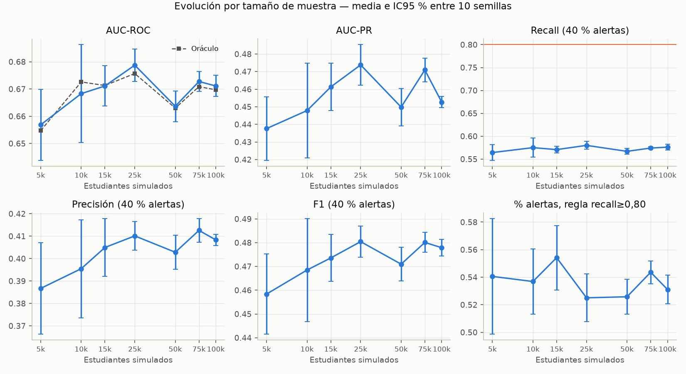

### 9.6 Estabilidad estadística (generador 2.0.0, 10 semillas por tamaño)

Protocolo del proyecto (test 2025-1/2), `cap40_topk`:

| tamano | semillas | AUC | AUC_ic95 | AUC_sd | recall | recall_ic95 | recall_sd | precision | precision_sd | F1 | alertas | alertas_sd |
|---|---:|---:|---:|---:|---:|---:|---:|---:|---:|---:|---:|---:|
| 5.000 | 10 | 0,657 | 0,013 | 0,018 | 0,564 | 0,017 | 0,024 | 0,387 | 0,029 | 0,458 | 0,400 | 0 |
| 10.000 | 10 | 0,668 | 0,018 | 0,025 | 0,575 | 0,021 | 0,029 | 0,395 | 0,031 | 0,468 | 0,400 | 0 |
| 15.000 | 10 | 0,671 | 0,007 | 0,010 | 0,571 | 0,007 | 0,010 | 0,405 | 0,018 | 0,474 | 0,400 | 0 |
| 25.000 | 10 | 0,679 | 0,006 | 0,008 | 0,580 | 0,009 | 0,012 | 0,410 | 0,009 | 0,480 | 0,400 | 0 |
| 50.000 | 10 | 0,664 | 0,006 | 0,008 | 0,567 | 0,006 | 0,009 | 0,403 | 0,011 | 0,471 | 0,400 | 0 |
| 75.000 | 10 | 0,673 | 0,004 | 0,005 | 0,574 | 0,003 | 0,004 | 0,413 | 0,007 | 0,480 | 0,400 | 0 |
| 100.000 | 10 | 0,671 | 0,004 | 0,005 | 0,576 | 0,006 | 0,009 | 0,408 | 0,004 | 0,478 | 0,400 | 0 |

Protocolo del proyecto, `recall80_val`:

| tamano | semillas | AUC | AUC_ic95 | AUC_sd | recall | recall_ic95 | recall_sd | precision | precision_sd | F1 | alertas | alertas_sd |
|---|---:|---:|---:|---:|---:|---:|---:|---:|---:|---:|---:|---:|
| 5.000 | 10 | 0,657 | 0,013 | 0,018 | 0,700 | 0,041 | 0,057 | 0,356 | 0,028 | 0,471 | 0,541 | 0,059 |
| 10.000 | 10 | 0,668 | 0,018 | 0,025 | 0,695 | 0,020 | 0,029 | 0,357 | 0,027 | 0,471 | 0,537 | 0,033 |
| 15.000 | 10 | 0,671 | 0,007 | 0,010 | 0,718 | 0,023 | 0,033 | 0,368 | 0,018 | 0,486 | 0,554 | 0,033 |
| 25.000 | 10 | 0,679 | 0,006 | 0,008 | 0,698 | 0,018 | 0,025 | 0,376 | 0,007 | 0,489 | 0,525 | 0,024 |
| 50.000 | 10 | 0,664 | 0,006 | 0,008 | 0,686 | 0,009 | 0,012 | 0,371 | 0,012 | 0,481 | 0,526 | 0,018 |
| 75.000 | 10 | 0,673 | 0,004 | 0,005 | 0,713 | 0,007 | 0,009 | 0,377 | 0,007 | 0,493 | 0,544 | 0,012 |
| 100.000 | 10 | 0,671 | 0,004 | 0,005 | 0,703 | 0,013 | 0,018 | 0,375 | 0,003 | 0,489 | 0,531 | 0,015 |

Ventana estacionaria (test 2024-1/2), `cap40_topk`:

| tamano | semillas | AUC | AUC_ic95 | AUC_sd | recall | recall_ic95 | recall_sd | precision | precision_sd | F1 | alertas | alertas_sd |
|---|---:|---:|---:|---:|---:|---:|---:|---:|---:|---:|---:|---:|
| 5.000 | 10 | 0,640 | 0,013 | 0,019 | 0,547 | 0,020 | 0,028 | 0,302 | 0,025 | 0,388 | 0,400 | 0 |
| 10.000 | 10 | 0,664 | 0,005 | 0,007 | 0,588 | 0,009 | 0,013 | 0,304 | 0,013 | 0,401 | 0,400 | 0 |
| 15.000 | 10 | 0,629 | 0,013 | 0,018 | 0,550 | 0,014 | 0,019 | 0,272 | 0,017 | 0,364 | 0,400 | 0 |
| 25.000 | 10 | 0,664 | 0,009 | 0,012 | 0,587 | 0,012 | 0,016 | 0,302 | 0,011 | 0,399 | 0,400 | 0 |
| 50.000 | 10 | 0,664 | 0,005 | 0,007 | 0,588 | 0,007 | 0,009 | 0,304 | 0,007 | 0,400 | 0,400 | 0 |
| 75.000 | 10 | 0,657 | 0,004 | 0,005 | 0,576 | 0,005 | 0,008 | 0,294 | 0,007 | 0,389 | 0,400 | 0 |
| 100.000 | 10 | 0,664 | 0,003 | 0,004 | 0,587 | 0,005 | 0,007 | 0,298 | 0,005 | 0,395 | 0,400 | 0 |

Ventana estacionaria, `recall80_val`:

| tamano | semillas | AUC | AUC_ic95 | AUC_sd | recall | recall_ic95 | recall_sd | precision | precision_sd | F1 | alertas | alertas_sd |
|---|---:|---:|---:|---:|---:|---:|---:|---:|---:|---:|---:|---:|
| 5.000 | 10 | 0,640 | 0,013 | 0,019 | 0,775 | 0,026 | 0,036 | 0,265 | 0,021 | 0,394 | 0,647 | 0,054 |
| 10.000 | 10 | 0,664 | 0,005 | 0,007 | 0,780 | 0,025 | 0,036 | 0,255 | 0,010 | 0,384 | 0,633 | 0,039 |
| 15.000 | 10 | 0,629 | 0,013 | 0,018 | 0,765 | 0,023 | 0,033 | 0,234 | 0,011 | 0,358 | 0,647 | 0,029 |
| 25.000 | 10 | 0,664 | 0,009 | 0,012 | 0,775 | 0,024 | 0,034 | 0,261 | 0,010 | 0,390 | 0,613 | 0,036 |
| 50.000 | 10 | 0,664 | 0,005 | 0,007 | 0,798 | 0,011 | 0,015 | 0,257 | 0,006 | 0,389 | 0,640 | 0,015 |
| 75.000 | 10 | 0,657 | 0,004 | 0,005 | 0,792 | 0,006 | 0,009 | 0,253 | 0,006 | 0,383 | 0,640 | 0,011 |
| 100.000 | 10 | 0,664 | 0,003 | 0,004 | 0,771 | 0,006 | 0,008 | 0,259 | 0,005 | 0,388 | 0,603 | 0,010 |

Estadísticos (`outputs/recalibration/estadistica.json`, 70 corridas por protocolo):

| Estadístico | Proyecto (2025-1/2) | Estacionaria (2024-1/2) |
|---|---:|---:|
| ANOVA recall @40 % entre tamaños | F = 1,15; p = 0,35 | F = 13,28; p ≈ 1,2·10⁻⁹ |
| ANOVA AUC entre tamaños | F = 2,73; p = 0,020 | F = 14,67; p ≈ 2,1·10⁻¹⁰ |
| Spearman tamaño vs. recall | ρ = 0,198; p = 0,10 | ρ = 0,329; p = 0,005 |
| sd recall 5k / 100k | 0,024 / 0,009 | 0,028 / 0,007 |
| Recall @40 % medio (IC95 %) | 0,572 ± 0,004 | 0,575 ± 0,005 |
| AUC medio | 0,669 | 0,654 |
| t de una muestra, recall @40 % vs. 0,80 | p ≈ 4·10⁻⁸¹ | p ≈ 2·10⁻⁷⁰ |
| `recall80_val`: alertas media / mínima | 53,7 % / 42,3 % | 63,2 % / 55,9 % |
| `recall80_val`: recall medio | 0,702 | 0,779 |
| `recall80_val`: corridas con alertas ≤ 50 % / recall ≥ 0,75 / ambas | 5 / 3 / 0 | 0 / 59 / 0 |

- El recall a capacidad fija es homogéneo entre tamaños en el protocolo del proyecto; el AUC difiere por la oscilación del oráculo (C3), no por el modelo.
- En la ventana estacionaria (sin el artefacto C2) la heterogeneidad se concentra en 5k, 15k y 75k; el AUC cae a 0,629–0,640 en 5k y 15k, y la precisión baja a 0,27–0,30 por la menor prevalencia. Con `recall80_val`: recall 0,779, 63,2 % de alertas y precisión 0,26.
- La brecha frente a 0,80 es sistemática, no de muestreo.

Criterio de promovibilidad por corrida (recall ≥ 0,75, alertas ≤ 50 %, precisión ≥ 0,30):

| protocolo | politica | corridas | recall>=0.75 | alertas<=50% | precision>=0.30 | cumple_los_3 |
|---|---:|---:|---:|---:|---:|---:|
| 2025-1,2025-2 | recall80_val | 70 | 3 | 5 | 70 | 0 |
| 2025-1,2025-2 | cap40_topk | 70 | 0 | 70 | 70 | 0 |
| 2025-1,2025-2 | cap50_topk | 70 | 0 | 59 | 70 | 0 |
| 2024-1,2024-2 | recall80_val | 70 | 59 | 0 | 1 | 0 |
| 2024-1,2024-2 | cap40_topk | 70 | 0 | 70 | 31 | 0 |
| 2024-1,2024-2 | cap50_topk | 70 | 0 | 47 | 4 | 0 |

Intervalos bootstrap por estudiante (400 remuestras, semilla 42, configuración final; proporciones):

| tamano | estudiantes_test | AUC | AUC_lo | AUC_hi | recall@40% | r40_lo | r40_hi | precision@40% | alertas_para_recall80 | a80_lo | a80_hi | precision_con_recall80 |
|---|---:|---:|---:|---:|---:|---:|---:|---:|---:|---:|---:|---:|
| 5.000 | 445 | 0,633 | 0,587 | 0,682 | 0,536 | 0,480 | 0,600 | 0,382 | 0,686 | 0,609 | 0,738 | 0,332 |
| 10.000 | 888 | 0,667 | 0,634 | 0,702 | 0,570 | 0,526 | 0,613 | 0,384 | 0,630 | 0,590 | 0,687 | 0,342 |
| 15.000 | 1.365 | 0,672 | 0,643 | 0,696 | 0,564 | 0,529 | 0,598 | 0,392 | 0,642 | 0,606 | 0,687 | 0,346 |
| 25.000 | 2.255 | 0,688 | 0,667 | 0,709 | 0,599 | 0,575 | 0,628 | 0,413 | 0,623 | 0,596 | 0,652 | 0,355 |
| 50.000 | 4.464 | 0,669 | 0,654 | 0,684 | 0,571 | 0,553 | 0,593 | 0,408 | 0,651 | 0,631 | 0,669 | 0,351 |
| 75.000 | 6.767 | 0,675 | 0,664 | 0,688 | 0,573 | 0,558 | 0,590 | 0,406 | 0,653 | 0,633 | 0,667 | 0,347 |
| 100.000 | 9.007 | 0,677 | 0,665 | 0,688 | 0,584 | 0,571 | 0,598 | 0,409 | 0,639 | 0,623 | 0,657 | 0,351 |

En ningún tamaño el IC de las alertas necesarias para recall 0,80 baja de 59 %; el límite de 50 % queda excluido en todos.

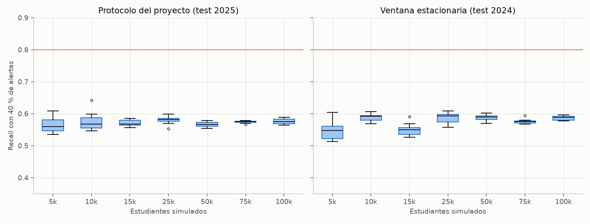

### 9.7 Curvas PR/ROC y carga operativa (generador 2.0.0)

Las curvas de 25k–100k se superponen con el oráculo; las de 5k–10k se separan por ruido de muestra. Precisión a recall 0,80 ≈ 0,33–0,36 en todos los tamaños (prevalencia de test ≈ 0,28).

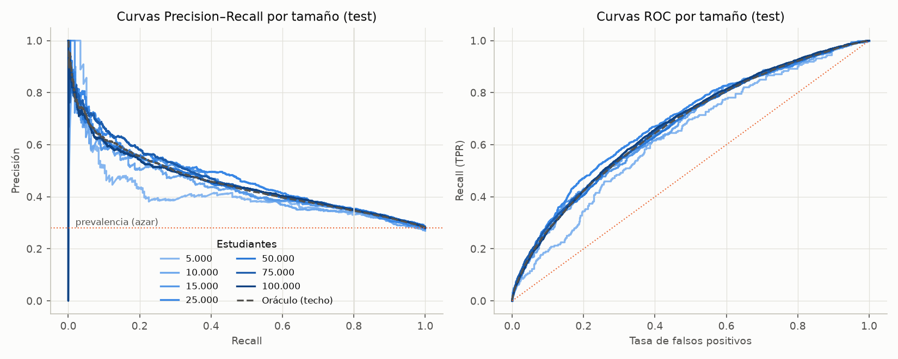

Modelo final en 100k (test, prevalencia 0,28), por cada 1.000 estudiantes evaluados en un ciclo:

| Alertas | Recall | Precisión | Estudiantes alertados | Desertores detectados | Alertas por desertor detectado |
|---:|---:|---:|---:|---:|---:|
| 20 % | 0,342 | 0,478 | 200 | 96 | 2,1 |
| 30 % | 0,470 | 0,438 | 300 | 132 | 2,3 |
| **40 %** | **0,584** | **0,409** | 400 | 164 | 2,4 |
| **50 %** | **0,683** | **0,382** | 500 | 191 | 2,6 |
| 60 % | 0,766 | 0,357 | 600 | 214 | 2,8 |
| 65 % | 0,807 | 0,348 | 650 | 226 | 2,9 |
| 70 % | 0,844 | 0,337 | 700 | 236 | 3,0 |

Para recall 0,80 se revisan ≈ 650 de cada 1.000 estudiantes; con 40 % se revisan 400 y se pierde el 42 % de los desertores. El cuello de botella es el recall, no la precisión. Estas cifras usan la prevalencia inflada por C2.

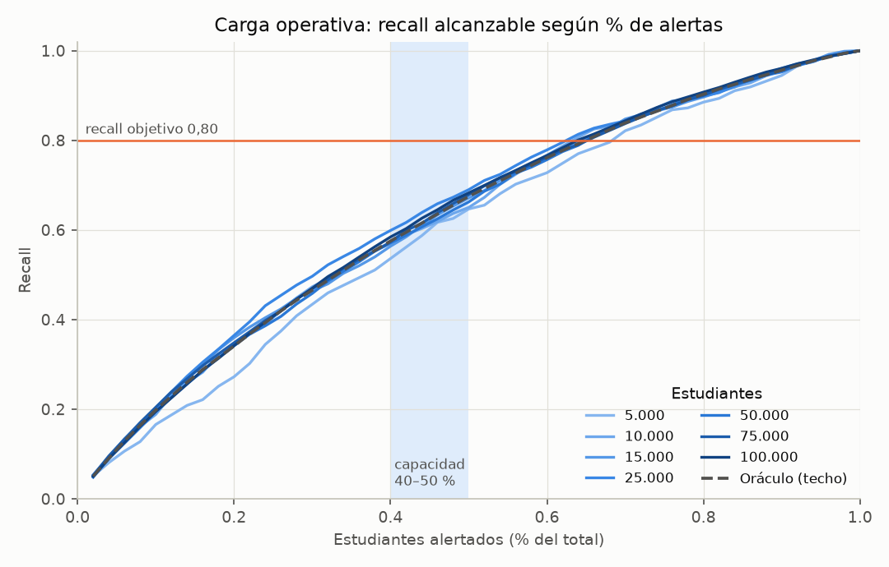

### 9.8 Limitaciones

- Resultados sintéticos: el techo del oráculo es propiedad del generador, no de la deserción real.
- Un solo dataset por tamaño; la variabilidad entre semillas es de partición y ajuste, no de regeneración.
- El oráculo usa `promedio_semestre` (no es variable del modelo) y aproxima el efecto del apoyo previo con el snapshot anterior: es una cota práctica, no la cota de Bayes.
- No se reentrenó `models/*.joblib` ni se modificó `train_pipeline.py`.
- La capacidad real de intervención de la universidad no está documentada.

### 9.9 Iteración 2: generador 2.1.0 (referencia vigente)

**Corrección del generador.** Un sorteo en el snapshot `q` produce un evento en `q+1`; el seguimiento posterior al último snapshot colocaba también su primer evento en `último+1`, duplicando el sorteo. `followup_alignment: aligned` (por defecto) lo ubica un periodo después del snapshot virtual; `legacy` reproduce 2.0.0. Verificación por intervención: la prevalencia de 2025-1/2025-2 baja de 0,298/0,271 (5k, legacy) a 0,207/0,202 (5k, corregido); en los 7 tamaños queda entre 0,197 y 0,218, frente a 0,18–0,21 en los demás periodos; prevalencia global 0,191–0,198; sin etiquetas inmaduras. `tests/test_synthetic_generator.py` exige brecha de prevalencia (dos últimos periodos − anteriores) < 0,04 en `aligned` y > 0,05 en `legacy` (suite en ese momento: 108 pasan, 1 omitida).

| Estudiantes | `dataset_version` (prefijo, 2.1.0) | Snapshots | Prevalencia | Prev. 2025-1 / 2025-2 |
|---:|---|---:|---:|---|
| 5.000 | `359454cb2e16` | 27.898 | 19,07 % | 0,207 / 0,202 |
| 10.000 | `743112558b4e` | 55.582 | 19,84 % | 0,218 / 0,208 |
| 15.000 | `acdf7581a455` | 83.453 | 19,45 % | 0,210 / 0,197 |
| 25.000 | `20b5676edc69` | 138.268 | 19,72 % | 0,206 / 0,202 |
| 50.000 | `0edb4a7f05be` | 277.042 | 19,59 % | 0,210 / 0,207 |
| 75.000 | `4a5cbc9fe79e` | 415.362 | 19,73 % | 0,213 / 0,210 |
| 100.000 | `1416e8469a6c` | 553.727 | 19,74 % | 0,211 / 0,207 |

**Resultados (configuración final, `cap40_topk`, 10 semillas × 7 tamaños):**

| Estudiantes | AUC (media) | Recall (IC95 %) | Precisión | F1 | Alertas | Alertas para recall 0,80 (IC95 % bootstrap, semilla 42) |
|---:|---:|---|---:|---:|---:|---|
| 5.000 | 0,670 | 0,595 ± 0,019 | 0,301 | 0,399 | 40 % | 64,3 % (59,5–69,6) |
| 10.000 | 0,687 | 0,615 ± 0,015 | 0,334 | 0,433 | 40 % | 64,2 % (59,5–70,8) |
| 15.000 | 0,680 | 0,605 ± 0,019 | 0,313 | 0,412 | 40 % | 62,3 % (57,7–66,7) |
| 25.000 | 0,672 | 0,596 ± 0,010 | 0,302 | 0,401 | 40 % | 62,9 % (59,4–67,3) |
| 50.000 | 0,672 | 0,597 ± 0,008 | 0,312 | 0,410 | 40 % | 64,0 % (60,1–66,9) |
| 75.000 | 0,677 | 0,603 ± 0,003 | 0,319 | 0,417 | 40 % | 64,7 % (62,9–67,0) |
| 100.000 | 0,673 | 0,600 ± 0,003 | 0,314 | 0,412 | 40 % | 63,5 % (61,7–65,5) |

- **Homogeneidad entre tamaños:** ANOVA del recall a 40 %: F = 1,55; p = 0,18; media global 0,601 ± 0,004; sd del recall 0,026 (5k) → 0,005 (100k). ANOVA del AUC: F = 2,25; p = 0,050. Spearman tamaño vs. recall: ρ = −0,095; p = 0,44.
- **Contra el objetivo:** recall frente a 0,80, p ≈ 2·10⁻⁷³.
- **Modelo vs. oráculo:** brecha ≤ 0,007 de AUC; pequeña pero significativa en 5k y 10k.
- **Mejora sobre el baseline** (diferencias pareadas, n = 21): AUC +0,015 ± 0,005 (p < 0,001); recall a 40 % +0,021 ± 0,007; AUC-PR +0,025 ± 0,008; Brier 0,237 → 0,154. Con `recall80_val` las alertas bajan de 62,6 % a 54,2 % (media 54,2 %, mínima 47,3 %; recall medio 0,725; 6 corridas con alertas ≤ 50 %, 13 con recall ≥ 0,75, ninguna con ambas).
- El techo no se mueve: el oráculo tiene recall 0,60 con 40 % de alertas, 0,69 con 50 % y 0,81 con 65 % (con 2.0.0: 0,58 / 0,67 / 0,80).

Detalle por configuración (`outputs/recalibration/v2_generador_corregido/tablas.md`, semilla 42). `TRAJ_*` añade variables de trayectoria. Política `recall80_val`:

| stage | config | auc | auc_sd | aucpr | brier | ece | recall | recall_sd | precision | f1 | alertas | alertas_sd |
|---|---:|---:|---:|---:|---:|---:|---:|---:|---:|---:|---:|---:|
| fx_final | FINAL_logit_C0.1 | 0,670 | 0,014 | 0,362 | 0,150 | 0,044 | 0,712 | 0,028 | 0,267 | 0,387 | 0,534 | 0,039 |
| fx_final | TRAJ_logit_C0.1 | 0,669 | 0,014 | 0,361 | 0,151 | 0,043 | 0,725 | 0,031 | 0,264 | 0,386 | 0,550 | 0,048 |
| fx_ref | REF_lgbm_shallow | 0,667 | 0,018 | 0,357 | 0,151 | 0,041 | 0,703 | 0,036 | 0,267 | 0,386 | 0,527 | 0,031 |
| fx_ref | S0_lgbm_project | 0,654 | 0,018 | 0,334 | 0,237 | 0,286 | 0,769 | 0,062 | 0,249 | 0,376 | 0,616 | 0,048 |
| fx_ref | TRAJ_lgbm_shallow | 0,668 | 0,016 | 0,356 | 0,151 | 0,041 | 0,708 | 0,033 | 0,268 | 0,389 | 0,528 | 0,035 |

Política `cap40_topk`:

| stage | config | auc | auc_sd | aucpr | brier | ece | recall | recall_sd | precision | f1 | alertas | alertas_sd |
|---|---:|---:|---:|---:|---:|---:|---:|---:|---:|---:|---:|---:|
| fx_final | FINAL_logit_C0.1 | 0,670 | 0,014 | 0,362 | 0,150 | 0,044 | 0,599 | 0,015 | 0,299 | 0,399 | 0,400 | 0 |
| fx_final | TRAJ_logit_C0.1 | 0,669 | 0,014 | 0,361 | 0,151 | 0,043 | 0,596 | 0,018 | 0,298 | 0,397 | 0,400 | 0 |
| fx_ref | REF_lgbm_shallow | 0,667 | 0,018 | 0,357 | 0,151 | 0,041 | 0,591 | 0,027 | 0,296 | 0,394 | 0,400 | 0 |
| fx_ref | S0_lgbm_project | 0,654 | 0,018 | 0,334 | 0,237 | 0,286 | 0,571 | 0,028 | 0,285 | 0,380 | 0,400 | 0 |
| fx_ref | TRAJ_lgbm_shallow | 0,668 | 0,016 | 0,356 | 0,151 | 0,041 | 0,593 | 0,022 | 0,296 | 0,395 | 0,400 | 0 |

Por tamaño — baseline del proyecto (LightGBM, `recall80_val`):

| size | n_test | prevalence | auc_roc | oracle_auc_test | auc_pr | recall | precision | f1 | specificity | fpr | alert_rate |
|---|---:|---:|---:|---:|---:|---:|---:|---:|---:|---:|---:|
| 5.000 | 862 | 0,179 | 0,622 | 0,653 | 0,263 | 0,636 | 0,220 | 0,327 | 0,508 | 0,492 | 0,517 |
| 10.000 | 1.682 | 0,199 | 0,635 | 0,679 | 0,302 | 0,784 | 0,244 | 0,373 | 0,399 | 0,601 | 0,637 |
| 15.000 | 2.560 | 0,206 | 0,661 | 0,683 | 0,346 | 0,812 | 0,259 | 0,392 | 0,395 | 0,605 | 0,648 |
| 25.000 | 4.181 | 0,195 | 0,658 | 0,676 | 0,351 | 0,746 | 0,248 | 0,372 | 0,452 | 0,548 | 0,587 |
| 50.000 | 8.450 | 0,209 | 0,665 | 0,671 | 0,358 | 0,806 | 0,261 | 0,394 | 0,397 | 0,603 | 0,645 |
| 75.000 | 12.702 | 0,210 | 0,668 | 0,674 | 0,369 | 0,796 | 0,261 | 0,393 | 0,400 | 0,600 | 0,641 |
| 100.000 | 16.874 | 0,200 | 0,666 | 0,671 | 0,349 | 0,800 | 0,250 | 0,381 | 0,401 | 0,599 | 0,640 |

Por tamaño — configuración final, `recall80_val`:

| size | n_test | prevalence | auc_roc | oracle_auc_test | auc_pr | recall | precision | f1 | specificity | fpr | alert_rate |
|---|---:|---:|---:|---:|---:|---:|---:|---:|---:|---:|---:|
| 5.000 | 862 | 0,179 | 0,641 | 0,653 | 0,305 | 0,766 | 0,223 | 0,345 | 0,418 | 0,582 | 0,615 |
| 10.000 | 1.682 | 0,199 | 0,671 | 0,679 | 0,362 | 0,692 | 0,266 | 0,384 | 0,527 | 0,473 | 0,517 |
| 15.000 | 2.560 | 0,206 | 0,683 | 0,683 | 0,395 | 0,714 | 0,284 | 0,406 | 0,531 | 0,469 | 0,519 |
| 25.000 | 4.181 | 0,195 | 0,679 | 0,676 | 0,369 | 0,677 | 0,271 | 0,387 | 0,558 | 0,442 | 0,488 |
| 50.000 | 8.450 | 0,209 | 0,672 | 0,671 | 0,373 | 0,711 | 0,280 | 0,402 | 0,517 | 0,483 | 0,531 |
| 75.000 | 12.702 | 0,210 | 0,675 | 0,674 | 0,379 | 0,707 | 0,281 | 0,402 | 0,517 | 0,483 | 0,531 |
| 100.000 | 16.874 | 0,200 | 0,669 | 0,671 | 0,351 | 0,717 | 0,265 | 0,387 | 0,503 | 0,497 | 0,541 |

Por tamaño — configuración final, `cap40_topk`:

| size | n_test | prevalence | auc_roc | oracle_auc_test | auc_pr | recall | precision | f1 | specificity | fpr | alert_rate |
|---|---:|---:|---:|---:|---:|---:|---:|---:|---:|---:|---:|
| 5.000 | 862 | 0,179 | 0,641 | 0,653 | 0,305 | 0,571 | 0,255 | 0,353 | 0,637 | 0,363 | 0,400 |
| 10.000 | 1.682 | 0,199 | 0,671 | 0,679 | 0,362 | 0,596 | 0,296 | 0,395 | 0,648 | 0,352 | 0,400 |
| 15.000 | 2.560 | 0,206 | 0,683 | 0,683 | 0,395 | 0,617 | 0,318 | 0,420 | 0,656 | 0,344 | 0,400 |
| 25.000 | 4.181 | 0,195 | 0,679 | 0,676 | 0,369 | 0,610 | 0,297 | 0,400 | 0,651 | 0,349 | 0,400 |
| 50.000 | 8.450 | 0,209 | 0,672 | 0,671 | 0,373 | 0,591 | 0,309 | 0,406 | 0,650 | 0,350 | 0,400 |
| 75.000 | 12.702 | 0,210 | 0,675 | 0,674 | 0,379 | 0,605 | 0,318 | 0,417 | 0,655 | 0,345 | 0,400 |
| 100.000 | 16.874 | 0,200 | 0,669 | 0,671 | 0,351 | 0,601 | 0,300 | 0,400 | 0,650 | 0,350 | 0,400 |

Por tamaño — configuración final, `cap50_topk`:

| size | n_test | prevalence | auc_roc | oracle_auc_test | auc_pr | recall | precision | f1 | specificity | fpr | alert_rate |
|---|---:|---:|---:|---:|---:|---:|---:|---:|---:|---:|---:|
| 5.000 | 862 | 0,179 | 0,641 | 0,653 | 0,305 | 0,636 | 0,227 | 0,335 | 0,530 | 0,470 | 0,500 |
| 10.000 | 1.682 | 0,199 | 0,671 | 0,679 | 0,362 | 0,674 | 0,268 | 0,383 | 0,543 | 0,457 | 0,500 |
| 15.000 | 2.560 | 0,206 | 0,683 | 0,683 | 0,395 | 0,706 | 0,291 | 0,413 | 0,554 | 0,446 | 0,500 |
| 25.000 | 4.181 | 0,195 | 0,679 | 0,676 | 0,369 | 0,687 | 0,268 | 0,386 | 0,545 | 0,455 | 0,500 |
| 50.000 | 8.450 | 0,209 | 0,672 | 0,671 | 0,373 | 0,689 | 0,288 | 0,406 | 0,550 | 0,450 | 0,500 |
| 75.000 | 12.702 | 0,210 | 0,675 | 0,674 | 0,379 | 0,682 | 0,287 | 0,404 | 0,548 | 0,452 | 0,500 |
| 100.000 | 16.874 | 0,200 | 0,669 | 0,671 | 0,351 | 0,682 | 0,273 | 0,390 | 0,546 | 0,454 | 0,500 |

Estabilidad entre semillas, `cap40_topk`:

| tamano | semillas | AUC | AUC_ic95 | AUC_sd | recall | recall_ic95 | recall_sd | precision | precision_sd | F1 | alertas | alertas_sd |
|---|---:|---:|---:|---:|---:|---:|---:|---:|---:|---:|---:|---:|
| 5.000 | 10 | 0,670 | 0,014 | 0,019 | 0,595 | 0,019 | 0,026 | 0,301 | 0,035 | 0,399 | 0,400 | 0 |
| 10.000 | 10 | 0,687 | 0,009 | 0,012 | 0,615 | 0,015 | 0,021 | 0,334 | 0,018 | 0,433 | 0,400 | 0 |
| 15.000 | 10 | 0,680 | 0,013 | 0,018 | 0,605 | 0,019 | 0,027 | 0,313 | 0,017 | 0,412 | 0,400 | 0 |
| 25.000 | 10 | 0,672 | 0,009 | 0,012 | 0,596 | 0,010 | 0,015 | 0,302 | 0,012 | 0,401 | 0,400 | 0 |
| 50.000 | 10 | 0,672 | 0,006 | 0,009 | 0,597 | 0,008 | 0,012 | 0,312 | 0,007 | 0,410 | 0,400 | 0 |
| 75.000 | 10 | 0,677 | 0,003 | 0,004 | 0,603 | 0,003 | 0,005 | 0,319 | 0,005 | 0,417 | 0,400 | 0 |
| 100.000 | 10 | 0,673 | 0,003 | 0,005 | 0,600 | 0,003 | 0,005 | 0,314 | 0,008 | 0,412 | 0,400 | 0 |

Estabilidad entre semillas, `recall80_val`:

| tamano | semillas | AUC | AUC_ic95 | AUC_sd | recall | recall_ic95 | recall_sd | precision | precision_sd | F1 | alertas | alertas_sd |
|---|---:|---:|---:|---:|---:|---:|---:|---:|---:|---:|---:|---:|
| 5.000 | 10 | 0,670 | 0,014 | 0,019 | 0,747 | 0,039 | 0,054 | 0,262 | 0,035 | 0,386 | 0,581 | 0,067 |
| 10.000 | 10 | 0,687 | 0,009 | 0,012 | 0,742 | 0,028 | 0,040 | 0,293 | 0,016 | 0,420 | 0,550 | 0,036 |
| 15.000 | 10 | 0,680 | 0,013 | 0,018 | 0,718 | 0,025 | 0,035 | 0,281 | 0,013 | 0,403 | 0,529 | 0,022 |
| 25.000 | 10 | 0,672 | 0,009 | 0,012 | 0,701 | 0,023 | 0,033 | 0,274 | 0,011 | 0,393 | 0,519 | 0,026 |
| 50.000 | 10 | 0,672 | 0,006 | 0,009 | 0,719 | 0,009 | 0,012 | 0,281 | 0,004 | 0,404 | 0,535 | 0,009 |
| 75.000 | 10 | 0,677 | 0,003 | 0,004 | 0,724 | 0,011 | 0,015 | 0,282 | 0,005 | 0,406 | 0,542 | 0,015 |
| 100.000 | 10 | 0,673 | 0,003 | 0,005 | 0,722 | 0,010 | 0,014 | 0,280 | 0,007 | 0,404 | 0,540 | 0,012 |

Criterio de promovibilidad por corrida:

| protocolo | politica | corridas | recall>=0.75 | alertas<=50% | precision>=0.30 | cumple_los_3 |
|---|---:|---:|---:|---:|---:|---:|
| 2025-1,2025-2 | recall80_val | 70 | 13 | 6 | 5 | 0 |
| 2025-1,2025-2 | cap40_topk | 70 | 0 | 70 | 57 | 0 |
| 2025-1,2025-2 | cap50_topk | 70 | 0 | 55 | 14 | 0 |

Modelo vs. oráculo (10 semillas):

| size | AUC_modelo | AUC_oraculo | brecha_media | brecha_ic95 |
|---|---:|---:|---:|---:|
| 5.000 | 0,670 | 0,677 | 0,007 | 0,005 |
| 10.000 | 0,687 | 0,691 | 0,004 | 0,003 |
| 15.000 | 0,680 | 0,680 | 0 | 0,003 |
| 25.000 | 0,672 | 0,670 | -0,002 | 0,002 |
| 50.000 | 0,672 | 0,671 | -0,001 | 0,001 |
| 75.000 | 0,677 | 0,676 | -0,001 | 0,001 |
| 100.000 | 0,673 | 0,673 | 0 | 0,001 |

Intervalos bootstrap por estudiante (400 remuestras, semilla 42; proporciones):

| tamano | estudiantes_test | AUC | AUC_lo | AUC_hi | recall@40% | r40_lo | r40_hi | precision@40% | alertas_para_recall80 | a80_lo | a80_hi | precision_con_recall80 |
|---|---:|---:|---:|---:|---:|---:|---:|---:|---:|---:|---:|---:|
| 5.000 | 460 | 0,641 | 0,589 | 0,692 | 0,571 | 0,506 | 0,646 | 0,255 | 0,643 | 0,595 | 0,696 | 0,224 |
| 10.000 | 901 | 0,671 | 0,637 | 0,710 | 0,596 | 0,544 | 0,646 | 0,296 | 0,642 | 0,595 | 0,708 | 0,248 |
| 15.000 | 1.360 | 0,683 | 0,652 | 0,712 | 0,617 | 0,570 | 0,655 | 0,318 | 0,623 | 0,577 | 0,667 | 0,265 |
| 25.000 | 2.236 | 0,679 | 0,654 | 0,704 | 0,610 | 0,577 | 0,645 | 0,297 | 0,629 | 0,594 | 0,673 | 0,248 |
| 50.000 | 4.500 | 0,672 | 0,656 | 0,690 | 0,591 | 0,569 | 0,616 | 0,309 | 0,640 | 0,601 | 0,669 | 0,261 |
| 75.000 | 6.756 | 0,675 | 0,661 | 0,688 | 0,605 | 0,585 | 0,623 | 0,318 | 0,647 | 0,629 | 0,670 | 0,260 |
| 100.000 | 8.969 | 0,669 | 0,657 | 0,681 | 0,601 | 0,585 | 0,618 | 0,300 | 0,635 | 0,617 | 0,655 | 0,252 |

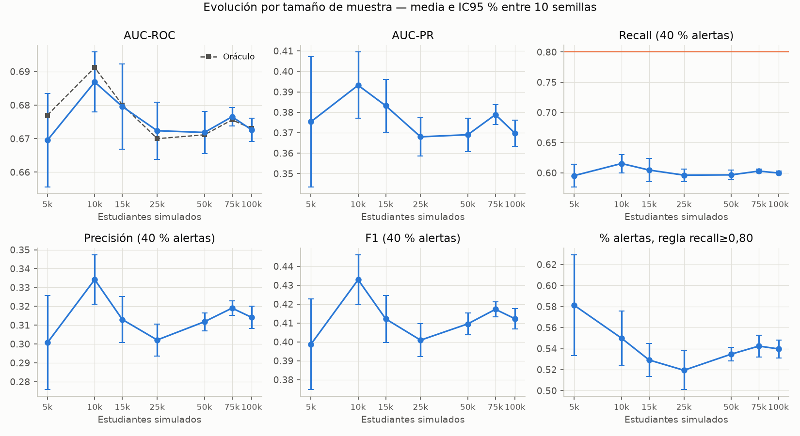

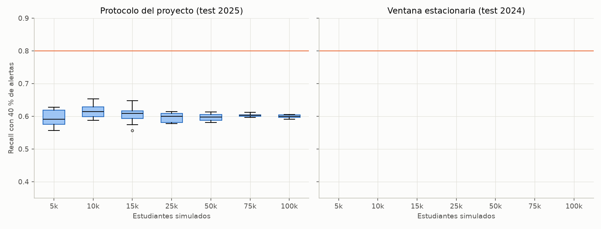

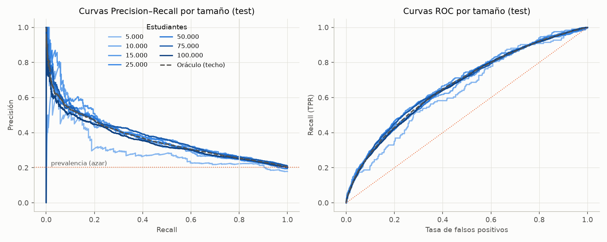

**Etiqueta con menos ruido (sensibilidad).** Con «deserción en el siguiente periodo» (`horizon_periods = 1`, `outcome_followup_periods = 1`, solo para este análisis), 3 tamaños × 5 semillas:

| Estudiantes | Prevalencia | AUC oráculo | AUC modelo | Recall @40 % | Precisión @40 % | Recall @50 % | Precisión @50 % |
|---:|---:|---:|---:|---:|---:|---:|---:|
| 10.000 | 0,114 | 0,681 | 0,676 | 0,618 | 0,176 | 0,714 | 0,163 |
| 25.000 | 0,108 | 0,682 | 0,681 | 0,633 | 0,171 | 0,719 | 0,155 |
| 50.000 | 0,114 | 0,677 | 0,679 | 0,633 | 0,180 | 0,724 | 0,165 |

Acortar el horizonte no sube el techo (AUC del oráculo 0,68); el recall a 40 % sube a ≈ 0,63 pero la precisión cae a ≈ 0,17. El ruido dominante es el sorteo de Bernoulli de un riesgo poco disperso (media 0,107). Cambiar esa dispersión sería ajustar el mundo simulado al modelo; no se hizo.

**Variables de trayectoria.** 18 variables por estudiante con periodos ≤ actual (rezagos de promedio, mora, apoyo y engagement; acumulados y rachas). Diferencias pareadas frente a la misma configuración sin ellas:

| Modelo | n | ΔAUC (IC95 %) | p | ΔRecall @40 % (IC95 %) | p |
|---|---:|---|---:|---|---:|
| Logística | 70 | −0,0013 ± 0,0007 | 0,001 | −0,001 ± 0,002 | 0,31 |
| LightGBM poco profundo | 21 | +0,0002 ± 0,0010 | 0,60 | +0,002 ± 0,003 | 0,15 |

No aportan señal: en el generador el riesgo depende casi solo del snapshot actual (el apoyo previo entra con efecto 0,88×). Además exigirían historia por estudiante en la puntuación.

**Curva de capacidad** (modelo final en 100k, prevalencia 0,20, semilla 42, por cada 1.000 estudiantes):

| Alertas | Recall | Precisión | Estudiantes revisados | Desertores detectados | Alertas por desertor detectado |
|---:|---:|---:|---:|---:|---:|
| 20 % | 0,363 | 0,363 | 200 | 73 | 2,8 |
| 30 % | 0,485 | 0,323 | 300 | 97 | 3,1 |
| **40 %** | **0,600** | **0,300** | 400 | 120 | 3,3 |
| **50 %** | **0,682** | **0,273** | 500 | 136 | 3,7 |
| 60 % | 0,771 | 0,257 | 600 | 154 | 3,9 |
| 65 % | 0,810 | 0,249 | 650 | 162 | 4,0 |
| 70 % | 0,846 | 0,242 | 700 | 169 | 4,1 |

El oráculo da prácticamente lo mismo (0,600 a 40 %; 0,693 a 50 %). Con 40–50 % de capacidad, el objetivo realista es recall 0,60–0,68, con ≈ 3,3–3,7 estudiantes revisados por desertor detectado.

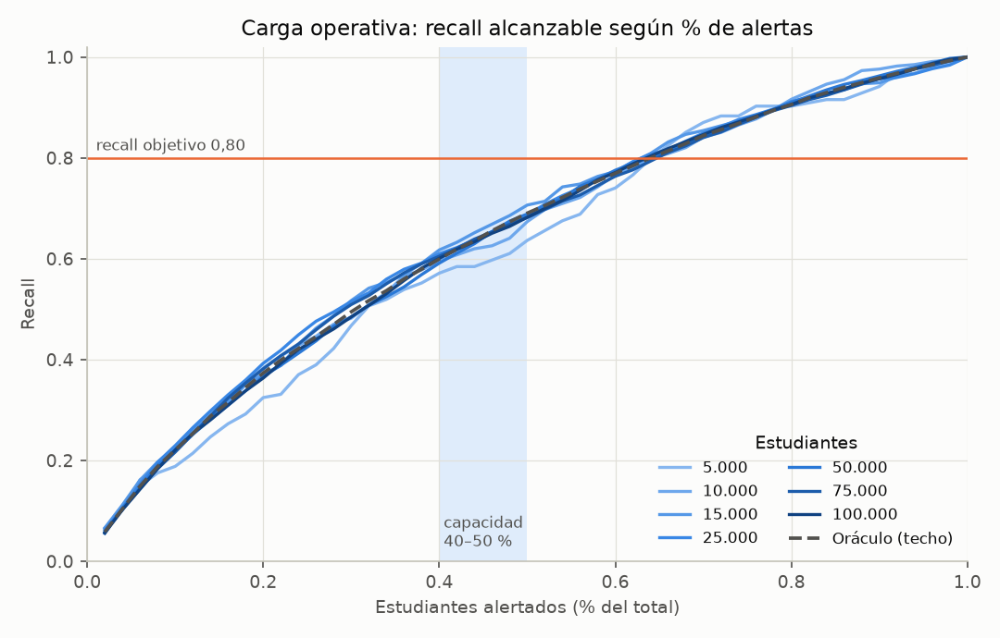

### 9.10 Recomendación y acciones

**No desplegar para priorizar estudiantes.** La solución es estable y reproducible (recall homogéneo entre tamaños, ECE 0,039, dispersión decreciente), apta para seguir desarrollándose; un despliegue solo de observación (sombra, sin intervención) con política de capacidad es coherente con una POC sintética.

| # | Acción | Estado |
|---|---|---|
| 1 | Corregir el generador (igualar sorteos de la etiqueta en los periodos finales) | Hecho en 2.1.0 |
| 2 | Aumentar la señal (etiqueta con menos ruido, mayor dispersión del riesgo o datos reales): se requiere AUC ≈ 0,84 para recall 0,80 con 40 % de alertas | Horizonte 1 evaluado sin mejora; el resto requiere decisión del equipo o datos reales |
| 3 | Probar variables de trayectoria | Evaluado sin mejora |
| 4 | Fijar la capacidad real de intervención; con 40–50 % el objetivo realista es recall 0,60–0,68, no 0,80 | Pendiente (decisión de la universidad) |
| 5 | Adoptar la política de capacidad (top-k %) en lugar de `recall80_val` | No implementado en `train_azure.py` |
| 6 | Antes de uso real: validación temporal con datos institucionales, equidad por sede/programa/género, monitoreo de calibración (ECE) y aprobación humana | Pendiente |
