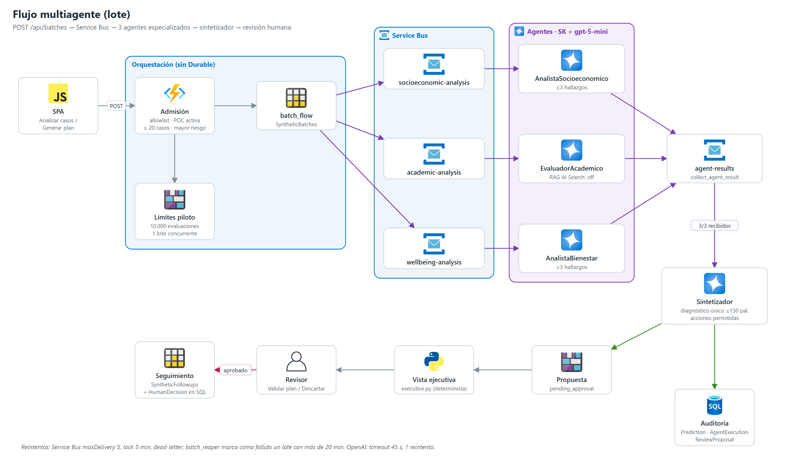

# 05 | Arquitectura multiagente

## 1. Principio

Los agentes son **motores internos de análisis**. Cada uno estudia una dimensión del caso y entrega hallazgos breves; el sintetizador los fusiona en **un único diagnóstico** con acciones propuestas; `executive.py` lo consolida con los datos del expediente en una vista de tamaño fijo. Ninguna salida individual se muestra al usuario, y ninguna recomendación se ejecuta sin validación humana.

La red genera observaciones estructuradas y propuestas de apoyo para revisión profesional. **No** diagnostica, no atribuye causalidad, no cambia el score predictivo, no toma decisiones académicas ni financieras, no envía comunicaciones, no asigna ayudas y no ejecuta intervenciones. Cada caso llega con la probabilidad ya calculada por el modelo predictivo (Azure ML v2, almacenada en el snapshot); el LLM nunca la inventa ni la recalcula, y el sintetizador la conserva tal como la recibió.

## 2. Agentes

Implementados en `azure/agent_platform/sat_agents/agents.py` con `ChatCompletionAgent` de Semantic Kernel sobre `AsyncAzureOpenAI` (token Entra, sin claves).

| Agente | Entrada (`AnalysisCase.agent_context`) | Salida | Límites |
|---|---|---|---|
| `AnalistaSocioeconomico` | Mora (meses, saldo), estrato, ciudad, contexto familiar | `summary`, `observations`, `limitations`, `citation_ids=[]` | No infiere pobreza, mérito ni causalidad |
| `EvaluadorAcademico` | Señales por asignatura + hasta 3 fuentes RAG | Igual + `sources` | Citas solo de fuentes recuperadas; RAG deshabilitado |
| `AnalistaBienestar` | Tipo de apoyo, sesiones, asistencia, canal | Igual | Sin diagnósticos ni inferencias clínicas |
| `Sintetizador` | Probabilidad, nivel de riesgo clasificado y las 3 salidas | `summary` (diagnóstico), `proposed_actions`, `limitations`, `human_review_required=true`, `automated_decision=false` | Solo 4 acciones permitidas; sin mencionar modelos ni IA |
| Revisor profesional (humano) | Diagnóstico, evidencia y acciones presentados en la SPA | `approved`, `edited` o `rejected` | Único rol que decide sobre una propuesta; su decisión queda auditada y no se convierte en etiqueta de deserción |

Notas por agente:

- **Socioeconómico**: describe solo las señales recibidas; no infiere elegibilidad automática para ayudas.
- **Académico**: puede consultar Azure AI Search solo si se configuran `ACADEMIC_RAG_ENABLED=true`, endpoint e índice aprobados (hoy `false`). Sin RAG declara que no recuperó evidencia normativa; no inventa normas ni citas. `citation_ids` (≤ 8) se valida contra las fuentes realmente entregadas.
- **Bienestar**: la ausencia de registro no prueba ausencia de necesidad.
- **Sintetizador**: recibe el `risk_level` ya clasificado para que el texto y el semáforo usen la misma etiqueta. El diagnóstico empieza por el nivel (Bajo/Medio/Alto/Crítico), nombra los factores asociados con cifras concretas y cierra con el foco prioritario, con lenguaje de asociación («asociado a», «coincide con»), sin causalidad ni nombres de campos.

**Contrato del caso** (`contracts.py`): `case_id` con prefijo `syn-`, `model_probability` entre 0 y 1, campos económicos explícitos, hasta 30 señales académicas y contexto de bienestar acotado. Se rechazan campos no permitidos, tipos fuera de rango y referencias inválidas. El prefijo reduce errores de contrato pero **no prueba** que el origen de los datos sea sintético. Cada especialista devuelve un JSON con exactamente `summary`, `observations`, `limitations` y `citation_ids`.

**Límites de salida** (`policy.py`, aplicados en el prompt y de nuevo, como defensa porque el modelo puede ignorar el prompt, en el saneamiento de `contracts.py`: `sanitize_analysis_text`, `sanitize_recommendation_text`):

| Elemento | Límite |
|---|---|
| `summary` de especialista | 1 frase, ≤ 240 caracteres |
| `observations` | ≤ 3, ≤ 160 caracteres, sin duplicados |
| `limitations` | ≤ 1 |
| Diagnóstico del sintetizador | 40–150 palabras |
| Acciones | `academic_advisor_review`, `tutoring_review`, `financial_aid_review`, `wellbeing_review` |

**Configuración del modelo**: `AZURE_OPENAI_MODEL=gpt-5-mini` (despliegue `sat-gpt5-mini`, versión 2025-08-07, GlobalStandard 50), `AZURE_OPENAI_API_VERSION=2025-04-01-preview`, `AZURE_OPENAI_REASONING_EFFORT=low`, `max_completion_tokens` 2048 (especialistas) / 3072 (sintetizador), `response_format=json_object`, timeout 45 s, 1 reintento. El uso de tokens reportado por el servicio es obligatorio y se costea con `AZURE_OPENAI_{INPUT,OUTPUT}_PRICE_PER_1M_TOKENS` (0,25 / 2,00 USD).

## 3. Orquestación del lote

Sin Durable Functions: el estado vive en Azure Tables.

1. **Admisión** (`POST /api/batches`): allowlist, modo sintético, POC activa. Selecciona hasta **20 casos** pendientes ordenados por probabilidad descendente (o un estudiante concreto, o el lote automático inicial).
2. **Límites del piloto** (`pilot_limits.py`): reserva en un contador de Blob con ETag; máximo 10.000 evaluaciones y **1 lote concurrente** (429 con `Retry-After: 10`).
3. **Reclamo**: los snapshots pasan a `processing`.
4. **Registro** (`batch_flow.register_batch`): una fila del lote y una por caso en `SyntheticBatches`.
5. **Fan-out**: un mensaje por caso y agente a `socioeconomic-analysis`, `academic-analysis` y `wellbeing-analysis` (ID `{review_id}:{agente}`, detección de duplicados 10 min). Si ya existe una respuesta guardada para ese caso, se reutiliza sin llamar al LLM.
6. **Workers**: cada uno llama a su agente y publica el resultado en `agent-results`.
7. **Colector** (`collect_agent_result`): valida el resultado, lo guarda en `SyntheticAgentResults` y, cuando hay 3 de 3, toma un cerrojo de finalización (fila `final`) para que el caso se cierre una sola vez.
8. **Síntesis y persistencia** (`_build_pending_review`): llama al sintetizador, fuerza `human_review_required=true` y `automated_decision=false`, calcula uso y costo, guarda `reviews/{id}/proposal.json` como `pending_approval` y escribe en SQL (`Prediction`, 4 filas `AgentExecution`, `ReviewProposal`, `AuditEvent`).
9. **Cierre**: snapshot a `processed` (o de vuelta a `pending` si falla); `complete_batch_if_done` cierra el lote y libera el cupo.

**Resiliencia**: colas con `maxDeliveryCount 5`, `lockDuration PT5M`, dead-letter, TTL 1 día; `batch_reaper` (cada 2 min) marca como fallidos los lotes de más de `BATCH_TIMEOUT_MINUTES` (20) y libera el cupo. Un lote de 20 casos genera hasta 80 llamadas al LLM. Verificación del 2026-11-12: 20 de 20 casos en menos de un minuto ([12 §9](./12_Guia_Operacion.md#9-validación-e2e-del-2026-11-12)).

## 4. Consolidación ejecutiva y decisión humana

`executive.py` (determinista, sin LLM) produce para el perfil: nivel y probabilidad, prioridad 0–100 (`0,7·prob·100 + 0,3·impacto medio − 10 si hay intervención activa`), estado, diagnóstico (el del sintetizador o uno preliminar que solo nombra áreas), ≤ 4 factores con evidencia, ≤ 4 acciones con estado y ≤ 5 eventos. Detalle en la [sección 7](#7-vista-ejecutiva).

El revisor decide con `POST /api/reviews/{id}/approval` (`approved`, `edited` o `rejected`; la SPA ofrece "Validar plan" y "Descartar"). La aprobación es de escritura única. Si se aprueba o edita, se crea el seguimiento `approval-{review_id}` y se registran `HumanDecision`, `Intervention` y `AuditEvent` en SQL.

**Cuándo aparece un resultado nuevo**: solo tras un lote completado (clic explícito, "Actualizar" con confirmación o lote automático inicial de la cohorte; ver [06](./06_Arquitectura_Frontend.md)). El lote toma los 20 casos pendientes de mayor riesgo, por lo que no garantiza incluir el perfil abierto ("Generar plan" sí analiza ese estudiante). Sin sesión autorizada, sin casos pendientes, con la POC pausada o ante fallos de Service Bus, identidad o Azure OpenAI, no se genera propuesta. El costo calculado es una estimación con tarifas configuradas, no una cuota ni un límite de gasto.

**Privacidad, seguridad y fallos**:

- Entradas, documentos recuperados y texto del agente son datos no confiables, nunca instrucciones.
- No se envían identificadores directos, nombres, contactos ni notas clínicas; solo la evidencia necesaria.
- Además de Easy Auth, el código valida la allowlist `CASE_REVIEWER_ALLOWED_PRINCIPAL_IDS` antes de lanzar lotes y aprobar; no basta con un identificador `syn-`.
- Los logs registran estado, códigos de error y metadatos mínimos; no prompts completos, tokens de acceso ni secretos.
- Si falla un agente, contrato, servicio o cola, no se fabrica una conclusión: el caso queda en reintento o vuelve a `pending`.
- La salida de los agentes no es evidencia de Recall ni etiqueta de ground truth.

## 5. Flujo Durable heredado (defecto conocido)

`POST /api/cases` todavía arranca `analysis_orchestrator`, que despacha los 3 mensajes **sin `batch_id`** y espera eventos externos durante 15 minutos. El colector descarta los resultados sin `batch_id` y nadie llama a `raise_event`, por lo que el caso **siempre expira**, después de consumir 3 llamadas al LLM y ocupar el único cupo concurrente. `batch_orchestrator` está definido pero ninguna ruta lo inicia. La SPA no usa estas rutas. Recomendación: retirar las rutas y orquestadores Durable o reconectarlos al colector.

## 6. Otra implementación "multiagente" (sin LLM)

`src/agents/` es un pipeline local de agentes deterministas (`AgentOrchestrator` → ingesta → calidad → variables → predicción → explicabilidad por reglas → monitoreo). Usa umbrales distintos (0,25/0,50/0,75, alerta 0,35) y no participa en el flujo operativo; solo ingesta y calidad se reutilizan en el entrenamiento.

## 7. Vista ejecutiva

Convierte la salida de la red en una única vista para directivos y equipo de permanencia (pestaña **Resumen ejecutivo** del perfil). **Regla de diseño**: un rector, decano o integrante de permanencia debe entender la situación de un estudiante en menos de 15 segundos, sin párrafos extensos ni detalles del pipeline de IA. Sustituye a una versión anterior que mostraba un informe por agente, una "síntesis del LLM" redundante, limitaciones, tokens, costos y códigos internos (`attended`, `sessions`, `academic_advisor_review`).

### 7.1 Estructura (`build_executive_view`)

`build_executive_view(profile, review, followups)` combina expediente, resultado del sintetizador y seguimientos en una estructura de tamaño fijo, devuelta en el campo `executive` de `GET /api/poc/students/{student_id}`.

| Campo | Contenido | Límite |
|---|---|---|
| `risk` | Nivel (`Crítico` ≥ 0,80; `Alto` ≥ 0,60; `Medio` ≥ 0,30; `Bajo`), tono y probabilidad en % | — |
| `priority` | Score 0–100 y etiqueta (`Inmediata` ≥ 75, `Alta` ≥ 55, `Programada` ≥ 30, `Monitoreo`) | — |
| `status` | `Sin intervención`, `Plan por validar`, `En seguimiento`, `Intervención completada`, `Plan descartado` | — |
| `explanation` | Diagnóstico consolidado (`source: consolidated`) o preliminar (`source: preliminary`) | ≤ 150 palabras |
| `factors` | Factores con evidencia numérica e impacto 0–100, ordenados por impacto | ≤ 4 |
| `actions` | Checklist con etiqueta institucional y estado (`pending`, `in_progress`, `done`) | ≤ 4 |
| `timeline` | Intervenciones registradas, más recientes primero | ≤ 5 |

Antes de mostrarse, el diagnóstico pasa por `_clean_explanation`, que reemplaza cualquier código interno de acción por su etiqueta institucional y recorta a 150 palabras.

### 7.2 Factores y evidencia

Se calculan a partir de los datos, no del texto del LLM, para que la evidencia sea reproducible.

| Factor | Condición | Evidencia (ejemplo) | Acción asociada |
|---|---|---|---|
| Morosidad financiera activa | mora > 0 meses | `2 meses · $1.347.388` | Evaluación de apoyo financiero |
| Bajo rendimiento en asignaturas críticas | ≥ 1 nota < 3,0 | `3 asignaturas` | Tutoría en asignaturas críticas |
| Inasistencia recurrente | asistencia promedio < 75 % | `60% asistencia` | Cita con asesor académico |
| Uso insuficiente de servicios de acompañamiento | riesgo ≥ Medio y sin asistencia a bienestar | `sin asistencia registrada` | Seguimiento en bienestar universitario |
| Combinación de señales de riesgo de abandono | riesgo ≥ Alto sin ningún factor anterior | `sin un factor dominante` | Cita con asesor académico |

No se incluye "promedio inferior a 3,0" porque siempre implica al menos una asignatura crítica y repetiría el segundo factor.

### 7.3 Prioridad, acciones y diagnóstico preliminar

- **Prioridad**: `score = 0,7 × probabilidad × 100 + 0,3 × impacto medio de los 3 factores principales − 10 si hay una intervención activa`, acotado a 0–100. El descuento evita que un caso ya atendido desplace a uno crítico sin atención.
- **Acciones**: orden "Contacto desde permanencia" (si el riesgo es ≥ Alto) → acciones derivadas de los factores → acciones adicionales del sintetizador; sin duplicados y máximo cuatro. El estado se obtiene de los seguimientos existentes; el contacto se marca completado cuando el caso ya tiene algún seguimiento. El contacto no es una acción del contrato, por lo que no tiene botón "Asignar".
- **Diagnóstico preliminar**: si el estudiante aún no tiene análisis, se genera un texto marcado **Preliminar** que solo nombra las áreas afectadas (p. ej. "Riesgo crítico por la coincidencia de señales académicas, financieras y de bienestar."), sin repetir cifras que ya aparecen en la evidencia. "Generar plan" lanza el análisis multiagente para obtener el consolidado.

### 7.4 Interfaz

Disposición: fila superior con tres tarjetas (Riesgo de abandono: nivel + probabilidad; Prioridad de atención: score + etiqueta; Estado); debajo, Diagnóstico (párrafo único + factores con evidencia y barra de impacto) junto a Acciones sugeridas (checklist con "Asignar", "Validar plan", "Descartar"); al final, mapa de calor de asignaturas del periodo y línea de tiempo de intervenciones.

- **Cada dato aparece una sola vez**: nivel y probabilidad comparten tarjeta; mora y saldo viven en el factor financiero; el número de intervenciones se lee en la línea de tiempo; no hay banner que repita el estado.
- **Semáforos con icono y etiqueta** (▲ Crítico, ◆ Alto, ■ Medio, ● Bajo), nunca solo color; validados en tema claro y oscuro.
- **Mapa de calor de asignaturas**: una celda por asignatura (nota y asistencia), con leyenda: nota y asistencia bajas, nota < 3,0, asistencia < 75 %, en rango.
- **"Asignar"** crea el seguimiento de esa acción en un clic; **"Validar plan" / "Descartar"** registran la decisión humana auditada.
- Las pestañas **Expediente** (datos personales, académicos, financieros, de bienestar y materias) y **Seguimientos** (gestión de tareas) conservan el detalle.

**Elementos retirados de la interfaz**: "Análisis automático · multiagente", "Síntesis del LLM", "Resultado pendiente de revisión humana", "Probabilidad del modelo recibida", limitaciones, informes por agente, tabla de tokens, costos estimados, fuentes recuperadas, pestañas vacías (Documentos, Línea de tiempo separada, Recomendaciones IA, Evaluación del modelo) y textos como "El score no implica causalidad". Renombrados: "Score IA" → "Riesgo", "Procesar GPT" → "Analizar casos", "Alertas IA" → "Alertas", "Analizar con agentes" → "Generar plan". En "Análisis recientes" del dashboard se muestra semáforo, porcentaje y número de acciones en lugar del texto del LLM. Estos datos **siguen almacenándose** (Blob/SQL) para auditoría y para el reporte CSV.

### 7.5 Validación

`tests/test_executive_view.py`:

| Prueba | Verifica |
|---|---|
| `test_example_case_matches_institutional_format` | Caso de referencia: nivel, estado, factores con evidencia, estados de acciones y diagnóstico sin códigos internos |
| `test_preliminary_explanation_without_analysis` | Diagnóstico preliminar que nombra áreas sin repetir cifras |
| `test_low_risk_case_is_quiet` | Un caso de riesgo bajo no genera factores ni acciones |
| `test_executive_view_stays_bounded_at_scale` | Con 5.000 a 100.000 estudiantes: ≤ 4 factores, ≤ 4 acciones, ≤ 5 eventos, diagnóstico ≤ 150 palabras, resto ≤ 100 palabras, < 6 KB y < 2 ms por caso |
| `test_visible_text_has_no_technical_vocabulary` | El texto visible no contiene `_review`, `attended`, `sessions`, "token", "prompt", "GPT", "LLM", "agente", "modelo" ni nombres de variables |
| `test_agent_output_is_capped_before_consolidation` | El saneamiento recorta salidas verbosas a los límites de la sección 2 |

La cantidad de texto por estudiante es constante: no depende del tamaño de la población ni de la extensión de la respuesta del LLM.

### 7.6 Limitaciones

- Los diagnósticos generados antes de este diseño usan instrucciones anteriores y pueden contener lenguaje técnico; deben regenerarse analizando de nuevo esos casos.
- Longitud y limpieza de códigos están garantizadas por código; el tono y la ausencia de jerga solo se verifican por instrucción al modelo.
- Los pesos de impacto y la fórmula de prioridad son heurísticas de presentación, no salidas del modelo predictivo ni criterios institucionales aprobados; deben calibrarse con el equipo de permanencia.
- La vista no se ha validado con usuarios directivos.
