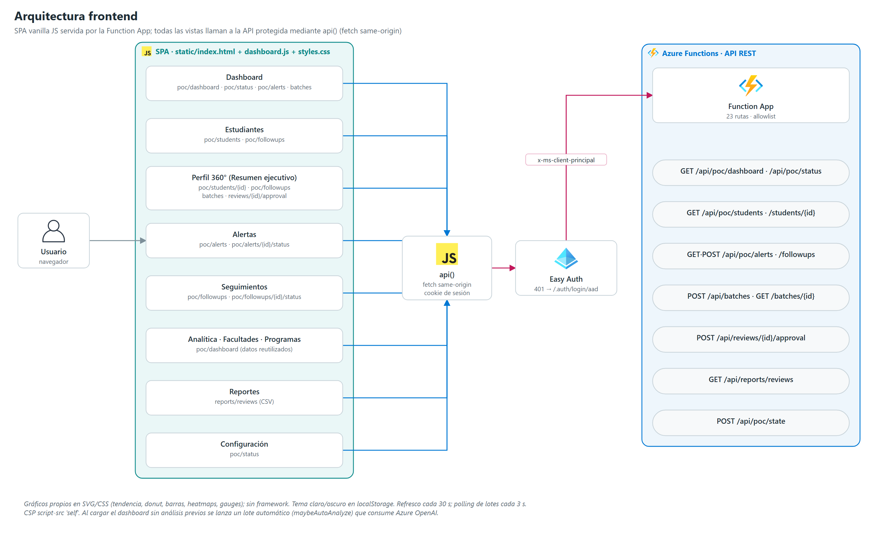

# 06 | Arquitectura frontend

## 1. Tecnología

| Aspecto | Implementación |
|---|---|
| Tipo | SPA en un único `index.html` con vistas que se muestran u ocultan |
| Código | `static/dashboard.js` (JavaScript sin framework), `static/styles.css` |
| Gráficos | Propios en SVG/CSS: tendencia (SVG), donut (conic-gradient), barras HTML, heatmap programa × semestre, sparklines, gauges de arco, mapa de calor de asignaturas en la vista ejecutiva |
| Tipografía | Inter y Quicksand (Google Fonts) |
| Tema | Claro/oscuro, persistido en `localStorage["fumc-theme"]` |
| Seguridad | CSP `script-src 'self'`, `X-Frame-Options: DENY`, `nosniff`, `no-referrer` (cabeceras de `serve_index`) |
| Servido por | `GET /` y `GET /{asset}` de la Function App (lista blanca de archivos) |

## 2. Vistas y API consumida

Todas las llamadas pasan por `api()` (`fetch` same-origin con la cookie de sesión de Easy Auth). Un `401` muestra el enlace a `/.auth/login/aad`.

| Vista | Funcionalidad | Endpoints |
|---|---|---|
| Dashboard | KPI con sparklines, evolución del riesgo, donut por nivel, riesgo por sede y facultad, tabla de programas, heatmap, alertas prioritarias, análisis recientes, filtros | `GET /api/poc/dashboard`, `GET /api/poc/status`, `GET /api/poc/alerts?status=open&limit=5`, `POST /api/batches`, `GET /api/batches/{id}`, `GET /api/reviews/{id}` |
| Estudiantes | Búsqueda, filtros, segmentos por riesgo, tabla paginada (25), vista rápida, asignar responsable, exportar CSV | `GET /api/poc/students`, `POST /api/poc/followups`, `POST /api/poc/followups/{id}/status` |
| Perfil 360° | Pestañas **Resumen ejecutivo** (por defecto), **Expediente** y **Seguimientos**; "Generar plan", "Validar plan", "Descartar", "Asignar" | `GET /api/poc/students/{id}` (incluye `executive`), `GET /api/poc/followups?student_id=`, `POST /api/batches`, `POST /api/reviews/{id}/approval`, `POST /api/poc/followups` |
| Alertas | Listado y cambio de estado | `GET /api/poc/alerts`, `POST /api/poc/alerts/{id}/status` |
| Seguimientos | Crear, iniciar, completar | `GET/POST /api/poc/followups`, `POST /api/poc/followups/{id}/status` |
| Analítica · Facultades · Programas | Reutilizan los datos del dashboard | `GET /api/poc/dashboard` |
| Reportes | Exportación CSV de análisis | `GET /api/reports/reviews` |
| Configuración | Parámetros de solo lectura | `GET /api/poc/status` |

La SPA no llama a `/api/cases*`, `GET /api/reviews`, `/api/model/feedback` ni `/api/ml/predict`.

## 3. Resumen ejecutivo del estudiante

Diseñado para que un directivo entienda un caso en menos de 15 segundos: cabecera con riesgo + probabilidad, prioridad y estado; diagnóstico único con la evidencia en barras de impacto; checklist de acciones; mapa de calor de asignaturas; línea de tiempo de intervenciones. No muestra informes por agente, tokens, costos ni nombres técnicos. Especificación completa en [05 · Vista ejecutiva](./05_Arquitectura_MultiAgente.md#7-vista-ejecutiva).

## 4. Principios de interacción

1. Si la API responde con error, la SPA muestra un mensaje de estado; no inventa datos ni usa expedientes locales de respaldo.
2. El score se presenta como probabilidad estimada junto a su nivel de riesgo; el diagnóstico usa lenguaje de asociación, no de causa.
3. Procedencia (sintético/institucional), corte, versión y limitaciones se conservan para auditoría y reportes, no en la vista ejecutiva.
4. Lanzar lotes, decidir propuestas y exportar requieren Entra ID y la allowlist del revisor.
5. No se muestran nombres, documentos ni cifras de ejemplo como si fueran datos reales.
6. Cada dato aparece una sola vez en la vista ejecutiva y el texto visible se limita a un diagnóstico de ≤ 150 palabras, independientemente del tamaño de la población.

## 5. Origen de la información presentada

| Área visible | Origen | ¿Usa GPT? |
|---|---|---|
| Conteos, niveles, probabilidades y filtros | Snapshot sintético en Azure Tables con el score del modelo (Azure ML v2) | No; el LLM no produce el score |
| Distribución por sede, programa y facultad; heatmap | Agregaciones de la API sobre el snapshot | No |
| Tendencia histórica | Filas sembradas con `DataSource = simulated-history` | No; es una tendencia simulada |
| Alertas iniciales | Regla de riesgo alto/crítico | No; no deben presentarse como "generadas por IA" |
| Seguimientos iniciales | Registros de demostración sembrados en Tables | No |
| Diagnóstico consolidado y acciones propuestas | Resultado del sintetizador guardado en Blob | Sí; solo tras un lote de agentes |
| Factores, evidencia, prioridad y estado de acciones | Consolidación determinista en `sat_agents/executive.py` | No |
| Diagnóstico "Preliminar" | Plantilla determinista a partir de los factores | No |

La SPA no invoca el endpoint de Azure ML en tiempo real.

## 6. Comportamiento temporal

| Mecanismo | Valor |
|---|---|
| Refresco automático | Cada 30 s con la pestaña visible y sesión válida |
| Caché del dashboard en cliente | 30 s |
| Sondeo de un lote en curso | Cada 3 s |
| Filtros | Debounce 120 ms |

## 7. Llamadas que consumen Azure OpenAI

| Disparador | Condición |
|---|---|
| "Analizar casos prioritarios" / "Analizar casos (máx. 50)" | Clic explícito; el servidor limita a 20 casos |
| "Generar plan" en el perfil | Clic explícito; un estudiante |
| "Actualizar" en el dashboard | Refresca datos y, si hay casos pendientes, inicia un lote tras confirmación |
| **Lote automático** (`maybeAutoAnalyze`) | Al cargar el dashboard cuando la cohorte tiene casos pendientes y ninguno procesado; una vez por sesión del navegador y una vez por cohorte en el servidor (`claim_auto_analysis`) |

El botón "Analizar casos (máx. 50)" de la vista Estudiantes conserva un texto que no coincide con el límite real de 20.

Ningún lote se lanza sin sesión autorizada, con la POC pausada o sin casos pendientes; en ese caso "Actualizar" solo refresca datos. Al terminar un lote, la SPA vuelve a consultar el dashboard y lista las propuestas guardadas.

## 8. Limitaciones conocidas

- Las iniciales del avatar ("AM") están fijas en `index.html`.
- La conmutación de pausa de la POC (`POST /api/poc/state`) está en una fila oculta del dashboard.
- Los `POST` desde el navegador requieren que el dominio figure en "Allowed external redirect URLs" de Easy Auth (protección CSRF).
