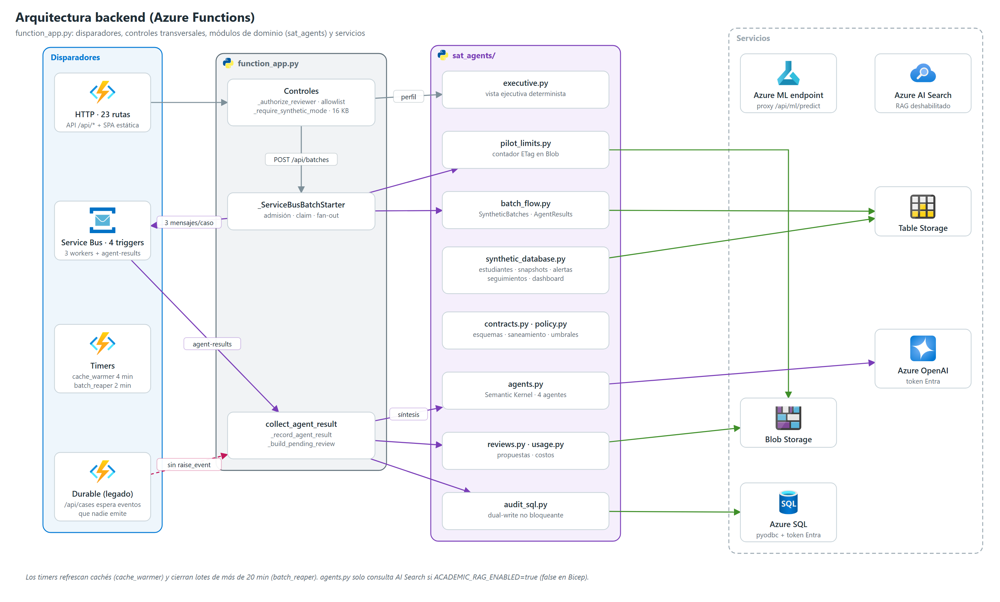

# 07 | Arquitectura backend



## 1. Aplicación

`azure/agent_platform/function_app.py` define una sola `df.DFApp` con `http_auth_level=ANONYMOUS` (la autenticación la impone Easy Auth y el código aplica la allowlist). `host.json`: `routePrefix: ""`, `functionTimeout` 10 min, Service Bus `maxConcurrentCalls` 50 y `prefetchCount` 0, task hub `FumcSatAgentHub`, extension bundle `[4.*, 5.0.0)`, muestreo de Application Insights sin incluir `Request`.

**35 funciones**: 23 HTTP, 4 Service Bus, 2 timers, 2 orquestadores y 4 actividades Durable (heredados).

## 2. API HTTP

Todas las rutas `/api/*` exigen `DATA_MODE=synthetic` (si no, 503) y la allowlist de revisores (401 sin sesión, 403 fuera de la lista). Cuerpo máximo 16 KB (1 MB en `/api/ml/predict`).

| Método | Ruta | Función | Descripción | Almacenamiento |
|---|---|---|---|---|
| GET | `/` | `serve_index` | SPA con cabeceras de seguridad | archivos |
| GET | `/{asset}` | `serve_static_asset` | `dashboard.js`, `styles.css`, logos (lista blanca) | archivos |
| POST | `/api/ml/predict` | `predict_with_azure_ml` | Proxy al endpoint Azure ML | AML |
| GET | `/api/poc/status` | `get_poc_status` | Estado de la POC, resumen de la base, cupos | Tables, Blob |
| POST | `/api/poc/state` | `set_poc_status` | Pausar/reanudar (409 si hay lote activo) | `SyntheticControl` |
| GET | `/api/poc/dashboard` | `get_synthetic_dashboard_api` | Agregados con filtros + resumen de revisiones (caché 60 s) | Tables, Blob |
| GET | `/api/poc/alerts` | `list_synthetic_alerts_api` | Alertas por estado y filtros | `SyntheticAlerts` |
| POST | `/api/poc/alerts/{alert_id}/status` | `update_synthetic_alert_api` | Reconocer / resolver | `SyntheticAlerts` |
| GET | `/api/poc/followups` | `list_synthetic_followups_api` | Seguimientos | `SyntheticFollowups` |
| POST | `/api/poc/followups` | `create_synthetic_followup_api` | Crear seguimiento (201) | `SyntheticFollowups`, SQL `AuditEvent` |
| POST | `/api/poc/followups/{followup_id}/status` | `update_synthetic_followup_api` | Cambiar estado o responsable | `SyntheticFollowups` |
| GET | `/api/poc/students` | `list_synthetic_students_api` | Búsqueda paginada (1–100) | caché sobre Tables |
| GET | `/api/poc/students/{student_id}` | `get_synthetic_student_api` | Expediente + revisión + `executive` | Tables, Blob |
| POST | `/api/batches` | `start_synthetic_batch` | Inicia lote (202) | Tables, Blob, Service Bus |
| GET | `/api/batches/{batch_id}` | `get_batch_status` | Progreso del lote | `SyntheticBatches` |
| POST | `/api/cases` | `start_case` | Flujo Durable heredado (**no finaliza**, ver [05](./05_Arquitectura_MultiAgente.md#5-flujo-durable-heredado-defecto-conocido)) | Durable |
| GET | `/api/cases/{instance_id}` | `get_case_status` | Estado Durable | Durable |
| GET | `/api/reviews` | `get_reviews` | Conteos y propuestas | Blob |
| GET | `/api/reviews/{review_id}` | `get_review_detail` | Propuesta + decisión (redactada) | Blob |
| POST | `/api/reviews/{review_id}/approval` | `approve_review` | Decisión humana de escritura única (409 si ya existe otra) | Blob, `SyntheticFollowups`, SQL |
| GET | `/api/reports/reviews` | `get_review_report_rows_api` | Filas para CSV | Blob |
| GET · POST | `/api/model/feedback` | `list_model_feedback` · `submit_model_feedback` | Retroalimentación de revisores | archivo local JSONL |

## 3. Disparadores no HTTP

| Tipo | Función | Configuración | Responsabilidad |
|---|---|---|---|
| Service Bus | `socioeconomic_worker` | cola `socioeconomic-analysis` | Agente socioeconómico |
| Service Bus | `academic_worker` | cola `academic-analysis` | Agente académico |
| Service Bus | `wellbeing_worker` | cola `wellbeing-analysis` | Agente de bienestar |
| Service Bus | `collect_agent_result` | cola `agent-results` | Colector, finalización, síntesis |
| Timer | `cache_warmer` | `30 */4 * * * *`, al arrancar | Refresca cachés de casos, dashboard y revisiones; verifica SQL |
| Timer | `batch_reaper` | `0 */2 * * * *` | Falla lotes > 20 min y libera cupos |
| Durable | `analysis_orchestrator`, `batch_orchestrator` + 4 actividades | — | Heredados; no usados por la SPA |

## 4. Módulos y dependencias

```text
function_app.py ─┬─ sat_agents.agents ──── contracts, policy, executive.risk_band  (semantic_kernel, openai, azure-search)
                 ├─ sat_agents.contracts ── policy
                 ├─ sat_agents.executive ── policy
                 ├─ sat_agents.synthetic_database ── policy                  (azure-data-tables)
                 ├─ sat_agents.batch_flow ── synthetic_database
                 ├─ sat_agents.pilot_limits · reviews                         (azure-storage-blob)
                 ├─ sat_agents.usage
                 ├─ sat_agents.audit_sql ── policy, synthetic_database, src.persistence.sql_repository (pyodbc)
                 └─ src.ml.feedback_loop
scripts/* ── sat_agents.{training_cohort, rescoring, legacy_replacement} + src.ml.endpoint_scoring
```

`function_app.py` resuelve la raíz del repositorio para importar `src/`; el paquete publicado debe incluir `src/`.

## 5. Configuración (app settings)

| Grupo | Variables | Fuente |
|---|---|---|
| Runtime | `FUNCTIONS_EXTENSION_VERSION=~4`, `AzureWebJobsFeatureFlags=EnableWorkerIndexing`, `AzureWebJobsStorage__accountName`, `AzureWebJobsStorage__credential=managedidentity`, `APPLICATIONINSIGHTS_CONNECTION_STRING` | Bicep |
| Azure OpenAI | `AZURE_OPENAI_ENDPOINT`, `AZURE_OPENAI_CHAT_DEPLOYMENT`, `AZURE_OPENAI_MODEL`, `AZURE_OPENAI_API_VERSION`, `AZURE_OPENAI_{INPUT,OUTPUT}_PRICE_PER_1M_TOKENS` | Bicep |
| Opcionales de agentes | `AZURE_OPENAI_REASONING_EFFORT` (low), `AGENT_MAX_COMPLETION_TOKENS` (2048), `AGENT_MAX_COMPLETION_TOKENS_SYNTHESIS` (3072) | Código (por defecto) |
| Mensajería y almacenamiento | `SERVICEBUS_NAMESPACE`, `ServiceBusConnection__fullyQualifiedNamespace`, `BLOB_STORAGE_URL`, `REVIEWS_CONTAINER` | Bicep |
| Seguridad | `REVIEWER_AUTH_ENFORCED=true`, `CASE_REVIEWER_ALLOWED_PRINCIPAL_IDS`, `ENTRA_CLIENT_SECRET` (referencia a Key Vault) | Bicep |
| POC | `DATA_MODE=synthetic`, `POC_ENABLED`, `SYNTHETIC_STUDENT_COUNT` (20000), `SYNTHETIC_COLD_START_LIMIT` (5000), `AUTO_ANALYZE_TOP_N`, `BATCH_TIMEOUT_MINUTES` (20) | Bicep / código |
| SQL | `SQL_PERSISTENCE_ENABLED=true`, `SQL_SERVER`, `SQL_DATABASE`; opcionales `SQL_MODEL_NAME`, `SQL_MODEL_VERSION`, `SQL_INFERENCE_SOURCE`, `AGENT_PROMPT_VERSION` | Bicep / código |
| RAG | `ACADEMIC_RAG_ENABLED=false`, `AZURE_SEARCH_ENDPOINT`, `AZURE_SEARCH_INDEX` | Bicep |
| Azure ML | `AZURE_ML_ENDPOINT_URL`, `AZURE_ML_ENDPOINT_KEY`, `AZURE_ML_DEPLOYMENT_NAME` | **No definidas en Bicep** (manual) |

## 6. Defectos y riesgos conocidos

| Defecto | Ubicación | Efecto |
|---|---|---|
| Flujo Durable sin `raise_event` | `analysis_orchestrator`, `collect_agent_result` | `POST /api/cases` expira siempre tras 15 min |
| Retroalimentación en archivo local | `src/ml/feedback_loop.py` | Datos perdidos o escritura fallida en Flex Consumption |
| Endpoint AML sin configurar en Bicep | `/api/ml/predict` | 500 hasta configurar manualmente |
| Errores de SQL silenciados | `audit_sql.py` | La auditoría puede quedar incompleta sin alerta visible (solo log) |
| KPI `pending_reviews` | `synthetic_database.py` | Cuenta snapshots procesados, no revisiones pendientes |
