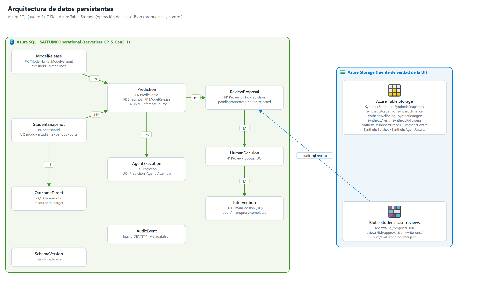

# 08 | Arquitectura de base de datos

## 1. Almacenes y rol

| Almacén | Rol | Acceso |
|---|---|---|
| Azure Table Storage | **Fuente de verdad de la UI**: cohorte, snapshots, alertas, seguimientos, lotes, control | `azure-data-tables` con identidad administrada; endpoint derivado de `BLOB_STORAGE_URL` |
| Azure Blob Storage | Propuestas, aprobaciones y contador del piloto | `azure-storage-blob` con identidad administrada |
| Azure SQL Database | **Auditoría relacional** de predicciones, agentes, propuestas, decisiones e intervenciones | pyodbc + ODBC Driver 18 + token Entra |

## 2. Azure SQL — `SATFUMCOperational`

Servidor `satfumc-sql-<sufijo>`, base serverless `GP_S_Gen5_1` (0,5–1 vCore, autopausa 60 min, 2 GB). Esquema en `azure/agent_platform/infra/sql_schema.sql` (idempotente, `IF OBJECT_ID … IS NULL`), versión 1 `baseline`.

| Tabla | Clave primaria | Relaciones y restricciones |
|---|---|---|
| `SchemaVersion` | `Version` | Versión aplicada |
| `ModelRelease` | (`ModelName`, `ModelVersion`) | Umbral en [0, 1]; `MetricsJson` válido |
| `StudentSnapshot` | `SnapshotId` | UQ (DataMode, PseudonymizedStudentId, AcademicPeriod, PredictionCut, SourceDatasetVersion); `DataMode` ∈ {synthetic, institutional} |
| `Prediction` | `PredictionId` | FK → `StudentSnapshot`, FK → `ModelRelease`; UQ (Snapshot, Model, Version); `RiskLevel` ∈ {Bajo, Medio, Alto, Crítico}; `InferenceSource` ∈ {azure_ml, synthetic_fixture} |
| `AgentExecution` | `AgentExecutionId` | FK → `Prediction`; UQ (Prediction, Agent, Attempt); estado ∈ {queued, running, succeeded, failed, timed_out} |
| `ReviewProposal` | `ReviewId` | FK → `Prediction` (UQ); estado ∈ {pending_approval, approved, edited, rejected} |
| `HumanDecision` | `HumanDecisionId` | FK → `ReviewProposal` (UQ); decisión ∈ {approved, edited, rejected} |
| `Intervention` | `InterventionId` | FK → `HumanDecision` (UQ); estado ∈ {open, in_progress, completed, cancelled} |
| `OutcomeTarget` | `SnapshotId` | FK → `StudentSnapshot`; madurez del target |
| `AuditEvent` | `bigint IDENTITY` | `MetadataJson` válido; índice por entidad |

7 claves foráneas y 4 índices no únicos (`IX_StudentSnapshot_StudentPeriod`, `IX_Prediction_RiskCreated`, `IX_AgentExecution_Prediction`, `IX_AuditEvent_Entity`). El esquema declara que no almacena identificadores directos.

### 2.1 Escrituras desde la aplicación (`audit_sql.py`)

Activas con `SQL_PERSISTENCE_ENABLED=true`. Son **no bloqueantes**: un error se registra en el log y no interrumpe el análisis.

| Evento | Tablas |
|---|---|
| Caso finalizado (`_build_pending_review`) | `ModelRelease` (si no existe), `StudentSnapshot` (si no existe), `Prediction`, 4 × `AgentExecution` (socioeconómico, académico, bienestar, síntesis con tokens, modelo e intento), `ReviewProposal`, `AuditEvent` `review.proposed` |
| Decisión humana (`approve_review`) | `HumanDecision`, actualización de `ReviewProposal`, `Intervention`, `AuditEvent` `review.<decisión>` |
| Seguimiento creado | `AuditEvent` `followup.created` |
| Arranque (`cache_warmer`) | Comprobación de conexión |

Valores fijos actuales: `DataMode = synthetic`; modelo por defecto `SAT_FUMC_LightGBM_Model` versión `2`; `ensure_model_release` inserta un registro mínimo (umbral 0,5, estado `pending_review`) si el modelo no existe. Verificación del 2026-11-12: 20 predicciones, 20 propuestas, 80 ejecuciones de agente y 20 eventos de auditoría ([12 §9](./12_Guia_Operacion.md#9-validación-e2e-del-2026-11-12)).

### 2.2 Acceso

`src/persistence/sql_repository.py::connect_entra` obtiene un token `https://database.windows.net/.default` con `DefaultAzureCredential` y reintenta ante errores transitorios y de reanudación del modo serverless. La identidad de la Function App tiene `db_datareader` y `db_datawriter`, asignados manualmente (no hay script en el repositorio). `AzureSqlRepository.apply_schema` aplica el DDL y registra la versión.

## 3. Azure Table Storage

| Tabla | PartitionKey / RowKey | Uso |
|---|---|---|
| `SyntheticStudents` | `students` / `ST-SYN-######` | Perfil |
| `SyntheticSnapshots` | periodo / estudiante | Probabilidad, nivel, estado del análisis, `ReviewId`, `FeaturesJson` |
| `SyntheticAcademic` | estudiante / asignatura | Nota y asistencia al corte |
| `SyntheticFinance` · `SyntheticWellbeing` | estudiante / periodo | Mora, financiación, beca · apoyo, sesiones, asistencia |
| `SyntheticTargets` | — | Target; nunca leído por agentes |
| `SyntheticAlerts` · `SyntheticFollowups` | — | Alertas por regla · seguimientos con historial |
| `SyntheticDashboardTrends` | — | Tendencia `simulated-history` |
| `SyntheticControl` | `control` / `poc`, `legacy-replacement` | `Enabled`, versión de siembra, tamaño, estado de migraciones |
| `SyntheticBatches` · `SyntheticAgentResults` | lote / caso · caso / agente | Orquestación del lote (`batch_flow.py`) |

Las tablas se crean con `create_table_if_not_exists`.

## 4. Azure Blob Storage

| Contenedor / ruta | Contenido | Regla |
|---|---|---|
| `student-case-reviews/reviews/{id}/proposal.json` | Propuesta con análisis, síntesis, uso y costo | Estado `pending_approval` |
| `student-case-reviews/reviews/{id}/approval.json` | Decisión humana | Escritura única (`overwrite=False`) |
| `student-case-reviews/pilot/evaluation-counter.json` | Contador del piloto | Concurrencia optimista por ETag |
| `function-deployment-packages` | Paquete de despliegue Flex | Privado |

## 5. Respaldo y recuperación

`scripts/replace_legacy_cohort.py` exporta las tablas a `outputs/backups/<marca>/` (JSONL) antes de reemplazar la cohorte. Azure SQL usa respaldo LRS gestionado. No hay política de retención ni restauración automatizada documentada para Tables y Blob.
