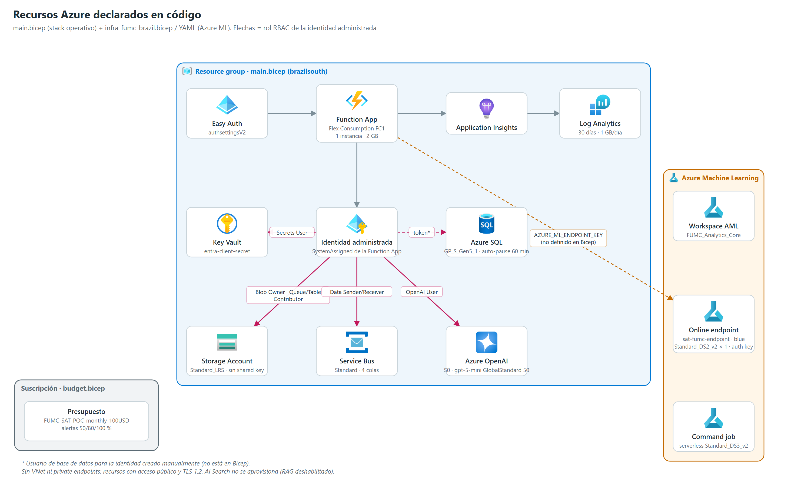

# 09 | Arquitectura Azure

## 1. Stack operativo (`azure/agent_platform/infra/main.bicep`)

Ámbito: grupo de recursos existente, región por defecto `brazilsouth`. Despliegue en vivo verificado: Function App `FUMCanalyticscore`, grupo `FUMC.CaseReviewer`, Linux, Python 3.11, publicada por zip deploy con compilación remota ([12 Guía de operación, §9](./12_Guia_Operacion.md#9-validación-e2e-del-2026-11-12)).

| Recurso | Nombre por defecto | SKU / configuración | Propósito |
|---|---|---|---|
| Storage Account | `fumcanalyticsre113684679` | Standard_LRS, StorageV2, Hot; sin acceso público a blobs; **sin shared key**; TLS 1.2 | Tables, Blob, almacenamiento de Functions y Durable |
| Contenedores Blob | `student-case-reviews`, `function-deployment-packages` | Privados | Propuestas; paquete Flex |
| Key Vault | `fumcanalyticsre392393878` | standard, RBAC, soft delete 7 días, purge protection | Secreto `entra-client-secret` |
| Azure SQL Server | `satfumc-sql-<uniqueString>` | v12, TLS 1.2, administrador `satadmin` + contraseña; admin Entra opcional | Servidor de auditoría |
| Azure SQL Database | `SATFUMCOperational` | **GP_S_Gen5_1** serverless, 0,5 vCore mín., autopausa 60 min, 2 GB | Auditoría (10 tablas) |
| Firewall SQL | `AllowAzureServices` | 0.0.0.0–0.0.0.0 | Solo servicios de Azure |
| Log Analytics | `<appInsights>-law` | PerGB2018, 30 días, 1 GB/día | Logs |
| Application Insights | `fumcanalyticsre0088876584` | Basado en workspace | Telemetría |
| Azure OpenAI | `FUMCAnalitysReviewer` | S0, `disableLocalAuth` | Modelo de los agentes |
| Despliegue OpenAI | `sat-gpt5-mini` | `gpt-5-mini` 2025-08-07, GlobalStandard, capacidad 50, RAI `DefaultV2` | Chat completions |
| App Service Plan | `<functionApp>-plan` | **FC1 Flex Consumption**, Linux | Plan de Functions |
| Function App | `FUMCanalyticscore` | Python 3.11, máx. 1 instancia, 2.048 MB, HTTPS only, FTPS deshabilitado, identidad asignada por el sistema | API, workers, SPA |
| Service Bus | `satfumc-sb-<uniqueString>` | Standard, `disableLocalAuth`, TLS 1.2 | Mensajería de agentes |
| Colas | `socioeconomic-analysis`, `academic-analysis`, `wellbeing-analysis`, `agent-results` | TTL 1 día, lock 5 min, 5 entregas, duplicados 10 min, dead-letter | Fan-out / fan-in |
| Easy Auth | `authsettingsV2` | `requireAuthentication`, `RedirectToLoginPage`, emisor AAD v2, audiencia = client ID | Inicio de sesión |

### 1.1 Roles RBAC de la identidad administrada

| Rol | Ámbito |
|---|---|
| Key Vault Secrets User | Key Vault |
| Cognitive Services OpenAI User | Azure OpenAI |
| Azure Service Bus Data Sender · Data Receiver | Service Bus |
| Storage Blob Data **Owner** · Queue Data Contributor · Table Data Contributor | Storage |
| `db_datareader` · `db_datawriter` | Base SQL (**asignado manualmente**, no en Bicep) |

No se asigna rol de Azure AI Search (no se aprovisiona).

### 1.2 Presupuesto (`budget.bicep`)

`FUMC-SAT-POC-monthly-100USD` a nivel de suscripción, alertas reales al 50/80/100 % y de pronóstico al 80 %. **Un presupuesto notifica; no detiene el gasto.**

### 1.3 Diferencias entre Bicep y el entorno en vivo

Ajustes aplicados a mano durante la validación del 2026-11-12 que **no están en `main.bicep`**; un redespliegue de la plantilla puede revertirlos u omitirlos:

| Elemento | Bicep | Entorno en vivo | Acción recomendada |
|---|---|---|---|
| Capacidad de `sat-gpt5-mini` | 50 | 200 (se elevó desde 5 tras errores `429`; se factura por tokens) | Parametrizar la capacidad |
| Cola `wellbeing-analysis` | Definida | Creada a mano con las mismas propiedades (la infraestructura previa era anterior al Bicep actual) | Ninguna si se redespliega con el Bicep vigente |
| Easy Auth: "Allowed external redirect URLs" y CORS | No configurados | Dominio de la app añadido; sin él, todo `POST` con cookie de sesión devuelve `403` (protección CSRF) | Incorporarlos a `authsettingsV2` / `siteConfig` |
| Usuario de la identidad en SQL | No | `db_datareader` · `db_datawriter` | Script post-despliegue |
| Accesos temporales de despliegue | No | Roles del usuario de despliegue (Table, Blob, Service Bus Data Sender), regla de firewall SQL `deploy-workstation`, configuración de diagnóstico `diag-http-auth` | **Retirar** |

Otros hallazgos del despliegue:

- Bicep emite la advertencia `BCP187` sobre `sku` en la definición de la base SQL; ARM terminó `Succeeded` y la base quedó `Online`. Conviene revisar la versión de API.
- Nombres no confirmados por la evidencia del 2026-11-12 (proceden de la verificación del 2026-11-09 y pueden corresponder a un despliegue anterior): grupo `rg-sat-fumc-prod` con el despliegue Bicep `satfumc-prod`, Storage `satfumcst8e039be1e4`, Key Vault `satfumckvea1ada48`. El servidor SQL en uso se documenta como `satfumc-sql-fumc01` (nombre por parámetro, no el valor por defecto con `uniqueString`). Confirmar con `az resource list -g FUMC.CaseReviewer -o table` antes de citarlos.
- Los secretos (contraseña SQL, `entra-client-secret`, claves del endpoint AML) residen en Key Vault o en app settings; no copiarlos a documentación, issues ni logs.

## 2. Azure Machine Learning

| Elemento | Definición | Origen |
|---|---|---|
| Workspace | `FUMC_Analytics_Core` (`config.json`, `azure/config.json`) | Existente; `infra_fumc_brazil.bicep` es una plantilla anterior con otros nombres |
| Data asset | `sat-fumc-synthetic-100k:1` (uri_folder) | Carga manual |
| Entorno | Imagen OpenMPI Ubuntu 22.04 + `environments/conda.yaml` | `job.yaml` |
| Job de entrenamiento | Serverless `Standard_DS3_v2` × 1 | `components/job.yaml` |
| Modelo | `SAT_FUMC_LightGBM_Model` v2 | MLflow / registro |
| Endpoint | `sat-fumc-endpoint`, `auth_mode: key` | `endpoints/endpoint.yaml` |
| Despliegue | `blue`, `Standard_DS2_v2` × 1, entorno `sat-fumc-online:4` | `endpoints/deployment.yaml` |

`deploy_azure_resources.py` (registro inicial de data asset, entorno y modelo v1) y `components/scoring_job.yaml` (requiere un `cpu-cluster` que ningún archivo crea) son legado.

### 2.1 Alcance de la integración AML ↔ Functions

| Aspecto | Estado (2026-11-12) |
|---|---|
| Puntuación de la cohorte | Los 15.000 estudiantes se puntuaron con `sat-fumc-endpoint` (`blue`, modelo v2) mediante script (`replace_legacy_cohort.py` / `rescore_students.py`); el resultado se guarda en Azure Tables |
| Puntuación en tiempo real | La SPA y los agentes **no** invocan el endpoint; los agentes no alteran la probabilidad |
| Ruta `/api/ml/predict` | Requiere `AZURE_ML_ENDPOINT_URL`, `AZURE_ML_ENDPOINT_KEY` y `AZURE_ML_DEPLOYMENT_NAME` (configuración manual, no en Bicep) |
| Reentrenamiento en AML | Los tres jobs de reentrenamiento intentados fallaron al construir el entorno; se mantiene el modelo v2 |

Que existan YAML, jobs o un despliegue registrado no acredita por sí solo que el endpoint esté disponible o conectado: verificar su estado por separado (`az ml online-endpoint show`).

### 2.2 Azure AI Foundry

Azure AI Foundry **no** aloja el runtime de los agentes: estos corren en Azure Functions con Semantic Kernel y Azure OpenAI. Foundry se contempla solo para evaluación y gobierno de prompts y agentes en una fase posterior. El término "Foundry" en el nombre del experimento MLflow (`SAT-FUMC-Foundry`) no implica uso de ese servicio.

## 3. Red

Todos los recursos tienen acceso público con TLS 1.2. No hay VNet, private endpoints ni reglas de red restrictivas (salvo el firewall SQL). La protección se basa en identidad (Entra, identidad administrada, autenticación local deshabilitada en OpenAI y Service Bus, sin shared key en Storage).

## 4. Costos

| Componente | Modelo de costo | Control en el código |
|---|---|---|
| Azure OpenAI | Por token (precios configurados 0,25 / 2,00 USD por millón entrada/salida) | ≤ 20 casos por lote, 1 lote concurrente, 10.000 evaluaciones por piloto, reutilización de respuestas, costo estimado por propuesta |
| Function App | Flex Consumption por ejecución y memoria | Máx. 1 instancia; **los timers de 2 y 4 min mantienen la app activa** |
| Azure SQL | Serverless por vCore-segundo + almacenamiento | Autopausa 60 min (la verificación de `cache_warmer` puede reanudarla) |
| Endpoint AML | Instancia `Standard_DS2_v2` dedicada mientras exista | Ninguno automático: eliminar o escalar a cero manualmente |
| Service Bus, Storage, Key Vault, Log Analytics | Tarifa base / uso | Cuota diaria de 1 GB en Log Analytics |

Detener la Function App no pausa ni elimina SQL, Storage, Service Bus, Azure OpenAI, Key Vault, monitoreo ni el endpoint AML; revisar Cost Management por recurso. Procedimiento de verificación, pausa y apagado: [12 Guía de operación, §4](./12_Guia_Operacion.md#4-pausa-reanudación-y-apagado).
