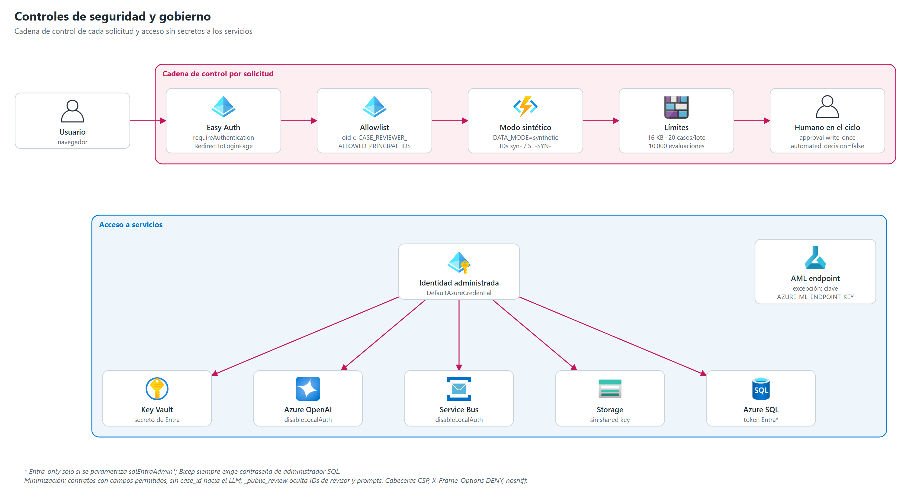

# 10 | Seguridad y gobierno

## 1. Cadena de control por solicitud

| # | Control | Implementación | Respuesta si falla |
|---|---|---|---|
| 1 | Autenticación | Easy Auth con Entra ID en toda la Function App (`requireAuthentication`, redirección a login) | 401 / redirección |
| 2 | Autorización | `_authorize_reviewer`: decodifica `x-ms-client-principal`, toma `oid` y lo compara con `CASE_REVIEWER_ALLOWED_PRINCIPAL_IDS`; exige `REVIEWER_AUTH_ENFORCED=true` | 401 sin cabecera · 403 fuera de lista · 503 si no está configurado |
| 3 | Modo de datos | `_require_synthetic_mode`: `DATA_MODE=synthetic` en todas las rutas, workers y actividades; IDs `syn-` (casos) y `ST-SYN-` (feedback) | 503 / 400 |
| 4 | Límites | Cuerpo ≤ 16 KB (1 MB en predicción), ≤ 20 casos por lote, 1 lote concurrente, 10.000 evaluaciones por piloto | 413 / 400 / 429 |
| 5 | Interruptor | `POC_ENABLED` + `SyntheticControl.Enabled` (`POST /api/poc/state`); no se pausa con un lote activo | 503 / 409 |
| 6 | Humano en el ciclo | `human_review_required=true`, `automated_decision=false`; aprobación de escritura única; el seguimiento solo se crea si se aprueba o edita | 409 si se intenta otra decisión |

Las rutas estáticas (`/` y `/{asset}`) dependen solo de Easy Auth.

## 2. Identidad y secretos

- Todo acceso a Storage, Service Bus, Key Vault, Azure OpenAI y Azure SQL usa la **identidad administrada** (`DefaultAzureCredential`). Azure OpenAI y Service Bus tienen la autenticación local deshabilitada y Storage no admite shared key.
- El secreto de la app registration de Entra se guarda en Key Vault y se consume como referencia (`ENTRA_CLIENT_SECRET`).
- **Excepciones**: el endpoint Azure ML usa clave (`AZURE_ML_ENDPOINT_KEY`, fuera de Bicep y de Key Vault); Azure SQL exige siempre una contraseña de administrador en Bicep y solo pasa a Entra-only si se parametrizan `sqlEntraAdminLogin` y `sqlEntraAdminObjectId`. `deploy.ps1` lee esa contraseña con `Read-Host` sin `-AsSecureString`.

## 3. Protección de datos

| Medida | Implementación |
|---|---|
| Datos sintéticos únicamente | Modo forzado en código y en Bicep; nombres ficticios generados |
| Minimización hacia el LLM | `agent_context()` excluye `case_id`, nombre, documento y target; contratos con lista blanca de campos |
| Datos no confiables | Documentos recuperados y entradas tratados como datos, nunca como instrucciones; citas validadas contra las fuentes entregadas |
| Redacción en la API | `_public_review` omite IDs de revisor, prompts y contenido de fuentes |
| SQL sin identificadores directos | `PseudonymizedStudentId`; `DataMode` explícito |
| Cabeceras web | CSP `script-src 'self'`, `X-Frame-Options: DENY`, `nosniff`, `no-referrer` |
| Registro | Muestreo en Application Insights; sin tokens ni prompts completos en logs |

No existe un motor de anonimización: la protección descansa en usar datos sintéticos y en la minimización de contratos.

## 4. Gobierno de IA

- Las salidas del LLM se validan con esquemas estrictos y se recortan a límites fijos; solo se aceptan 4 acciones de apoyo.
- Instrucciones comunes (`SHARED_AGENT_RULES`): la probabilidad no es causa ni decisión; no inferir atributos sensibles; no sugerir sanciones; todo es borrador para revisión profesional.
- Cada ejecución queda en `AgentExecution` con tokens, modelo e intento; cada decisión en `HumanDecision` y `AuditEvent`.
- El modelo predictivo no cumple la regla de promoción; su uso está limitado a la POC.

## 5. Brechas para uso institucional

| Brecha | Recomendación |
|---|---|
| Sin VNet ni private endpoints | Integración VNet de Functions y private endpoints para Storage, SQL, Service Bus, OpenAI y AML |
| Endpoint AML con clave | `auth_mode: aml_token` o identidad administrada; clave en Key Vault mientras tanto |
| Contraseña de administrador SQL | Entra-only por defecto en Bicep |
| Rol SQL manual | Script versionado para crear el usuario contenido y sus roles |
| `outputs/backups/` no ignorado por git | Añadir a `.gitignore` (contiene exportaciones de tablas) |
| Errores de auditoría silenciados | Alerta en Application Insights sobre fallos de `audit_sql` |
| Sin gobierno de datos reales | Fuentes aprobadas, evaluación de impacto, retención y consentimiento antes de cambiar `DATA_MODE` |
| Lote automático al cargar el dashboard | Requerir confirmación explícita si se quiere control estricto de consumo |
| Accesos temporales del despliegue | Retirar los roles de datos asignados al usuario de despliegue (Table, Blob, Service Bus Data Sender), la regla de firewall SQL `deploy-workstation` y la configuración de diagnóstico `diag-http-auth` |
| Backup/restore y retención sin verificar | Probar restauración de Azure SQL y definir retención para SQL, Tables y Blob |
| Mensajes en dead-letter de intentos anteriores (360) | Revisar y purgar; alerta sobre crecimiento de la DLQ |
| Sin escaneo de seguridad ni respuesta a incidentes | Análisis de dependencias y código en CI; procedimiento de incidentes con responsable |

## 6. Preparación para producción

Infraestructura desplegada no equivale a producto institucional listo: el aprovisionamiento y la escritura en SQL son hitos técnicos, no prueban desempeño ni aptitud para priorizar estudiantes reales.

### 6.1 Matriz de preparación (2026-11-12)

| Área | Estado | Pendiente |
|---|---|---|
| Aprovisionamiento Azure | Completado para la POC | Red privada y Entra-only en SQL (§5) |
| Publicación de Functions | Completada | Retirar el código Durable heredado (las actividades no se indexan) |
| Acceso Entra | Completado para la POC | Validar la allowlist con los revisores definitivos |
| Auditoría SQL | Integrada y verificada desde Functions | Backup/restore, retención y alertas de fallo |
| Azure ML → aplicación | Parcial | La cohorte se puntuó por script; sin inferencia por snapshot; los jobs de reentrenamiento en AML fallaron al construir el entorno |
| Evidencia del modelo | Insuficiente para promoción | Ninguna corrida cumple la regla; validación con datos institucionales |
| Prueba E2E autenticada | Completada con datos sintéticos | Prueba controlada de aprobación y rechazo con revisión de telemetría y errores |
| Datos FUMC autorizados | Pendiente | Conectores y aprobación de tratamiento |
| Operación y CD | Pendiente | CD con OIDC, aprobaciones, rollback, SLO y plan de operación |

### 6.2 Bloqueos antes de usar datos reales

| # | Ámbito | Requisito |
|---|---|---|
| 1 | Gobierno | Finalidad, fuentes, base legal, responsable, privacidad, residencia, minimización, retención y acceso aprobados |
| 2 | Target y temporalidad | Definición institucional de deserción, madurez del resultado, ventanas, variables disponibles por corte, censura y faltantes |
| 3 | Datos y calidad | Fuentes autorizadas, seudonimización, datasets versionados; pruebas de duplicados, leakage, deriva y reglas de calidad |
| 4 | Modelo | Holdout institucional temporal y por estudiante; recall ≥ 0,80 junto con precisión, F1, AUC, calibración, tasa de alertas, capacidad y equidad; bloquear promoción si no se cumple |
| 5 | Integración | Snapshot y versión comunes entre AML y agentes; conservar score y procedencia; probar errores, timeout, idempotencia, DLQ y contrato extremo a extremo |
| 6 | Persistencia | Backup/restore y retención verificados; RBAC mínimo con script versionado |
| 7 | Identidad y seguridad | Mínimo privilegio, red privada, pruebas de privacidad, escaneo y respuesta a incidentes |
| 8 | Operación | Dashboards y alertas en Application Insights (latencia, costo, errores), SLO y runbooks |
| 9 | Uso humano | Validación con orientadores y formación; ninguna decisión automática ni contacto al estudiante |

### 6.3 Orden recomendado de cierre

1. Retirar los accesos temporales de despliegue y limpiar las colas dead-letter.
2. Ejecutar una aprobación y un rechazo sintéticos controlados y validar telemetría y registros en SQL.
3. Verificar backup/restore y fijar retención.
4. Integrar la inferencia AML por snapshot solo con contrato común, endpoint autenticado sin clave y pruebas de scoring.
5. Mantener la plataforma sin uso institucional hasta cerrar gobierno, evaluación del modelo y operación (§6.2).
