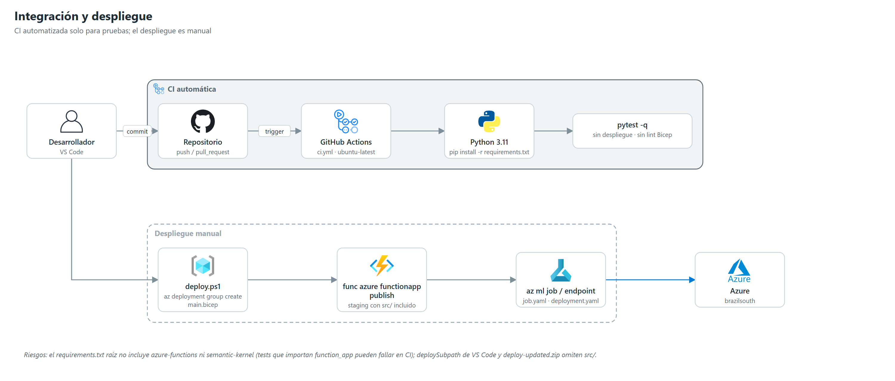

# 11 | DevOps y CI/CD

## 1. Integración continua

`.github/workflows/ci.yml`:

| Elemento | Valor |
|---|---|
| Disparadores | `push` y `pull_request` en cualquier rama |
| Permisos | `contents: read` |
| Job | `test` en `ubuntu-latest`, timeout 30 min |
| Pasos | `actions/checkout@v4` → `actions/setup-python@v5` (3.11, caché pip) → `pip install -r requirements.txt` → `python -m pytest -q` |

**Riesgo**: el `requirements.txt` raíz no incluye `azure-functions`, `azure-functions-durable`, `semantic-kernel`, `azure-data-tables` ni `azure-servicebus`, que sí están en `azure/agent_platform/requirements.txt`. Las pruebas que importan `function_app` pueden fallar en CI aunque pasen localmente (118 aprobadas, 1 omitida en la estación de desarrollo). Solución: instalar también `azure/agent_platform/requirements.txt` en el workflow.

No hay despliegue continuo, validación de Bicep (`bicep build`/what-if), análisis estático ni federación OIDC con Azure.

## 2. Despliegue (manual)

| Capa | Herramienta | Pasos |
|---|---|---|
| Infraestructura | `infra/deploy.ps1` o Azure CLI | `bicep build main.bicep` → what-if → `az deployment group create` con parámetros (secretos por canal protegido) |
| Presupuesto | Azure CLI | Despliegue a nivel de suscripción de `budget.bicep` |
| Esquema SQL | `AzureSqlRepository.apply_schema` o cliente SQL | Aplicar `sql_schema.sql`; crear el usuario de la identidad administrada con `db_datareader`/`db_datawriter` |
| Function App | Azure Functions Core Tools v4 | Preparar una carpeta con `host.json`, `function_app.py`, `requirements.txt`, `sat_agents/`, `static/` **y `src/`**; `func azure functionapp publish <app> --python` con build remoto |
| Modelo | Azure ML CLI v2 | `az ml job create -f azure/components/job.yaml`; registrar si es elegible; `az ml online-deployment create/update -f azure/endpoints/deployment.yaml` |
| Cohorte | `scripts/` | `seed_operational_data.py` o `replace_legacy_cohort.py` (respaldo previo), luego `rescore_students.py` cuando cambie el modelo |

**Riesgos del despliegue actual**:
- `.vscode/settings.json` publica `azure/agent_platform` como subcarpeta: omite `src/` y la app no arrancaría (`function_app.py` importa `src.ml.feedback_loop`).
- `azure/agent_platform/deploy-updated.zip` (ignorado por git) es un paquete antiguo sin `src/`, `audit_sql.py`, `batch_flow.py` ni `executive.py`.
- Gran parte del código vigente no está confirmado en git; el estado desplegado no es reproducible desde el historial hasta confirmarlo.

### 2.1 Verificación posterior y reversa

| Etapa | Procedimiento |
|---|---|
| Compuerta posterior al despliegue | `python scripts/validate_readiness.py` con `SAT_BASE_URL` y `SAT_BEARER_TOKEN` (revisor autorizado); genera `outputs/readiness_report.md` y devuelve código 1 si hay algún `FAIL`. Detalle en [12 Guía de operación, §2.1](./12_Guia_Operacion.md#21-verificador-de-preparación) |
| Reversa de código | Republicar el paquete anterior de la Function App (conservar el zip previo, con `src/`) |
| Reversa de datos sintéticos | Las ampliaciones de cohorte son aditivas: revertir implica borrar los IDs nuevos de las tablas `Synthetic*` y restaurar `StudentCount` en `SyntheticControl`, solo con respaldo previo. El reemplazo de cohorte se revierte desde `outputs/backups/` |
| Reversa de modelo | Volver a la versión anterior en `deployment.yaml`, redesplegar `blue`, ejecutar `rescore_students.py` y restaurar `SQL_MODEL_VERSION` |

## 3. Gestión de configuración

- Infraestructura: `main.bicep` + `main.parameters.example.json` (marcadores; los valores reales no se versionan).
- Funciones: app settings definidos en Bicep; las variables de Azure ML (`AZURE_ML_ENDPOINT_URL`, `AZURE_ML_ENDPOINT_KEY`, `AZURE_ML_DEPLOYMENT_NAME`) se configuran a mano. Recomendado: guardar la clave en Key Vault y referenciarla desde el app setting.
- Ajustes del entorno en vivo fuera de Bicep (capacidad OpenAI, redirect URLs/CORS de Easy Auth, roles SQL): ver [09 Arquitectura Azure, §1.3](./09_Arquitectura_Azure.md#13-diferencias-entre-bicep-y-el-entorno-en-vivo).
- Local: `local.settings.example.json` (copiar a `local.settings.json`, ignorado).
- Modelo: versión fijada en `deployment.yaml` y en `SQL_MODEL_VERSION`.

## 4. Hoja de ruta recomendada

1. Confirmar en git el código desplegado.
2. CI: instalar dependencias de la plataforma, `bicep build`, lint y pruebas en Python 3.11.
3. CD con OIDC hacia Azure, entorno de pruebas separado y aprobación manual para producción.
4. Script de empaquetado de la Function App que incluya `src/` (y retirar `deploySubpath`).
5. Despliegue del modelo por etapas (`blue`/`green`) condicionado a la regla de promoción.
6. Prueba E2E automatizada tras cada despliegue (`scripts/validate_readiness.py`).
