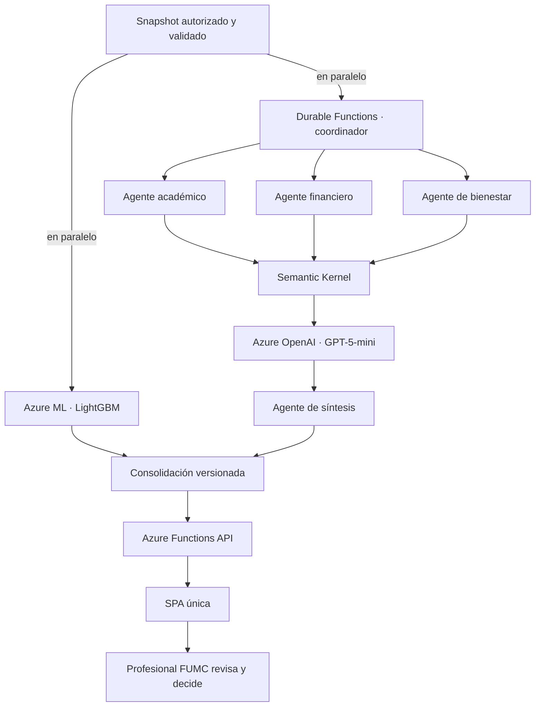

# 06.01 | Arquitectura de IA del SAT-FUMC

> El diseño canónico, sus brechas y los criterios de salida a producción están en [`ProductionArchitecture.md`](./ProductionArchitecture.md). Este documento resume las dos ramas de IA.

## 1. Flujo objetivo

## 2. Principios

- El modelo tabular produce la probabilidad; el LLM no la calcula, modifica ni interpreta como causalidad.
- Los agentes describen evidencia disponible, faltantes y límites. No infieren diagnósticos, mérito ni causas personales.
- La síntesis valida su esquema y conserva metadatos de modelo, prompt, fuentes permitidas y tokens.
- Toda recomendación es un borrador para revisión profesional. No se envían comunicaciones ni se ejecutan intervenciones automáticamente.
- El target permanece aislado de predictores e inputs de agentes.
- GPT-5-mini es el deployment configurado en la POC existente. Azure AI Foundry se plantea para evaluación y gobierno; el runtime actual es Semantic Kernel sobre Azure OpenAI, no Foundry Agent Service.

## 3. Estado actual y criterios de evaluación

El umbral se calibra en una ventana temporal de validación separada del holdout. La meta Recall ≥ 0,80 debe comprobarse en datos institucionales etiquetados, junto con precisión, F1, AUC, calibración, tasa de alertas, capacidad profesional y brechas de equidad. Un Recall alto obtenido clasificando prácticamente a todos como positivos no habilita promoción.

Los agentes se evalúan con casos aprobados y datos no identificables: validez de JSON, fidelidad a evidencia, citas, seguridad, sesgo, tasa de abstención, costo y latencia. Ningún benchmark sintético se presenta como eficacia sobre estudiantes reales.

Al 2026-11-09 la Function App está desplegada y Azure indexó sus funciones; sin embargo, el flujo real de la POC no combina un snapshot con scoring AML. La probabilidad de demo la genera el Digital Twin. Azure SQL está provisionado, pero no conectado a esta app; la persistencia actual usa Tables/Blob. No se verificó una invocación autenticada de agentes. Véase [`CloudDeploymentArchitecture.md`](./CloudDeploymentArchitecture.md) para evidencia Azure.
