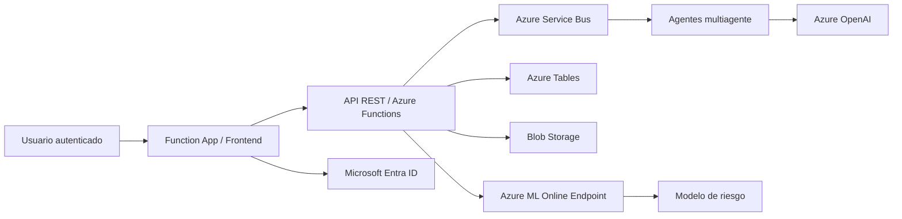

# Integración en Azure y guía de deshabilitación del proyecto

## 1. Estado real de la integración en Azure

El proyecto está integrado y desplegado en la suscripción correcta de `reverse05`, con la arquitectura actual operando en modo demo con datos sintéticos y válida para revisión funcional.

### Componentes conectados

- Azure Function App: sirve la interfaz web y expone la API de negocio.
- Azure ML Online Endpoint: recibe el payload del estudiante y devuelve la probabilidad y nivel de riesgo.
- Azure Tables: almacena registros sintéticos, alertas y seguimientos.
- Azure Blob Storage: guarda artefactos, archivos y metadatos del entorno.
- Azure Service Bus: coordina procesos y lotes de análisis.
- Azure OpenAI: aporta la síntesis LLM y análisis cualitativo del perfil.
- Microsoft Entra ID: controla acceso autenticado a la interfaz y a la API.

### Diagrama funcional

### Archivos clave del despliegue

- `azure/agent_platform/function_app.py` — backend de la app y orquestación del flujo.
- `azure/agent_platform/static/dashboard.js` — frontend y render de perfiles/alertas.
- `azure/endpoints/score.py` — script de inferencia compatible con Azure ML.
- `azure/endpoints/deployment.yaml` — despliegue del endpoint online.
- `azure/environments/online-environment.yaml` — entorno de inferencia.
- `azure/config.json` — configuración del entorno y despliegue de Azure.
- `src/ml/train_pipeline.py` — entrenamiento y evaluación del modelo.
- `docs/CloudDeploymentArchitecture.md` — descripción profesional de la arquitectura.

## 2. Cómo verificar que todo está conectado en Azure

Para validar la integración en el portal de Azure:

1. Abrir Azure Portal.
2. Ir a la suscripción `reverse05`.
3. Revisar estos recursos:
   - Function App
   - Azure Machine Learning workspace
   - Azure ML Online Endpoint / Deployment
   - Storage account
   - Service Bus namespace
   - Application Insights (si está habilitado)
4. En la Function App revisar:
   - App Settings
   - variables de entorno como `AZURE_ML_ENDPOINT_URL`, `AZURE_ML_ENDPOINT_KEY`, `AZURE_ML_DEPLOYMENT_NAME`
   - `DATA_MODE=synthetic`
5. En Azure ML revisar:
   - que el endpoint está en estado `Healthy` o `Succeeded`
   - que el deployment tiene un runtime operativo
   - que la llamada HTTP devuelve respuesta válida
6. En la UI revisar:
   - autenticación Entra funcionando,
   - carga de perfiles sintéticos,
   - dashboard con estudiantes visibles,
   - análisis y síntesis generada con el flujo real.

## 3. Cómo deshabilitar o pausar el proyecto para evitar costos

### Opción recomendada: pausa segura

Si quieres parar costos sin borrar la infraestructura:

1. En Azure Portal, entrar a la Function App.
2. Hacer `Stop` y dejarla detenida.
3. En Azure ML, detener o pausar el deployment del endpoint online.
4. Revisar Storage y Service Bus y dejar solo lo necesario.
5. Si no vas a usar la app por un tiempo, también puedes desactivar los recursos auxiliares del proceso.

### Opción más agresiva: eliminar el entorno

Si quieres dejarlo completamente apagado:

1. Eliminar el deployment del endpoint de Azure ML.
2. Eliminar el endpoint online si ya no se usará.
3. Eliminar o detener la Function App.
4. Revisar si el Storage y Service Bus ya no son necesarios y deshabilitarlos o eliminarlos según el caso.

### Lo importante para no pagar innecesariamente

- No dejar Azure ML endpoint funcionando sin uso.
- No dejar la Function App en modo siempre activo si no va a recibir tráfico.
- Revisar costos de OpenAI / Azure AI si se usan modelos de inferencia o análisis complemento.
- Mantener solo los recursos mínimos que respaldan la demo o la validación funcional.

## 4. Cómo volverlo a levantar después

Cuando quieras reactivar la solución:

1. Iniciar la Function App.
2. Verificar que las app settings siguen presentes.
3. Validar Azure ML endpoint y deployment.
4. Confirmar que el `DATA_MODE` sigue en `synthetic`.
5. Probar la UI conectada.
6. Hacer una llamada de prueba real al endpoint y confirmar respuesta 200.

## 5. Recomendación operacional final

Para el proyecto actual, la forma más segura y limpia de controlar costos es:

- dejar la solución en `Stop` o con Azure ML deployment pausado cuando no se vaya a usar,
- conservar la documentación y el código del proyecto,
- mantener la infraestructura solo para pruebas de validación y demostración,
- evitar tocar la cuenta educativa y continuar usando la suscripción `reverse05` únicamente.

Esto permite conservar la plataforma operativa, evitar costos innecesarios y volver a activarla rápida y reproduciblemente cuando haga falta.
