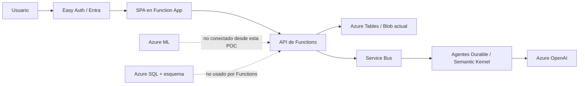

# 12.01 | Integración Azure, verificación y apagado seguro

> **Estado comprobado: 2026-11-09.** Esta guía distingue recursos aprovisionados, respuestas de autenticación y conexiones funcionales. No declara como conectados componentes que solo existen como código.

## 1. Estado real del entorno

El despliegue `satfumc-prod` del grupo `rg-sat-fumc-prod` terminó `Succeeded` en Brazil South. La Function App `satfumcfunc0e83b2486979` está `Running` en Linux con Python 3.11; tras publicar con Core Tools v4 se indexaron 33 funciones.

| Capacidad | Situación observada |
|---|---|
| Function App / SPA / API | Paquete publicado; host Running; 33 funciones indexadas |
| Easy Auth / Entra | Configurado; rutas anónimas devuelven 401 y login AAD devuelve 302 |
| Tables / Blob | Persistencia utilizada actualmente por la POC de agentes |
| Service Bus | Namespace y colas de la POC provisionados |
| Azure OpenAI | Cuenta y deployment `sat-gpt5-mini` provisionados |
| Azure SQL | Base `SATFUMCOperational` Online; nueve tablas del esquema aplicadas |
| Azure ML | Hay código y manifiestos, pero la Function App no envía sus casos al endpoint AML; el estado de un endpoint AML independiente no se validó aquí |
| Inicio autenticado E2E | No completado: no se observó un `200` posterior a login interactivo ni una corrida de agentes autenticada |

**Límite importante:** que SQL esté `Online` y tenga tablas no conecta `src/persistence/sql_repository.py` a la app. Functions sigue usando Azure Tables/Blob. La probabilidad de los casos sintéticos de la POC proviene del Digital Twin y no de AML.

## 2. Flujo que sí está desplegado y flujo pendiente



## 3. Comprobaciones recomendadas

### 3.1. Estado ARM y Function App

```powershell
az deployment group show -g rg-sat-fumc-prod -n satfumc-prod --query properties.provisioningState -o tsv
az functionapp show -g rg-sat-fumc-prod -n satfumcfunc0e83b2486979 --query state -o tsv
az functionapp function list -g rg-sat-fumc-prod -n satfumcfunc0e83b2486979 --query "[].name" -o table
```

### 3.2. Autenticación y rutas HTTP

En una sesión no autenticada, `GET /` y `GET /api/poc/status` respondieron `401`. `GET /.auth/login/aad` redirigió (`302`) a Microsoft. El `401` anónimo es esperado por la política de acceso, pero **no demuestra** que la autenticación interactiva, el callback y los permisos del revisor estén bien hasta obtener un `200` con un usuario de prueba autorizado.

Después de iniciar sesión, comprobar desde navegador:

1. La SPA carga y no utiliza datos locales de fallback.
2. `GET /api/poc/status` devuelve JSON válido al revisor autorizado.
3. La identidad aparece en `CASE_REVIEWER_ALLOWED_PRINCIPAL_IDS`.
4. Una consulta de solo lectura valida acceso a Tables/Blob sin iniciar inferencia ni consumir tokens.

No registrar cookies, cabeceras `Authorization`, tokens o secretos al hacer estas pruebas.

### 3.3. SQL y Azure ML

```powershell
az sql db show -g rg-sat-fumc-prod -s satfumc-sql-nfatitnqjp572 -n SATFUMCOperational --query "{status:status,sku:sku.name}" -o json
```

La presencia del esquema SQL debe verificarse por catálogo desde una sesión de base autorizada. Para AML, verificar la existencia/estado del recurso por separado; no inferir que está conectado a la POC a partir de YAML o de un deployment registrado.

## 4. Pausa y reducción de costos

### 4.1. Pausa temporal de la app

El endpoint `POST /api/poc/state` permite pausar nuevos trabajos, pero requiere sesión y revisor autorizados; no borra recursos. También puede detenerse la Function App:

```powershell
az functionapp stop -g rg-sat-fumc-prod -n satfumcfunc0e83b2486979
```

Detener Functions no pausa ni elimina SQL, Storage, Service Bus, Azure OpenAI, Key Vault o monitorización. Revisa Cost Management por recurso; los costos pueden continuar.

### 4.2. Eliminación completa

Eliminar el grupo de recursos borra de forma irreversible la aplicación, la base SQL, el almacenamiento, las colas, las claves/secretos y la telemetría asociados. Antes de hacerlo:

1. Confirma la suscripción y el grupo con el propietario del proyecto.
2. Exporta únicamente los datos sintéticos, logs y artefactos que deban conservarse.
3. Asegura que la contraseña SQL y los secretos ya rotados no sean requeridos por otra aplicación.
4. Verifica que no haya información institucional autorizada ni evidencia que deba preservarse.
5. Solicita aprobación explícita para la eliminación.

No automatizar `az group delete` en una tarea genérica ni usarlo como primera medida de control de costos.

## 5. Reactivación y validación posterior

1. Inicia la Function App con `az functionapp start`.
2. Revisa estado del host y que Azure tenga las funciones indexadas.
3. Confirma runtime Python 3.11, configuración `DATA_MODE=synthetic` y referencias Key Vault sin mostrar valores.
4. Repite el login Entra con una cuenta autorizada; confirma `200` en el endpoint de solo lectura.
5. Solo después, ejecuta una acción sintética acotada y verifica logs, identidad administrada, Service Bus y persistencia Tables/Blob.
6. No consideres validada la integración AML/SQL hasta probarla desde Functions con contratos y datos sintéticos.

## 6. Referencias operativas

- [`CloudDeploymentArchitecture.md`](./CloudDeploymentArchitecture.md) — inventario/evidencia de recursos.
- [`ProductionArchitecture.md`](./ProductionArchitecture.md) — arquitectura objetivo y brechas.
- [`ProductionReadiness.md`](./ProductionReadiness.md) — gates antes de producción.
- [`azure/agent_platform/infra/README.md`](../azure/agent_platform/infra/README.md) — Bicep, esquema SQL y publicación de Functions.
