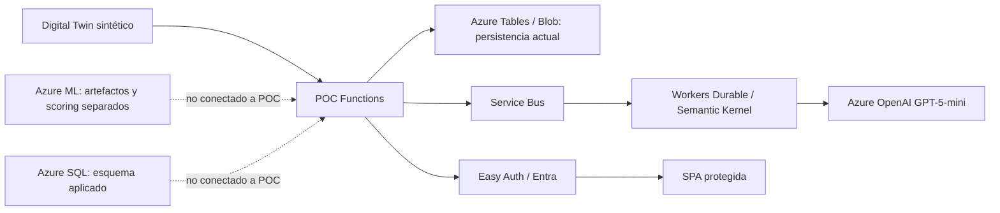

# 10.02 | Estado de despliegue y arquitectura en Azure

> **Corte de verificación: 2026-11-09.** Este documento registra el resultado observado en Azure y separa el aprovisionamiento de infraestructura de la validación del flujo funcional autenticado.

## 1. Resumen ejecutivo

La infraestructura de la POC sí quedó desplegada. El grupo `rg-sat-fumc-prod` está en Brazil South; el despliegue ARM/Bicep `satfumc-prod` terminó `Succeeded`. La Function App `satfumcfunc0e83b2486979` está `Running`, usa Linux/Flex Consumption con runtime Python 3.11 y reportó **33 funciones indexadas** luego de publicar el paquete con Azure Functions Core Tools v4 y compilación remota.

Esto **no** significa que esté verificado el servicio institucional de punta a punta. Los requests anónimos devuelven `401`; el endpoint `/.auth/login/aad` redirige (`302`) a Microsoft. No se completó el inicio de sesión interactivo ni se verificó un `200` autenticado, una carga de datos, una corrida de agentes o una inferencia AML desde Functions.

## 2. Inventario verificado

| Recurso/capacidad | Identificador | Estado comprobado |
|---|---|---|
| Grupo de recursos | `rg-sat-fumc-prod` | Existe |
| Function App | `satfumcfunc0e83b2486979` | `Running`; Linux; Python 3.11; 33 funciones indexadas |
| Plan Functions | Flex Consumption (`FC1`) | Provisionado |
| Storage | `satfumcst8e039be1e4` | `Succeeded`; acceso HTTPS requerido |
| Key Vault | `satfumckvea1ada48` | `Succeeded`; autorización RBAC |
| Service Bus | Namespace de la POC | `Succeeded`; colas definidas en Bicep |
| Azure OpenAI | Cuenta de la POC / `sat-gpt5-mini` | Cuenta y deployment `Succeeded` |
| Azure SQL | Servidor `satfumc-sql-nfatitnqjp572`; base `SATFUMCOperational` | Base `Online`, nivel Basic; nueve tablas del esquema aplicadas y verificadas |
| Application Insights / Log Analytics | Componentes de la POC | Provisionados |

Los nombres identifican recursos de esta POC; no incluyen tokens ni contraseñas. Los secretos se mantienen fuera del repositorio, en Key Vault. No copiar valores de configuración segura a documentación, issues o logs.

## 3. Estado real de las integraciones

### 3.1. Functions, agentes y SPA

El código publicado contiene la API y la SPA, las orquestaciones Durable y los workers de Service Bus. El host inició y Azure indexó 33 funciones. La configuración de Easy Auth requiere autenticación Entra y el código aplica además la allowlist de revisores.

Comprobaciones HTTP anónimas:

| Ruta | Respuesta | Interpretación |
|---|---:|---|
| `/` | `401` | Acceso anónimo bloqueado; no prueba que una sesión autenticada cargue la SPA |
| `/api/poc/status` | `401` | Acceso de API anónimo bloqueado, comportamiento esperado |
| `/.auth/login/aad` | `302` | Redirección a `login.microsoftonline.com`; no prueba el callback ni una respuesta autorizada |

La aceptación final de la app requiere abrir el login con una cuenta autorizada, completar Entra y comprobar la SPA/API con un `200`. Esa prueba no se pudo completar desde la sesión de despliegue.

### 3.2. Azure SQL

`azure/agent_platform/infra/sql_schema.sql` se aplicó a `SATFUMCOperational`. Se comprobaron estas nueve tablas: `ModelRelease`, `StudentSnapshot`, `Prediction`, `AgentExecution`, `ReviewProposal`, `HumanDecision`, `Intervention`, `OutcomeTarget` y `AuditEvent`.

El esquema y la base existen, pero la Function App **todavía persiste en Azure Tables/Blob**. `src/persistence/sql_repository.py` no está integrado en las rutas/servicios de Functions ni se validó una escritura operacional desde la aplicación.

### 3.3. Azure Machine Learning

El repositorio contiene jobs, scoring scripts y manifiestos de endpoint AML. La POC distribuida **no envía sus snapshots al endpoint AML**: la probabilidad de sus datos de demo se genera en el Digital Twin. El estado actual de un endpoint AML independiente no forma parte de esta verificación; no debe inferirse a partir de que existan YAML o scripts.

## 4. Arquitectura: actual y objetivo



La arquitectura objetivo de ramas paralelas, un snapshot común y consolidación SQL se documenta en [`ProductionArchitecture.md`](./ProductionArchitecture.md). El diagrama de arriba refleja el límite de integración actual.

## 5. Comandos de comprobación

Ejecutar desde una sesión Azure CLI con la suscripción correcta; no pasar secretos en línea:

```powershell
az deployment group show -g rg-sat-fumc-prod -n satfumc-prod --query properties.provisioningState -o tsv
az functionapp show -g rg-sat-fumc-prod -n satfumcfunc0e83b2486979 --query state -o tsv
az functionapp function list -g rg-sat-fumc-prod -n satfumcfunc0e83b2486979 --query "[].name" -o table
az sql db show -g rg-sat-fumc-prod -s satfumc-sql-nfatitnqjp572 -n SATFUMCOperational --query status -o tsv
```

Las solicitudes anónimas a rutas protegidas deben ser rechazadas. Las pruebas autenticadas deben realizarse con usuario de prueba autorizado y no deben registrar tokens.

## 6. Advertencias, seguridad y costo

- Bicep produjo `BCP187` sobre `sku` en la definición SQL. ARM terminó `Succeeded` y SQL aparece `Online`; conviene revisar el schema Bicep/API, pero el warning no fue el resultado final del despliegue.
- La POC permanece en `DATA_MODE=synthetic`. No está autorizada para datos FUMC.
- La existencia de Azure SQL no significa que Functions lo use; la existencia de recursos AML tampoco significa que la aplicación esté conectada.
- Functions, SQL Basic, Service Bus, Storage, Key Vault, Application Insights y Azure OpenAI pueden generar costos. Pausar la Function App no elimina todos los cargos; antes de borrar, exportar el esquema/estado necesario.
- Revisa [`Azure-Integration-and-Shutdown-Guide.md`](./Azure-Integration-and-Shutdown-Guide.md) antes de detener o eliminar recursos y [`ProductionReadiness.md`](./ProductionReadiness.md) antes de solicitar uso institucional.
