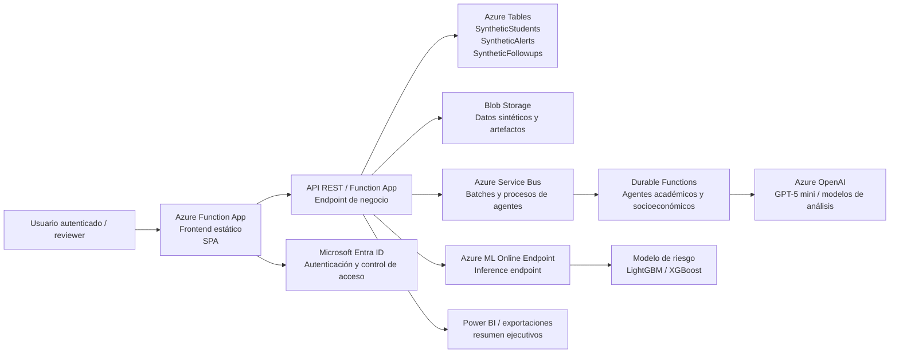

# Arquitectura desplegada actual en Azure

## Visión general

La solución actual está desplegada en la suscripción de `reverse05` y opera en modo de demostración con datos sintéticos. La plataforma combina:

- un modelo predictivo entrenado y publicado como `managed online endpoint` en Azure Machine Learning,
- una Function App que expone la interfaz y los servicios backend,
- almacenamiento persistente en Azure Tables y Blob Storage,
- colas de trabajo con Azure Service Bus,
- un frontend estático que presenta perfiles, alertas, seguimientos y análisis multiagente,
- autenticación con Microsoft Entra para controlar acceso a la UI y a la API.

El flujo está diseñado para priorizar visibilidad operativa y validación funcional, sin integrar información real institucional ni producir decisiones automáticas.

## Diagrama de arquitectura

## Componentes reales del despliegue

### 1. Frontend y capa de acceso
- `azure/agent_platform/static/index.html`
- `azure/agent_platform/static/dashboard.js`
- `azure/agent_platform/function_app.py`

La Function App sirve la interfaz SPA y expone los endpoints de negocio necesarios para:
- consultar dashboard y estudiantes,
- abrir perfiles individuales,
- crear alertas y seguimientos,
- lanzar lotes de procesamiento,
- invocar el endpoint de Azure ML,
- exportar resúmenes.

### 2. Persistencia de datos sintéticos
- `BLOB_STORAGE_URL`: almacenamiento Blob para archivos y metadatos del entorno.
- `Azure Tables`: tablas de estudiantes, alertas, dashboards, seguimientos y fichas sintéticas.

La base sintética está configurada para 5.000 estudiantes en el despliegue actual para pruebas de carga, análisis estadístico y validación de UI, con nombres ficticios y perfiles simulados.

### 3. Orquestación del procesamiento multiagente
- Azure Service Bus para asignar lotes y tareas.
- Durable Functions para coordinar la ejecución secuencial de análisis del caso.
- Agentes de análisis académico y socioeconómico, además de síntesis final para recomendaciones.

### 4. Inferencia predictiva en Azure ML
El endpoint gestionado recibe un payload conformado con las variables relevantes del estudiante y responde con la probabilidad y el nivel de riesgo.

Los artefactos clave del despliegue son:
- `azure/endpoints/score.py`
- `azure/endpoints/deployment.yaml`
- `azure/environments/online-environment.yaml`
- `azure/environments/conda-online.yaml`
- `azure/config.json`

### 5. Modelo y artefactos del proyecto
- `src/ml/train_pipeline.py`: entrenamiento del modelo y evaluación de métricas.
- `src/ml/feature_engineering.py`: transformación de variables y señales del riesgo.
- `models/`: artefactos de modelos locales y de referencia.
- `outputs/`: resúmenes, reportes y predicciones exportadas.

## Flujo operativo end-to-end

1. El usuario ingresa a la UI autenticada.
2. La Function App valida la sesión y consulta los registros sintéticos de Azure Tables.
3. Al seleccionar un estudiante o lanzar un lote, la app prepara el payload para inferencia.
4. La Function App invoca el Azure ML online endpoint.
5. El modelo devuelve probabilidad y nivel de riesgo.
6. Los resultados se agregan a la vista del perfil, dashboard y alertas.
7. El agente de síntesis genera recomendaciones y se visualizan en la UI.
8. Las operaciones de negocio quedan persistidas como estado y trazabilidad en Azure Tables.

## Principios de diseño y restricciones operativas

- Datos sintéticos únicamente: no se usa información institucional real.
- El modelo no toma decisiones automáticas; solo prioriza riesgo.
- La recomendación generada por LLM se presenta como síntesis explicativa, no como resolución oficial.
- La autenticación está aplicada a la UI y a cada API relevante.
- La solución está lista para despliegue repetido sin depender de la cuenta educativa.

## Estado actual del sistema

El entorno ya está desplegado y operativo en la suscripción `reverse05`. Los recursos principales se encuentran conectados y la app web puede consultar la capa de negocio y la predicción en Azure ML.

El sistema actual tiene las siguientes características:

- Azure ML endpoint online publicado y consumible.
- Function App conectada al endpoint y con variables de entorno configuradas.
- Dataset sintético de demo funcionando con nombres ficticios.
- Volumen escalable a 5.000 registros.
- Visualización de dashboard, perfiles, alertas, seguimientos y síntesis LLM en la interfaz web.

## Requisitos para re-despliegue

1. Validar el tenant y la suscripción correctos.
2. Revisar `azure/config.json` y `azure/connect_workspace.py`.
3. Confirmar `AZURE_ML_ENDPOINT_URL`, `AZURE_ML_ENDPOINT_KEY` y `AZURE_ML_DEPLOYMENT_NAME`.
4. Confirmar `DATA_MODE=synthetic`, `BLOB_STORAGE_URL` y `SERVICEBUS_NAMESPACE`.
5. Publicar la Function App con el zip final del proyecto.
6. Verificar acceso autenticado y disponibilidad de endpoints.
7. Ejecutar validación real del flujo de predicción y UI.
