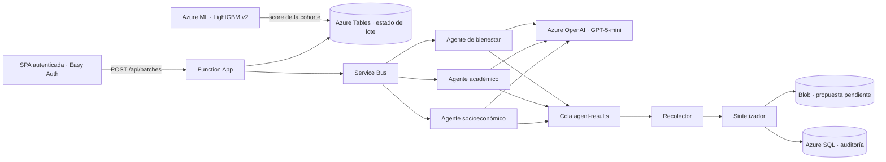

# 13.03 | Validación de extremo a extremo en Azure (2026-11-12)

> Registro de lo que se desplegó, corrigió y verificó sobre la Function App `FUMCanalyticscore` (grupo `FUMC.CaseReviewer`, Brazil South, plan Flex Consumption, Python 3.11). Todos los datos son **sintéticos**; esta validación no habilita uso con estudiantes reales.

## 1. Resultado

Flujo completo verificado con un usuario autenticado desde la interfaz:

`Dashboard → «Analizar casos prioritarios» → Service Bus → 3 agentes (GPT-5-mini) → síntesis → revisión pendiente + Azure SQL`

| Comprobación | Resultado |
|---|---|
| Lote de análisis lanzado desde la interfaz | **20 de 20 casos procesados, 0 fallidos**, en menos de 1 minuto |
| Orden de selección | Del mayor al menor riesgo (probabilidad del modelo descendente) |
| Persistencia en Azure SQL desde la app | **Verificada.** 20 predicciones, 20 propuestas, 80 ejecuciones de agente (4 por caso) y 20 eventos de auditoría |
| Conexión de la app a SQL | Registrada por la propia app: «Persistencia SQL activa: conexión a Azure SQL verificada» |
| Esquema SQL | 10 tablas presentes, versión de esquema 1 (`baseline`), verificado el 2026-11-12 |
| Puntuación de la cohorte | 15.000 estudiantes puntuados por el endpoint Azure ML `sat-fumc-endpoint` (despliegue `blue`, `SAT_FUMC_LightGBM_Model` v2) |
| Pruebas automatizadas | 118 aprobadas, 1 omitida |

### Ejemplo de salida del análisis (caso sintético)

> **Diagnóstico — Crítico:** asociado a mora de 2 meses y saldo en mora de $1.084.663, estrato 6 y sin dependientes; coincide con tres asignaturas con nota inferior a 3,0 (TOP-A044: 2,0 y asistencia 15,1 %; TOP-A045: 2,1 y asistencia 49,3 %; TOP-A043: 2,3 y asistencia 51,3 %) y ausencia de acompañamiento registrado (0 sesiones, soporte no registrado). El foco prioritario de atención es la revisión financiera inmediata y la coordinación con apoyo académico y de bienestar para estabilizar condiciones administrativas y educativas mientras se verifican datos faltantes.

La salida es un borrador para revisión profesional: no ejecuta acciones ni contacta al estudiante.

## 2. Arquitectura en funcionamiento

- **Orquestación sin Durable Functions.** El lote se registra en `SyntheticBatches` y cada respuesta de agente en `SyntheticAgentResults`. El recolector finaliza un caso cuando llegan las tres respuestas, con un cerrojo que garantiza una sola finalización por caso.
- **Temporizadores.** `batch_reaper` cierra cada 2 minutos los lotes que superan 20 minutos y devuelve sus casos a pendiente. `cache_warmer` renueva cada 4 minutos la caché del dashboard y verifica la conexión SQL.
- **Reutilización.** Las respuestas de agentes se guardan también por caso: si una síntesis falla, el lote siguiente no vuelve a llamar a los agentes.
- **Tamaño de lote:** 20 casos; un solo lote activo a la vez.

## 3. Qué se guarda en Azure SQL

| Momento | Tablas |
|---|---|
| Al terminar cada caso | `ModelRelease`, `StudentSnapshot`, `Prediction`, `ReviewProposal`, `AgentExecution` (socioeconómico, académico, bienestar y síntesis, con salida, tokens, modelo e intento) y `AuditEvent` |
| Al aprobar, editar o rechazar una propuesta | `HumanDecision`, `Intervention` y `AuditEvent` |
| Al cambiar un seguimiento | `AuditEvent` |

La app entra con su identidad administrada (`db_datareader` y `db_datawriter`, sin permisos de administración). Si SQL falla, el análisis continúa y el error queda registrado.

## 4. Problemas encontrados y corregidos

| Síntoma | Causa | Corrección |
|---|---|---|
| «Procesar GPT» devolvía «La solicitud no fue aceptada» | Easy Auth rechazaba con `403` todo `POST` con cookie de sesión (protección CSRF): el origen no estaba en «Allowed external redirect URLs» | Se añadió el dominio de la app a esa lista y a CORS |
| Las actividades Durable no se registraban (`Can't bind parameter 'data' to type 'System.String'`) | Incompatibilidad del host con las actividades Python | Flujo rehecho sobre Service Bus y Azure Tables |
| Workers fallaban con `TypeError … ChatMessageContent` | Semantic Kernel actual devuelve un objeto en `response.content` | El texto se lee de `response.message.content` |
| Respuestas vacías de GPT-5-mini | El límite de 512 tokens incluía el razonamiento | 2.048 tokens por analista, 3.072 para la síntesis y esfuerzo de razonamiento `low` |
| Error `429` de Azure OpenAI | Capacidad del despliegue `sat-gpt5-mini` en 5 | Capacidad 200 (se factura por tokens consumidos) |
| No existía la cola `wellbeing-analysis` | La infraestructura desplegada era anterior al Bicep actual | Cola creada con las mismas propiedades |
| Contratos rechazaban salidas válidas | Textos largos, campos ajenos y acciones en texto libre | Saneamiento previo al contrato estricto: recorta textos, descarta campos ajenos y traduce acciones a los cuatro códigos permitidos |
| 1 de 20 casos no llegó a SQL | Condición de carrera al registrar la misma versión del modelo | Bloqueo `UPDLOCK, HOLDLOCK` en las comprobaciones y un reintento; el caso se completó |
| Filtro de programa del dashboard sin efecto | Opciones mal construidas y alertas filtradas por código en lugar de nombre | Cinco filtros acumulativos (sede, facultad, programa, semestre y riesgo) y resolución código → nombre |
| Dashboard y perfil lentos con 15.000 estudiantes | Escaneos completos y caché de 20 s | Columnas selectivas, cachés compartidas y renovación en segundo plano: filtros en 9–40 ms con caché caliente |

## 5. Datos de la cohorte

| Tabla | Filas |
|---|---|
| Estudiantes, snapshots, targets, finanzas y bienestar | 15.000 cada una |
| Registros académicos | 44.994 |
| Alertas | 1.953 |
| Seguimientos | 11.035 |

- Niveles de riesgo: Medio 9.082, Bajo 3.965, Alto 1.953 (105 críticos, probabilidad ≥ 0,80).
- **La cohorte solo contiene semestres 7, 8 y 9**, porque se tomaron del generador de entrenamiento los estudiantes vigentes en 2025-2.
- Los 5.000 estudiantes heredados se reemplazaron con respaldo en `outputs/backups/legacy_replacement_20261110T021848Z`.

## 6. Pendiente

1. **Reentrenamiento en Azure ML:** los tres jobs de reentrenamiento fallaron al construir el entorno; se mantiene el modelo v2.
2. **Puntuación en tiempo real:** la cohorte se puntuó con el endpoint mediante un script de reemplazo; la interfaz no llama al endpoint al vuelo.
3. **Código Durable heredado:** cuatro actividades siguen definidas y fallan al indexarse; ya no se usan.
4. **Mensajes muertos:** 360 mensajes de intentos anteriores en las colas de mensajes muertos.
5. **Accesos temporales:** retirar los roles asignados al usuario de despliegue (Table, Blob y Service Bus Data Sender), la regla de firewall `deploy-workstation` y la configuración de diagnóstico `diag-http-auth`.
6. **Revisión de métricas del modelo:** el resultado de 100k implica una prevalencia cercana al 84 % en la partición de prueba; requiere revisión antes de citarse.
7. **Validación visual** de los modos claro y oscuro del dashboard rediseñado.
