# 13.01 | Arquitectura objetivo y estado verificable del SAT-FUMC

> **Documento canónico.** Las guías de arquitectura, alcance y operación deben concordar con este archivo. La arquitectura descrita abajo es el diseño objetivo; el estado de código y el de Azure se informan por separado. **Última verificación de recursos Azure: 2026-11-09.**

## 1. Objetivo funcional

La plataforma apoya a los profesionales de permanencia de la Fundación Universitaria María Cano. Produce una estimación de riesgo, organiza evidencia académica/financiera/de bienestar y propone acciones para revisión. **No determina deserción, no toma decisiones académicas ni financieras y no ejecuta intervenciones automáticamente.**

La aplicación web autenticada es el punto único de acceso operativo. Las exportaciones CSV son una capacidad de esa aplicación; no existe una segunda interfaz analítica requerida para operar el flujo.

## 2. Arquitectura objetivo

```mermaid
flowchart LR
    SIS[Fuentes institucionales autorizadas\nAcadémica · financiera · bienestar · LMS] --> ING[Ingesta y procesamiento\nAzure Functions / Python]
    ING --> Q[Calidad, privacidad y corte temporal\nTarget separado de predictores]
    Q --> SNAP[Snapshot consolidado estudiante-periodo-corte]

    SNAP -->|en paralelo| AML[4A · Rama predictiva\nAzure Machine Learning · LightGBM]
    SNAP -->|en paralelo| ORQ[4B · Coordinador\nService Bus + Semantic Kernel]
    ORQ --> A[Agente académico]
    ORQ --> F[Agente financiero]
    ORQ --> B[Agente de bienestar]
    A --> GPT[Azure OpenAI · GPT-5-mini]
    F --> GPT
    B --> GPT
    GPT --> SYN[Agente sintetizador\nConserva score ML y evidencia]

    AML --> JOIN[Consolidación versionada\nprobabilidad · factores · resúmenes · propuestas]
    SYN --> JOIN
    JOIN --> DB[Persistencia operacional\nAzure SQL objetivo]
    DB --> API[API autenticada\nAzure Functions]
    API --> UI[SPA única\nDashboard · ficha · alertas · revisión]
    UI --> HUMAN[Profesional FUMC\nAprueba · edita · rechaza]
    HUMAN --> FB[Seguimiento y retroalimentación auditables]
    FB --> HIST[Datos históricos curados\nADLS/Blob + Azure ML Data Assets]
    HIST --> TRAIN[Azure ML Jobs · evaluación · registro]
    TRAIN --> AML

    KV[Key Vault + Managed Identity] -. secretos y acceso .-> ING
    OBS[Application Insights + Log Analytics\ntrazas, métricas y alertas] -. telemetría .-> API
    FOUNDRY[Azure AI Foundry\nevaluación y gobierno de prompts/agentes] -. evaluación/versionado .-> ORQ
```

### 2.1 Ingesta y snapshot

- Cada fila debe identificar una unidad estable `(student_id pseudonimizado, periodo, corte)` y declarar `as_of`/fecha de disponibilidad.
- Las señales de Académica, Finanzas, Bienestar y LMS se validan contra contratos versionados; la tabla de target se mantiene aislada y nunca se envía a inferencia ni a agentes.
- La calidad bloquea llaves duplicadas, targets inválidos, fuga temporal y esquemas incompatibles; faltantes y reglas no evaluables se reportan, no se ocultan.
- Los datos de entrenamiento se guardan en ADLS/Blob con manifiesto, hash, versión y linaje. Azure SQL se reserva para datos operacionales, estados de revisión, alertas, seguimientos y auditoría; no sustituye al lake de entrenamiento.

### 2.2 Ramas paralelas

**Rama 4A — Predictiva.** Azure ML ejecuta la versión aprobada de LightGBM sobre el snapshot. Entrega probabilidad, nivel, umbral versionado, identificador/version del modelo y factores explicativos disponibles. Solo el modelo determina el score. Si la versión no está aprobada o el servicio falla, el caso queda en error/reintento; no se sustituye silenciosamente por una regla o score inventado.

**Rama 4B — Generativa.** El coordinador registra el lote en Azure Tables y distribuye en paralelo tareas especializadas mediante Service Bus. Semantic Kernel conecta los agentes a Azure OpenAI GPT-5-mini. Los agentes describen evidencia disponible y limitaciones, no infieren causalidad ni recalculan el score. El sintetizador recibe el resultado ML y las tres salidas especializadas; los datos recuperados se tratan como contenido no confiable. La salida estructurada queda sujeta a validación de contrato.

### 2.3 Consolidación y revisión

La unión se correlaciona por un `case_id` opaco y almacena versiones de datos, modelo, umbral, prompt/agente y timestamps. La SPA presenta el score por separado de la síntesis, citas/evidencia permitidas, limitaciones y propuestas. El profesional debe aprobar, editar o rechazar; únicamente una acción aprobada puede crear un seguimiento, quedando actor, fecha y motivo auditados.

### 2.4 Retroalimentación y MLOps

El feedback del orientador es una señal de proceso, no una etiqueta de deserción. El target solo se actualiza cuando la ventana institucional de observación se cierra y la fuente de verdad lo confirma. El reentrenamiento es por job versionado y con aprobación: split temporal, evaluación de Recall/Precision/F1/AUC/calibración, tasa de alertas, fairness por cohortes, registro y promoción con rollback. No hay aprendizaje automático en línea a partir de cada revisión.

## 3. Plataforma Azure objetivo

| Capacidad | Servicio objetivo | Responsabilidad |
|---|---|---|
| API y orquestación | Azure Functions + Service Bus + Azure Tables | API, procesos asíncronos, reintentos, DLQ e idempotencia |
| Modelo y MLOps | Azure Machine Learning | Data Assets, jobs, MLflow, registry, endpoints/batch scoring, promoción y rollback |
| LLM | Azure OpenAI GPT-5-mini | Explicación, resúmenes y propuestas estructuradas |
| Agentes y evaluación | Semantic Kernel; Azure AI Foundry para evaluación/gobierno | Fan-out/fan-in, pruebas de calidad, versionado de prompts y seguimiento |
| Datos operacionales | Azure SQL | Casos, predicciones, decisiones humanas, seguimiento y auditoría |
| Datos históricos/artefactos | ADLS Gen2 / Blob Storage | Snapshots inmutables, datasets y artefactos ML |
| Secretos | Key Vault + Managed Identity | Sin claves en código, UI, archivos de configuración o logs |
| Telemetría | Application Insights + Log Analytics | Correlación por `case_id` seudónimo, latencia, errores, costo y alertas |
| Acceso | Microsoft Entra ID + RBAC mínimo | Autenticación de usuarios, identidades administradas y separación de roles |
| Entrega | CI/CD con gates | Tests, análisis, evaluación ML/LLM, aprobación de entorno y despliegue reversible |

Red privada, Private Endpoints, retención, región, cuotas, SLA, capacidad y residencia se deben acordar con TI y gobierno de datos antes de crear el entorno institucional.

## 4. Estado comprobable en código y Azure

| Área | Estado comprobado |
|---|---|
| Fuentes institucionales | No hay conectores SIS/LMS/finanzas/bienestar reales ni autorización documentada. Los datasets versionados y la app distribuida son sintéticos. |
| Persistencia de la POC | Azure Tables y Blob guardan datos sintéticos, estado de lotes y propuestas. Desde el 2026-11-12 la app escribe además en Azure SQL predicciones, propuestas, ejecuciones de agente y auditoría con su identidad administrada. |
| Entrenamiento ML | Hay pipeline local y job de Azure ML. Se incorporó calibración de umbral por ventana temporal, búsqueda pequeña de LightGBM y bloqueo de registro cuando no se supera la compuerta. El job no se ejecutó como parte de esta revisión. |
| Métrica objetivo | Hay runs sintéticos posteriores a 10k y 100k (Recall de test 0,8453/0,8162), pero alertaron 70,17%/78,68% y ambos quedaron bloqueados para promoción. **Recall ≥ 0,80 no está demostrado en datos institucionales ni se garantiza.** El umbral y la capacidad de alertas deben validarse con cohorts autorizadas. Ver [`ScaleExperiments.md`](./ScaleExperiments.md). |
| Endpoint AML | Existen scripts/manifiestos de scoring, pero la app distribuida no pasa actualmente su snapshot por el endpoint AML. La probabilidad que acompaña a sus casos de demostración se genera en el Digital Twin. |
| Red de agentes | Service Bus, Semantic Kernel y Azure OpenAI GPT-5-mini. Lote autenticado de 20 casos: 20 procesados, 0 fallidos (2026-11-12). |
| Revisión y autenticación | Easy Auth/Entra con allowlist de revisores. Anónimo `401`; revisor autenticado `200` y `POST` operativos. La aprobación de una propuesta en vivo aún no se probó. |
| Azure OpenAI / Foundry | El código Semantic Kernel usa el deployment Azure OpenAI configurado. No debe afirmarse que el runtime sea Foundry Agent Service; Foundry queda como capacidad objetivo de evaluación/gobierno. |
| Interfaz | SPA protegida servida por Function App. El fallback con perfiles locales se deshabilitó; si la API no está disponible, no se presentan esos perfiles. La exportación CSV es una función de la misma SPA. |
| Infraestructura Azure | Function App `FUMCanalyticscore` (grupo `FUMC.CaseReviewer`, Brazil South, Flex Consumption, Python 3.11) `Running`. Service Bus, Storage, Application Insights, Azure OpenAI, Azure ML y SQL en uso. |
| Azure SQL | `SATFUMCOperational` está `Online` (serverless General Purpose (`GP_S_Gen5`, 1 vCore, autopausa 60 min)); `sql_schema.sql` fue ejecutado y se verificaron las diez tablas esperadas. Esto prueba el recurso y el esquema, no su uso por Functions. |
| CI/CD y producción institucional | Hay pruebas y artefactos de infraestructura, pero no un pipeline de CD institucional con aprobación, OIDC, rollback, SLO ni prueba E2E AML→agentes→SQL→SPA. La POC no está habilitada para datos reales. |

### 4.1. Evidencia del despliegue Azure

| Comprobación | Resultado |
|---|---|
| ARM/Bicep | `satfumc-prod` = `Succeeded` |
| Functions | `FUMCanalyticscore` `Running`; runtime `python 3.11`; publicación por zip deploy con build remoto |
| Easy Auth | `GET /` y `GET /api/poc/status` anónimos = `401`; `GET /.auth/login/aad` = `302` hacia `login.microsoftonline.com` |
| SQL | Base `SATFUMCOperational` = `Online`; diez tablas `dbo` del esquema canónico presentes |
| Azure OpenAI | Deployment `sat-gpt5-mini` = `Succeeded` |
| Prueba E2E | 2026-11-12: sesión autenticada `200`, lote de 20 casos procesado y escrito en SQL; ver [`E2EValidation.md`](./E2EValidation.md). Pendiente: inferencia AML en tiempo real desde la interfaz |

Durante el despliegue Bicep se emitió el diagnóstico `BCP187` sobre la propiedad `sku` de la base SQL. El despliegue finalizó correctamente y la base aparece `Online`; la advertencia debe revisarse contra el esquema/API vigente, pero no debe registrarse como error de provisioning.

## 5. Criterios de habilitación institucional

1. Aprobación de fuente, finalidad, base legal, minimización, retención, pseudonimización y evaluación de impacto de privacidad.
2. Definición del target institucional, ventanas de observación y features disponibles a cada corte; historial suficiente y representativo.
3. Evaluación temporal y por estudiante/cohorte sin leakage; Recall ≥ 0,80 en holdout real, junto con precisión, F1, calibración, tasa de alertas/capacidad y análisis de equidad. Si falla, no promover.
4. Azure ML endpoint y app consumiendo el mismo contrato, versión, umbral y modelo; integración automatizada con pruebas de extremo a extremo.
5. Esquema Azure SQL, migraciones, RBAC, backup/restore, auditoría y política de retención aprobados.
6. Evaluación humana de calidad, seguridad y sesgo de agentes; revisión obligatoria antes de cualquier intervención.
7. CI/CD con OIDC, entornos separados, aprobaciones, pruebas de carga/seguridad, monitoreo, rollback y responsable operativo.
8. Revisión de aceptación por FUMC; hasta entonces el sistema permanece como demostración sintética y no debe usarse para priorizar personas reales.
