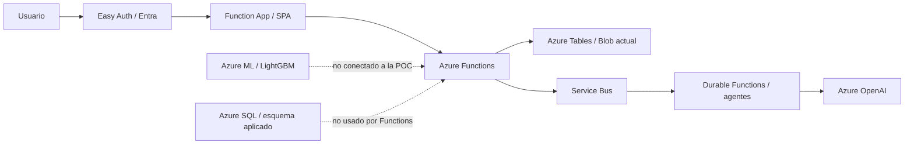

# Plataforma de apoyo a la permanencia estudiantil con aprendizaje automático y agentes generativos en Azure

## Resumen ejecutivo

Este trabajo presenta el diseño y una prueba de concepto (POC) sintética para apoyar la revisión profesional de señales relacionadas con la permanencia estudiantil. La arquitectura objetivo combina un modelo LightGBM en Azure Machine Learning y agentes Semantic Kernel/Durable Functions con Azure OpenAI GPT-5-mini. No reemplaza la valoración profesional ni ejecuta decisiones académicas, financieras o de bienestar.

Al 9 de noviembre de 2026 se verificaron el despliegue de infraestructura Azure, la publicación de la Function App Linux/Python 3.11 y la aplicación de un esquema Azure SQL de nueve tablas. Se indexaron 33 funciones. Esto acredita aprovisionamiento y arranque, no una operación end-to-end autenticada. Se hicieron evaluaciones ML sintéticas a 6k/15k/30k y generación de datos a 100k; esta última no se entrenó. Las evaluaciones no habilitaron promoción. Functions persiste en Tables/Blob, no usa SQL y no envía sus casos a AML.

## 1. Contexto y objetivo

El problema central es apoyar la toma de decisiones institucionales tempranas para detectar estudiantes en riesgo. La estrategia del proyecto no es reemplazar la evaluación humana, sino priorizar intervenciones para quienes presentan mayor probabilidad de deserción o dificultad de permanencia. En este sentido, el sistema combina modelos predictivos con análisis de contexto y recomendaciones accionables.

La propuesta se limita a probar contratos, componentes y usabilidad con datos generados:

- detectar riesgo académico y socioeconómico temprano,
- priorizar casos de mayor urgencia,
- apoyar la intervención de consejeros, tutores y bienestar universitario,
- visualizar el riesgo en un dashboard y un perfil individual del estudiante,
- validar infraestructura y publicación de una aplicación de Functions protegida por Entra.

## 2. Arquitectura objetivo y estado implementado

El despliegue Bicep `satfumc-prod` terminó `Succeeded` en `rg-sat-fumc-prod`. La Function App `satfumcfunc0e83b2486979` está `Running` en Python 3.11 y Azure indexó 33 funciones. Los siguientes elementos describen lo provisionado y sus límites, no una conexión end-to-end:

### Componentes principales

- Azure Machine Learning: existen jobs, manifiestos y scripts de scoring; la conexión desde Functions no está implementada y no se verificó aquí el estado de un endpoint independiente.
- Function App: servicio principal de backend y frontend estático.
- Azure Tables: almacenamiento del digital twin sintético y perfiles de estudiantes.
- Azure Blob Storage: artefactos y datos asociados.
- Azure Service Bus: orquestación de análisis y eventos de procesamiento.
- Azure OpenAI: apoyo con agentes de análisis y síntesis LLM.
- Azure SQL: `SATFUMCOperational` está Online con las nueve tablas de `sql_schema.sql`; Functions todavía no usa este repositorio.
- Dashboard web: SPA publicada en Functions; acceso anónimo recibe `401`. El login Entra redirige (`302`) a Microsoft, pero no se verificó una sesión interactiva ni un `200` autenticado.

## 3. Datos y generación sintética

El proyecto contiene varios alcances sintéticos que no deben confundirse. El dataset versionado en el repositorio tiene 6.000 estudiantes y 27.975 snapshots; las corridas ML aisladas incluyen variantes de 6k, 15k y 30k. Se generó un dataset 100k fuera del repositorio con 552.847 snapshots, 485.421 etiquetas maduras y 2.394.881 filas académicas. No se entrenó ni evaluó el clasificador a esa escala. La Function App tiene un máximo/default configurable de 5.000 perfiles para su Digital Twin; su inicialización no se verificó con sesión autenticada.

La estrategia sintética permite:

- mantener la validación funcional sin depender de datos personales reales,
- probar contratos y componentes de forma aislada,
- evaluar la arquitectura de scoring, UI y agentes en un escenario operativo realista,
- escalar la carga sin afectar la privacidad ni la seguridad institucional.

## 4. Pipeline predictivo

El pipeline sigue estas etapas:

1. ingestión y preparación de un dataset sintético,
2. validación de calidad y consistencia,
3. ingeniería de características,
4. partición temporal para entrenamiento y evaluación,
5. entrenamiento de candidatos y selección del umbral en validación,
6. evaluación de Recall, precisión, F1, AUC y calibración,
7. creación de artefactos y contratos de scoring.

La ingeniería de variables incluye indicadores académicos, financieros, de bienestar, de participación y de riesgo acumulado. El código de entrenamiento y los manifiestos de inferencia están disponibles, pero no se reporta aquí un endpoint AML independiente como activo ni una llamada desde Functions. La puntuación de los casos de demo procede del Digital Twin.

## 5. Resultados y evidencia disponible

No se publican métricas predictivas como resultado aprobado. Los valores históricos de Recall, precisión, F1, AUC, Brier y umbral no se concilian de forma reproducible entre reportes y runs; por ello, no se usan para afirmar capacidad de detección. El objetivo **Recall ≥ 0,80** es una condición de aceptación pendiente de evaluación con etiquetas institucionales autorizadas y holdout temporal.

| Evidencia | Resultado | Interpretación |
|---|---|---|
| Suite local | 71 pruebas pasaron en la última ejecución | Validación de código/contratos; no mide eficacia del modelo ni E2E Azure |
| ARM/Bicep | `satfumc-prod`: `Succeeded` | Aprovisionamiento comprobado |
| Function App | `Running`, Python 3.11, 33 funciones indexadas | Host y publicación comprobados |
| HTTP sin sesión | `/` y `/api/poc/status`: `401`; login Entra: `302` | Acceso anónimo bloqueado; no se verificó respuesta de usuario autenticado |
| Azure SQL | `SATFUMCOperational`: `Online`; nueve tablas aplicadas | Esquema desplegado; aplicación no conectada a SQL |

### 5.1. Métricas de los runs ML sintéticos

| Escala | Recall | Precisión | F1 | AUC-ROC | AUC-PR | Brier | Tasa de alertas | Promoción |
|---:|---:|---:|---:|---:|---:|---:|---:|---|
| 6k baseline | 0,6971 | 0,3194 | 0,4381 | 0,6071 | 0,3929 | 0,2348 | 62,52% | No |
| 15k baseline | 0,8069 | 0,3090 | 0,4469 | 0,6456 | 0,3827 | 0,2328 | 65,32% | No |
| 30k baseline | 0,7731 | 0,3313 | 0,4639 | 0,6679 | 0,4236 | 0,2333 | 61,31% | No |

Estos runs son sintéticos y usan versiones de dataset registradas; ninguno es elegible para promoción. El 15k cruza Recall 0,80, pero la tasa de alertas es 65,32%. Las variantes calibradas lograron Recall 0,7796 en 6k y 0,7917 en 30k. No se entrenó el modelo a 100k; esa escala solo generó datos. La matriz completa, hashes y limitaciones están en [`../docs/ScaleExperiments.md`](../docs/ScaleExperiments.md).

## 6. Estado actual en Azure

La evidencia del 2026-11-09 confirma:

- Despliegue Bicep `satfumc-prod` con estado `Succeeded`.
- Function App `satfumcfunc0e83b2486979` `Running`, Linux/Python 3.11, con 33 funciones indexadas tras publicación remota.
- Azure SQL `SATFUMCOperational` `Online` y las nueve tablas de `sql_schema.sql` aplicadas.
- Azure OpenAI, Service Bus, Storage y Key Vault provisionados.
- Solicitudes anónimas a `/` y `/api/poc/status` bloqueadas con `401`; `/.auth/login/aad` redirige (`302`) a Microsoft.

No se completó el inicio de sesión interactivo, la carga autenticada del dashboard ni la ejecución de un caso. Functions sigue persistiendo en Azure Tables/Blob; no usa el esquema SQL y no invoca el endpoint AML. Los recursos y el host están desplegados, pero no se verificó la operación end-to-end.

La interfaz presenta riesgos/probabilidades y alertas sintéticas del Digital Twin; no son respuestas GPT. GPT se invoca solo al iniciar y confirmar un lote autenticado de hasta cinco casos pendientes. El dashboard no genera análisis al abrirse ni en el refresco automático. En la consulta disponible, Application Insights no mostró requests ni dependencies durante los 14 días previos; no hay evidencia de una ejecución GPT en Azure.

## 7. Conclusiones

El proyecto demuestra la posibilidad de desplegar la infraestructura de la POC y publicar una Function App con los componentes de agentes. No demuestra una operación end-to-end: AML, agentes, SQL y la SPA aún no se conectan sobre el mismo snapshot verificado con un usuario autenticado.

La evidencia actual no permite afirmar un nivel de sensibilidad, eficacia predictiva ni utilidad para priorización. La POC permite continuar el desarrollo técnico en entorno sintético, sujeto a validar el login interactivo, las integraciones y las métricas antes de cualquier evaluación con datos institucionales.

La continuidad requiere completar una prueba autenticada de bajo impacto, integrar SQL y AML, validar contratos y observabilidad, obtener autorización institucional y evaluar el modelo con un protocolo temporal reproducible. Mientras falten estos pasos, el sistema permanece como POC sintética y no debe priorizar estudiantes reales.

## 8. Referencias internas

- [README.md](../README.md)
- [docs/CloudDeploymentArchitecture.md](../docs/CloudDeploymentArchitecture.md)
- [docs/ProductionArchitecture.md](../docs/ProductionArchitecture.md)
- [docs/ProductionReadiness.md](../docs/ProductionReadiness.md)
- [docs/AIArchitecture.md](../docs/AIArchitecture.md)
- [docs/DataArchitecture.md](../docs/DataArchitecture.md)
- [docs/SyntheticDataStrategy.md](../docs/SyntheticDataStrategy.md)
- [docs/PredictiveModel.md](../docs/PredictiveModel.md)
- [docs/UI-Architecture-SAT-DE.md](../docs/UI-Architecture-SAT-DE.md)
